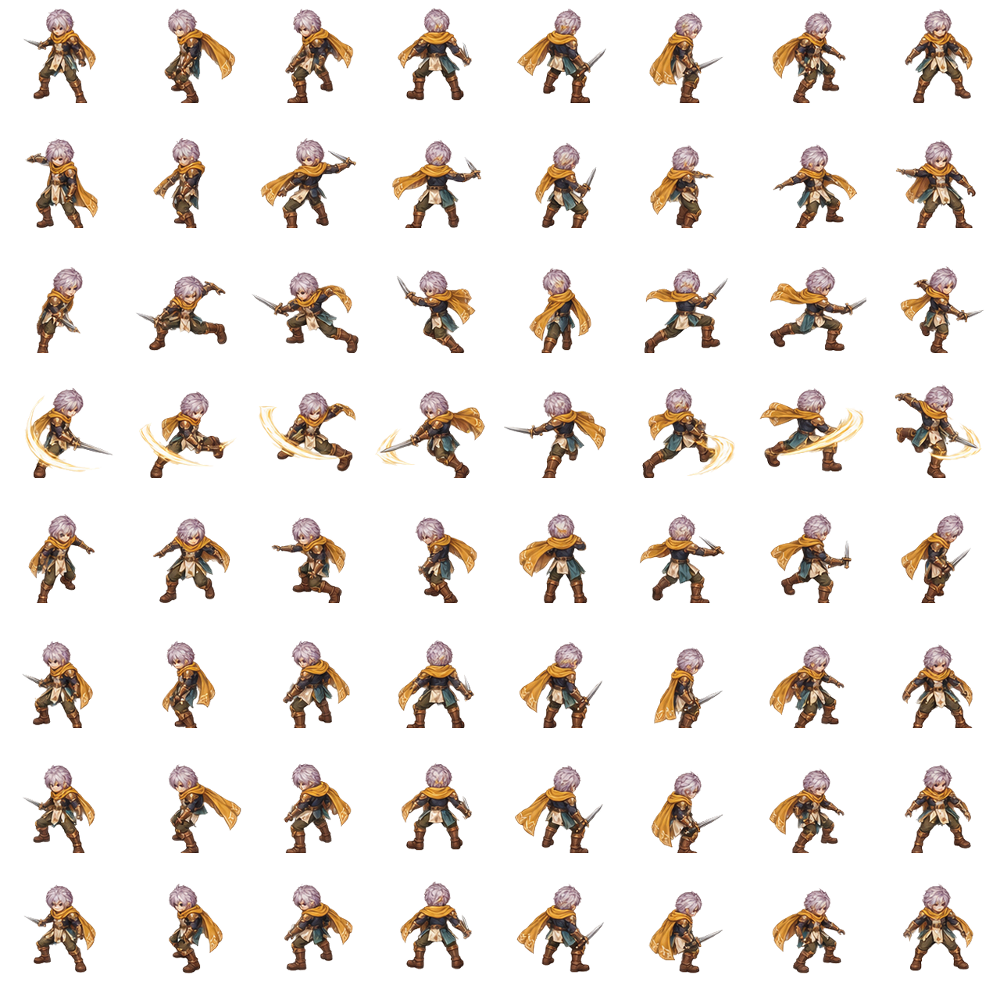
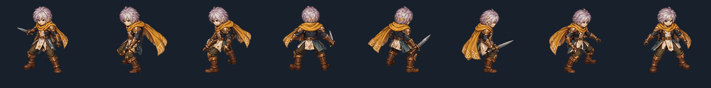

# Swordsman V3 master-frame and cutout handoff

**Status:** `EIGHT_FRAME_PILOT_REJECTED_FOR_SMOOTHNESS / SIXTEEN_FRAME_REPAINT_REQUIRED`

The art stage starts with a complete character master for each existing motion
frame and camera direction. Pixel-label masks then cut equipment and body
groups from those exact frames. All cutouts retain the same canvas and source
pixel coordinates. This method keeps the motion timing and pose data already
in the V3 guides.

## Current progress

- Idle, Walk, and BasicAttack each have a complete 8×8 character master, with the source action's frame order and timing.
- All three masters use one shared `0.949153` scale, target a 112px character height, and align to root `(80,132)` inside each 160px cell.
- Each master is cut into aligned `BaseBody`, `HeadHair`, `Outfit`, `Weapon`, `BackAccessory`, `CosmeticFX`, and `Headgear` sheets. The head label seed now includes visible warm face pixels as well as hair; see `refine_headhair_labels.py` and each action's refinement report and preview. Inspect these heuristic masks before using them for swaps.
- All three cutout sets recompose to their full masters with exactly zero pixel mismatches. This verifies registration and pixel coverage; it does not prove semantic edges, natural motion, or replacement-safe hidden surfaces.
- BasicAttack's original broad gold-white trail is rejected and preserved in the source master. The separate `WeaponSlash` SVG/PNG experiment is also rejected: its strokes cross the character and fail to track the blade. Keep it only as a diagnostic, not as a replacement. The new pass will paint `WeaponLight` per attack frame and facing from the 16-frame attack guide. Headgear remains empty.
- Review the native-resolution GIFs: [Idle](review/layered-v3-idle-8-directions.gif), [Walk](review/layered-v3-walk-8-directions.gif), and [BasicAttack](review/layered-v3-basicattack-8-directions.gif). The pilot has only eight painted frames. Idle/Walk loop; BasicAttack now plays once and stops on recovery.
- The pilot is below the requested smoothness bar: Idle/Walk visibly pop at the loop seam and have too few painted poses. Both BasicAttack trail designs are rejected. Review-only 16-frame pose guides and timing plans are now in `swordsman-master-cutout-v2/guides/` and `authoring/characters/factory-v3/motions/retargeted/16frame-candidate/`; they still need matching full masters and exact same-frame cutouts.
- Hidden scalp/body/clothing pixels are not invented by a cutout. Paint concealed surfaces before enabling hair, outfit, cape, or weapon swaps that expose a hole. These are review templates, not a runtime package.
- The guide-fit mask attempt is retained as `source/BasicAttack/labels-guide-seed.png` and `review/basicattack-master-label-seed-preview.png`; it is not the current label source.






## Source layout

Provide one transparent 8×8 master sheet and one grayscale label sheet for each
action:

```text
source/
  Idle/master.png
  Idle/labels.png
  Walk/master.png
  Walk/labels.png
  BasicAttack/master.png
  BasicAttack/labels.png
```

Directions are columns in `S, SW, W, NW, N, NE, E, SE` order. Frames are
chronological rows. A `master.png` includes the whole swordsman in the exact
guide pose, with the same root, scale, camera, and action timing. The label map
must match the master dimensions exactly.

## Grayscale label values

Use these values in `labels.png`; `0` is only for transparent master pixels.

| Value | Cutout | Output sheet folder |
|---:|---|---|
| 1 | BaseBody | `BaseBody` |
| 2 | HeadHair | `Hair` |
| 3 | Outfit | `Outfit` |
| 4 | Weapon | `Weapon` |
| 5 | BackAccessory | `BackAccessory` |
| 6 | CosmeticFX | `CosmeticFX` |
| 7 | Headgear | `Headgear` |

Assign every visible master pixel, including antialiased edge pixels, to one
label. The tool rejects unlabeled or out-of-silhouette mask pixels and checks
that the cutouts recompose to the master exactly. Pixel labels are disjoint;
the master remains the exact visual source for the first cutout set.

The current BasicAttack mask uses a flat color map at
`source/BasicAttack/mask-color-coded-v2.png`. Convert it to grayscale labels,
then inspect the overlay and refine the labels in the editor if needed:

Mask colors are flat RGB values: blue `BaseBody`, magenta `HeadHair`, green
`Outfit`, cyan `Weapon`, yellow `BackAccessory`, red `CosmeticFX`, black
background. The full master supplies the cutout art; the mask only supplies
class labels.

```sh
python tools/character_factory_v3/label_master_from_color_mask.py \
  --master authoring/characters/factory-v3/paint-jobs/swordsman-master-cutout-v1/source/BasicAttack/master-source-unregistered.png \
  --mask authoring/characters/factory-v3/paint-jobs/swordsman-master-cutout-v1/source/BasicAttack/mask-color-coded-v2.png \
  --labels authoring/characters/factory-v3/paint-jobs/swordsman-master-cutout-v1/source/BasicAttack/labels-color-mask-seed-v2.png \
  --preview authoring/characters/factory-v3/paint-jobs/swordsman-master-cutout-v1/review/basicattack-master-color-mask-seed-v2-preview.png
```

Apply the common runtime transform to the full master and its label sheet
together; do not transform cutout parts separately:

```sh
python tools/character_factory_v3/normalize_master_sheet.py \
  --master authoring/characters/factory-v3/paint-jobs/swordsman-master-cutout-v1/source/BasicAttack/master-source-unregistered.png \
  --labels authoring/characters/factory-v3/paint-jobs/swordsman-master-cutout-v1/source/BasicAttack/labels-color-mask-seed-v2.png \
  --output-master authoring/characters/factory-v3/paint-jobs/swordsman-master-cutout-v1/source/BasicAttack/master.png \
  --output-labels authoring/characters/factory-v3/paint-jobs/swordsman-master-cutout-v1/source/BasicAttack/labels.png \
  --reference-height 112 --root-anchor 80 132
```

Open `tools/character_factory_v3/cutout_label_editor.html` in a browser, load
one master sheet, and paint the class labels frame by frame. It displays one
camera/frame at 3× zoom and saves a 1280×1280 grayscale label map; rename the
download to `labels.png` in that action's folder.
Alternatively, create empty label maps after placing the master sheets:

```sh
python tools/character_factory_v3/cutout_master_sheet.py \
  --input-root authoring/characters/factory-v3/paint-jobs/swordsman-master-cutout-v1/source \
  --output-root authoring/characters/factory-v3/paint-jobs/swordsman-master-cutout-v1/cutouts \
  --actions BasicAttack \
  --write-label-templates
```

Annotate the `labels.png` maps with the values above, then run the same command
without `--write-label-templates`. The output contains separate per-action
part sheets and `cutout-report.json`. Those sheets can be reviewed and then
previewed without changing their pixels or registration:

```sh
python tools/character_factory_v3/review_layered_sheets.py \
  --input-root authoring/characters/factory-v3/paint-jobs/swordsman-master-cutout-v1/cutouts \
  --source-definition assets/characters/swordsman-male-v3/sprite.json \
  --evidence-dir authoring/characters/factory-v3/paint-jobs/swordsman-master-cutout-v1/review \
  --actions BasicAttack \
  --preserve-cutout-registration
```

The preview creates a native 160px-per-cell eight-direction GIF for each action,
an eight-direction layer breakdown, and continuity diagnostics. After visual review, the exact
cutouts can be packed with the same `--preserve-cutout-registration` flag on
`tools/character_factory_v3/import_layered_sheets.py`.

Cutouts contain visible master pixels only. Before enabling a hair, outfit,
cape, or weapon swap that reveals a concealed area, paint and review the
underlying body surface in the matching frames. Keep the master and first
cutout set unchanged as the pixel-accurate reference.
