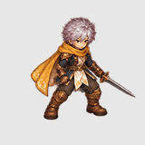

# Rejected SE BasicAttack paint trial

**Status: REJECTED — do not import or treat as approved character art.**

This is a 16-frame, single-SE full-character trial based on the fantasy swordsman
identity and the BasicAttack pose guide. It is useful only to review the timing,
palette, and possible attack silhouette. It is not an eight-direction master,
has no same-frame cutouts, and contains no `WeaponLight` trail.

## Review GIF

The GIF loops infinitely for visual seam inspection. Production BasicAttack
remains a one-shot and returns to Idle after recovery, following the Ragnarok
playback pattern. The GIF is not a runtime preview.

## Why it failed

- The generated frames do not leave a reliable safety margin. Sword pixels
  touch or cross the cell edge in frames 6–10, cutting the blade in the sheet.
- The pose sequence has a first-to-last alpha IoU of `0.805` and a minimum
  adjacent-frame alpha IoU of `0.445`. These are silhouette diagnostics; they
  do not outweigh the visible clipping.
- No separate sword light/trail exists. The sword remains part of the full
  master, and no layers were extracted or imported.

The GIF contains 16 frames and preserves the BasicAttack guide timing within
GIF's 10ms duration units (`1,970ms` encoded versus `1,966ms` source). The
normalizer uses one shared scale and the fixed center of each source cell as
the horizontal root; it does not resize frames independently. Full source,
normalized frames, contact sheet, hashes, and measurements are in this folder
and `review/provenance.json`.
