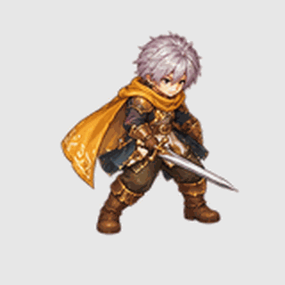

# Rejected compact SE BasicAttack trial

**Status: REJECTED — review-only, not runtime art.**

This is a 16-frame, single-SE full-character trial using the swordsman identity
and the BasicAttack timing guide. It uses a shorter, low diagonal sweep with a
more controlled body turn than iteration 2.

## Loop review

The review GIF loops infinitely. Its final recovery frame is locked to the
first guard frame so the GIF has an exact last-to-first silhouette match. This
lock is for seam inspection only. The production BasicAttack remains a one-shot
and returns to Idle after recovery, following the Ragnarok playback pattern.

## Why it failed

- The blade still touches or crosses the source-cell edge in frames 9–10; a
  stray blade fragment appears at the left edge of frame 11.
- Adjacent-frame alpha IoU bottoms at `0.598`. The loop seam is `1.0` because
  the review recovery frame is an exact copy of the first guard frame; this is
  not evidence that the full action passed natural-motion review.
- This is only the SE facing. There are no frame-matched cutouts and no
  separate `WeaponLight` trail. Nothing from this trial was imported.

## Rejected WeaponLight trial

An effect-only sheet was generated and composited against this master. It uses
the correct empty/strike frame ranges, but repeats similar curved strokes and
crosses the torso instead of tracking the blade. It remains diagnostic only:

- [WeaponLight composited over the character](review/weaponlight-composite-contact-4x4.png)
- [WeaponLight composited behind the character](review/weaponlight-composite-behind-contact-4x4.png)
- [Raw effect-only sheet](source/weaponlight-overlay-trial-4x4.png)

This does not replace the rejected broad crescent or `WeaponSlash` pilots. A
new effect must follow each sword path as a narrow, frame-specific layer.

### Tip-motion `WeaponLight` review

A separate, narrow trail prototype now follows the detected sword-tip motion
for frames 6–12, with a compact frame-8 contact glint. It is a better aligned
direction-specific diagnostic than the repeated curved strokes, but remains
review-only: the effect is subtle, the base still has clipped blade pixels,
and only SE is covered.

The effect-only layer is `review/procedural-weaponlight-v2/weaponlight-se-16.png`.
Its source points, active frame list, GIF timing, and hashes are recorded in
`review/procedural-weaponlight-v2/provenance.json`. No layer was imported.

The normalized preview uses one shared scale, a fixed cell-center root, and a
112px target visible character height. It contains 16 frames and preserves the
BasicAttack guide timing within GIF's 10ms duration units (`1,970ms` encoded
versus `1,966ms` source). See `review/provenance.json` for measurements and
source hashes.
