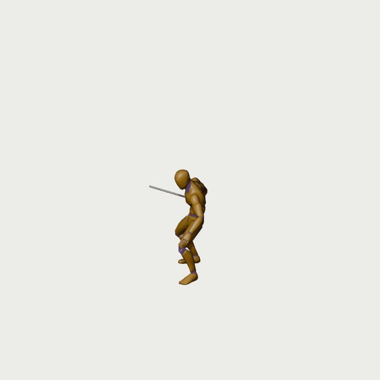
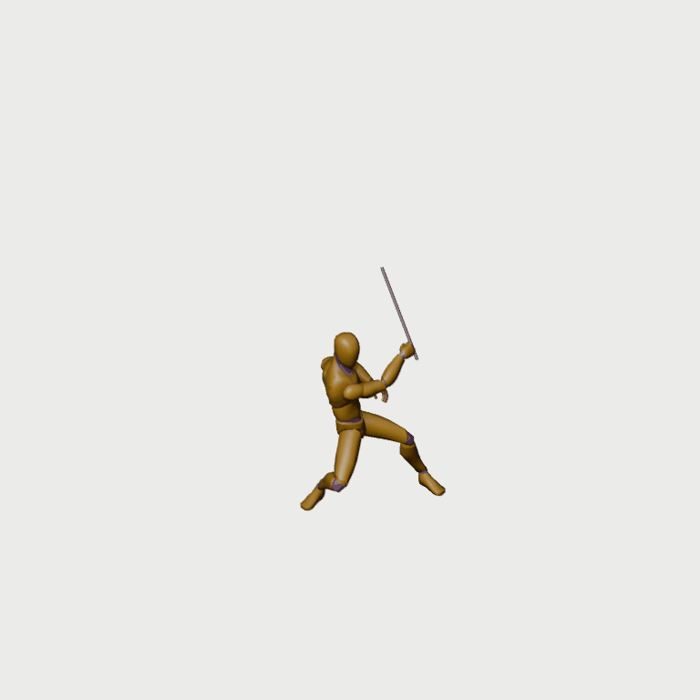
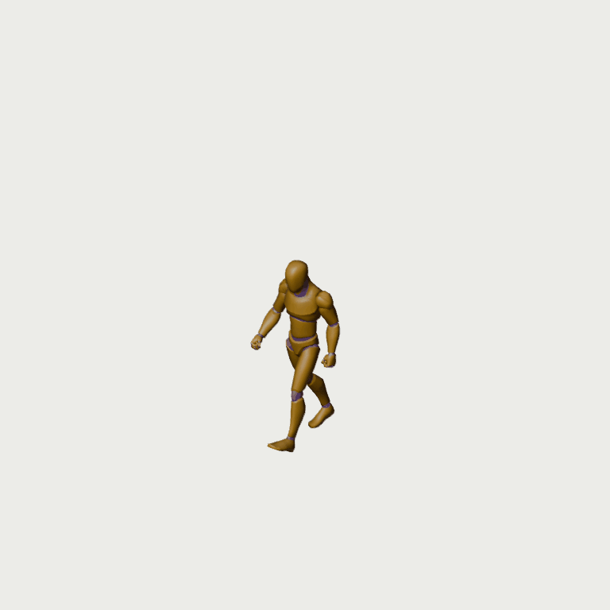
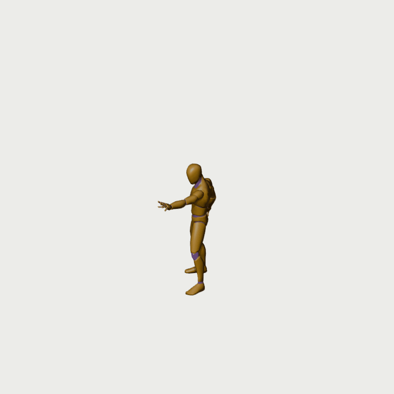

# ActionForge upload study — 26 October 2026

The uploaded `actionforge_85_clips.glb` contains **84 actual animations**, although metadata declares 85 IDs. `fps_test` has no animation. The original upload is preserved unchanged, SHA256 `5a825e8d2627afd849a553622d7ca0aa88eb9ee94eca3cb1924dbe53085808da`.

All 84 actual clips have fixed-camera GIFs, 12-pose contacts, native bone samples and SHA receipts: **4,086 samples** at native timing / 30 fps. All capture files match receipts, and no capture touches the viewport edge. The initial `idle_no_loop` suffix bug was corrected: this shake-off gesture is a one-shot, not an idle loop. The superseded diagnostic is excluded from the published catalog.

[Open the searchable offline catalog](../../../../authoring/characters/factory-v3/patch-0.0.1/research/actionforge-all-clips-20261026/catalog.html) after cloning/downloading; GitHub shows HTML source. [Per-clip assessment](../../../../authoring/characters/factory-v3/patch-0.0.1/research/actionforge-all-clips-20261026/review-assessment.json) · [inventory CSV](../../../../authoring/characters/factory-v3/patch-0.0.1/research/actionforge-all-clips-20261026/inventory.csv).

## Useful candidates

| Use | Clips | Current conclusion |
| --- | --- | --- |
| Downward basic strike comparison | sword_attack | Preparation, downward strike and recovery visible; compare against preserved Swordsman art before changing anything. |
| Heavier overhead / skill | sword_regular_b + sword_regular_b_rec | Deep forward/downward strike with extended follow-through; strike alone has no idle recovery. |
| Mage casting | spell_simple_enter / idle_loop / shoot / exit | Four linked state candidates; grip, release markers and transition checks still needed. |
| Shared movement / reactions | walk_loop, idle_loop, hit_chest, hit_head, death01, laytoidle | Useful source shapes; target-body, contact and gameplay review still needed. |
| Rest | sitting_* | Chair-height sitting; do not substitute for floor sitting. |
| Archer | none dedicated | No bow/archer/arrow clip names in this bundle; retain the explicitly labelled current bow source. |

Mesh2Motion remains the preferred source. Shape similarity to Mesh2Motion is not proof of equal timing or interchangeable actions. App code is proprietary and was not reused; the exported animation/rig data is covered by the published CC0 notices. See the retained legal evidence.

## Source previews

These GIFs show source mannequins and a diagnostic blade, not final character art.

## Production correction

The owner rejected the new fragmented Archer assembly. Production returns to **complete posed BodyCostume + HeadHair + Weapon** cutouts per coherent frame/view, with same-frame occluders and independent effects as needed. Separately generated limb assemblies are rejected and not counted as delivered sprites. The accepted Swordsman artwork stays protected.

Source capture counts, 268 passing factory tests, and the 48-action shared skeleton library do not certify final illustration quality. Actual sprite imports remain **2/96**, zero newly complete playable characters. Coarse contact-sheet review is complete; full-speed naturalness, target-rig retargeting, all required views, final painted cutouts and six-character gameplay admission are unfinished.
