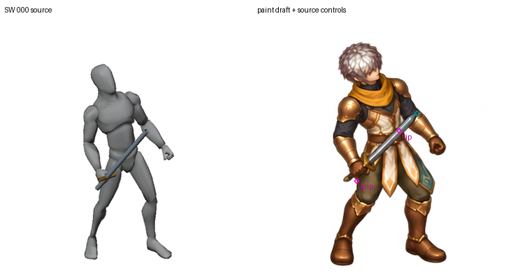
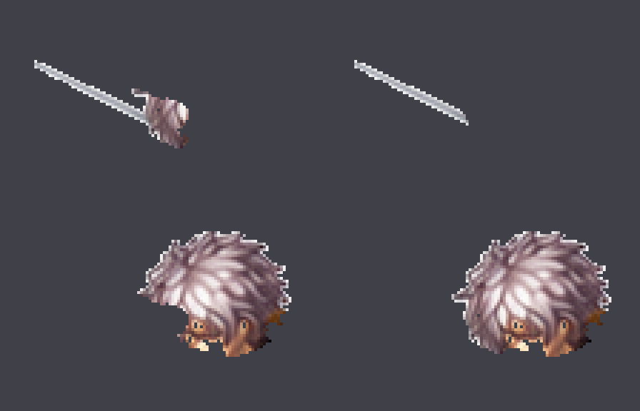

# First complete Swordsman target: repairs and open master gate

The owner now explicitly prioritizes one complete character before returning to
the six-character total. The selected character is the preserved tall male
Swordsman. Completion still requires all19 logical actions,18 unique painting
jobs and2080 distinct view/pose positions after the existing Idle/CombatIdle
reuse (2208 logical positions). One repaired frame or a generated sheet is not
1/6. No character is complete at this checkpoint.

## Corrected native-resolution diagnosis

The previous362px-slot versus768px-canvas rejection was incorrect for the recorded
zoomed crop. Source1536 → authoring768 uses scale1/2. The fixed source crop
[448,520,1088,1160] therefore occupies authoring[224,260,544,580], a320×320
viewport. A362×362 generated crop can **downsample to320×320** and be placed on
a transparent768×768 canvas without enlarging detail. The density is1.13125
native pixels per required authoring pixel. Padding is not counted as detail.

[Qualification](resolution-qualification.json). Four targeted tests distinguish
this valid cropped case from a362px full-frame source that really would require
upsampling; they also reject stretched/aspect-invalid contracts. This is a
factual correction, not a relaxed geometry/size/contact requirement. The original
Hit draft remains unapproved for pose/weapon geometry. The prior source review
and goal document now point to this correction.

## Whole-master correction still misses source controls

One further complete12-frame image edit used the original draft, clean source
guide and a marked sheet of exact per-frame grip/tip targets. It again produces
1448×1086 RGBA with sufficient cropped native detail, but it does not move the
visible blade endpoints to those targets. Manually marked slot000/007/011 tip
errors are9.732/7.067/9.726 runtime px, with a3-native-pixel radial uncertainty
(0.829 runtime px). These are blade diagnostics, not sole-contact scores.
The complete characters were edited together; no separate limbs were assembled.
No repair from this output is merged into a production master.



[007](SW007-controls.png) · [011](SW011-controls.png)
· [normal one-shot](paint-normal-one-shot.gif) · [slow one-shot](paint-slow-one-shot.gif)
· [proof](proof.json). All12 slots are shown once with no loop extension.
The100/300 ms preview cadence is not approved gameplay timing.
[Raw output, exact prompt, marked reference and manual annotations](../../../../authoring/characters/factory-v3/patch-0.0.1/painted-candidates/swordsman-hit-whole-master-repair-20261102/).
Model and seed are not exposed; the current interface has reference images and
text instructions, without an explicit pose-control or pixel-edit-mask input.

## BasicAttack SE001 visible ownership repair

The native512px SE001 Weapon layer includes a detached visible hair fragment.
A reviewed bounded blade polygon and conservative metal-color criterion keep
142 visible metal pixels in Weapon and move220 same-frame pixels into HeadHair.
Master, BodyCostume and the existing occluder retain their original RGBA.
Core recomposition and recomposition with the existing occluder reproduce the
master exactly. A second run reproduces all10 output files byte-for-byte.



Top row: Weapon before/after; bottom row: HeadHair before/after. This is a
same-frame ownership correction, not a newly painted or warped character.
The final mixed edge pixels, full sequence, actual grip, hidden surfaces and
variant occlusion still require review. It is **not a complete BasicAttack**.
[Separate corrected layers and receipt](../../../../authoring/characters/factory-v3/patch-0.0.1/research/basicattack-SE001-ownership-20261102/).
The protected originals were not overwritten.


## Precise-editor handoff prepared

[The85-file handoff](../../../../authoring/characters/factory-v3/patch-0.0.1/research/hit-precision-editor-handoff-20261102/)
contains12 fixed768px draft/guide pairs, COCO18 body-keypoint JSON, illustrative
body-pose maps, exact weapon-axis targets, whole-master edit masks and all66
projected bone origins. Native crop pixels only downsample; no silhouette fit
or separate generated limb is used. The projected joints match recorded source
landmarks within0.000068 authoring px. Native nose/eye/ear points do not exist,
so their confidence stays zero; no facial/sole landmark is invented. All85
files reproduce byte-for-byte. This prepares real inputs for a precise editor;
no external editor has been connected or verified, and no output is accepted.

```sh
python tools/character_factory_v3/prepare_hit_precision_handoff.py --output /tmp/hit-precision-handoff-fresh
```

## Current completion gate

[Per-action first-character requirements](first-character-gates.json) records the
19 actions, existing reuse and unchanged formal approval flags. The source
renderer is repaired, but source-accurate whole masters are still missing or
unapproved. Failed pose repairs must not be expanded into thousands of images
and admitted merely to populate the registry. No cutout import, variant,
production runtime binding, actual gameplay test or completed character is added.
Historical2/96 technical imports remain unchanged and are not recertified here.

The immediate missing capability is a way to correct the actual master geometry
while retaining the fixed camera and protected artwork. Searching available
integrations for ControlNet/ComfyUI/pose/mask controls returned generic Adobe,
Higgsfield and Runway integrations, all unconnected; none has a verified usable
pose-lock capability here. Browser tools are also not exposed. No account was
connected, purchase made, safety control bypassed or permission requested.
Native image edits run successfully but the measured corrections still fail.
This is an open production blocker, not an additional owner-approval gate.

## Reproduce

```sh
python -m unittest discover -s tests/character_factory_v3 -p test_cropped_paint_resolution.py -v
python tools/character_factory_v3/qualify_cropped_paint_resolution.py --output /tmp/hit-qualified-fresh.json
python tools/character_factory_v3/repair_basicattack_se001_ownership.py --output /tmp/se001-ownership-fresh
python tools/character_factory_v3/review_hit_native_recovery.py --audit authoring/characters/factory-v3/patch-0.0.1/research/swordsman-hit-native-recovery-20261102/audit.json --candidate authoring/characters/factory-v3/patch-0.0.1/painted-candidates/swordsman-hit-whole-master-repair-20261102 --output /tmp/hit-master-repair-review-fresh
```

All896 protected baseline hashes match during review. Factory config, ledger,
shared canonical renderers and production art remain unchanged. Review-only
outputs and source hashes are retained; stochastic image generation is not
claimed reproducible. Completed characters remain **0/6**, target **1/6**.
