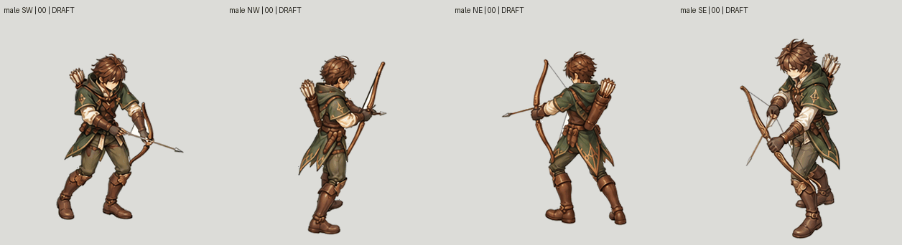
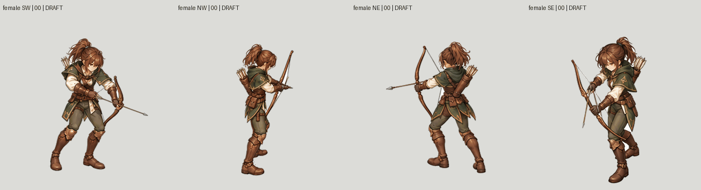
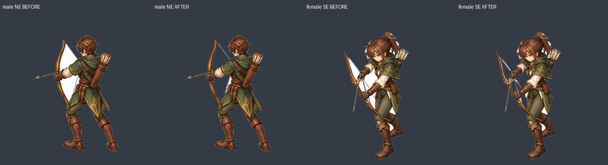

# Archer four-view matting and recovery — 26 October 2026

**Active work, not final acceptance.** Runtime coverage remains 2/96 imported
jobs and zero newly complete characters. The original tall Swordsman remains
the visual authority. These changes preserve complete coherent painted bodies;
they do not assemble independently generated limbs.

## Completed in this checkpoint

- Inspected all eight source-sheet white-component audit contacts: two sexes ×
  four real diagonal attack cameras × sixteen frames. Explicit reviewed seeds
  remove **152,310 enclosed white background pixels** in bow/arm/leg air gaps.
  Protected interior pixels remain unchanged. Optional white-spill correction
  is limited to the outer two-pixel band. Narrow remaining fringes still need
  native-size visual review; this does not certify all matting boundaries.
- Extended complete-master recovery repair to **all eight camera/sex groups**.
  All 66 source bone matrices match poses 0 and 15 within `5.960464477539062e-7`.
  Each final recovery reuses its own first complete painted body and applies
  only a bounded local arrow-removal paint patch. Lower-body pixels and every
  pixel outside that projectile corridor match exactly. The 120 other cleaned
  input frames are unchanged. This is done before cutting semantic parts.
- Added a reusable fixed-viewport master preview renderer. Normal and slow GIFs
  below use a single recorded crop and native pixel scale; no frame fitting or
  fabricated in-betweens. Playback uses 80ms sample steps and a 240ms terminal
  inspection hold, not final gameplay timing or a certified seamless cycle.
- Improved cutout tooling to accept only pinned head proposals containing the
  **same RGBA pixels** as their actual complete master. Explicit hand occlusion
  can retain the glove with BodyCostume; manually traced visible boundaries can
  clip ownership without changing any master pixels. Segmentation proposals now
  have to respect body/hand negative points as well as head positive points.

## GIFs

Slow versions: [male](male-slow.gif), [female](female-slow.gif).

## Evidence and reproduction

- [Protected endpoint pixel checks](protected-pixel-proof.json)
- [Matte cleanup checks](matte-cleanup-proof.json)
- [Complete repaired masters and exact recovery plan](../../../../authoring/characters/factory-v3/patch-0.0.1/review/archer-coherent-recovery-masters-v2-20261026/)
- [Reviewed air-gap seed annotations and contacts](../../../../authoring/characters/factory-v3/patch-0.0.1/research/archer-white-air-components-20261026/)
- [Local correction sources and exact ImageGen requests](../../../../authoring/characters/factory-v3/patch-0.0.1/painted-candidates/archer-tall-source-reset-20261026/remaining-view-recovery/)

Run `repair_coherent_recovery_masters.py --plan <complete-master-recovery-plan.json>
--output <fresh-directory>` from the repository root. It verifies source pose
equivalence, preserves frames 0–14, and records all input/output hashes. Preview
with `render_fixed_master_review.py --masters <repaired-root> --recipe
<preview-recipe.json> --output <fresh-directory>`. Background cleaning uses the
frozen cleaner and explicit reviewed annotations beside each cleaned Master.

## Still open

The new recovery masters are not yet registered to the final runtime canvas.
Intermediate anatomy, placement, hand/bow fit and release timing still need
comparison against the actual guide. SE release-arm foreshortening remains open.
NW head-mask proposals have been inspected at native resolution: some include
forearm, glove, quiver or bow pixels. Model confidence and exact reconstruction
do not approve those boundaries. Two male boundaries have manual visible-hair
clips; remaining problematic cuts need equivalent cleanup. Hidden surfaces and
hair/costume swap proofs are not complete.

BodyCostume must remain the whole clothed body with all limbs. No new paint job
is admitted by this checkpoint. All remaining actions for Swordsman/Mage/Archer,
both sexes, and actual playable-character admission remain required.
