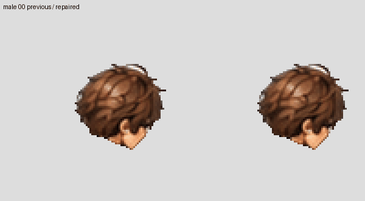
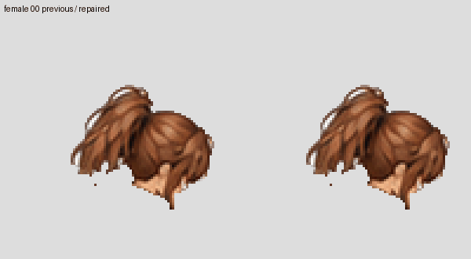
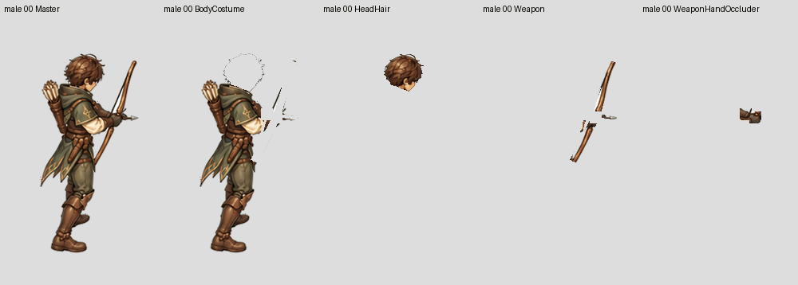
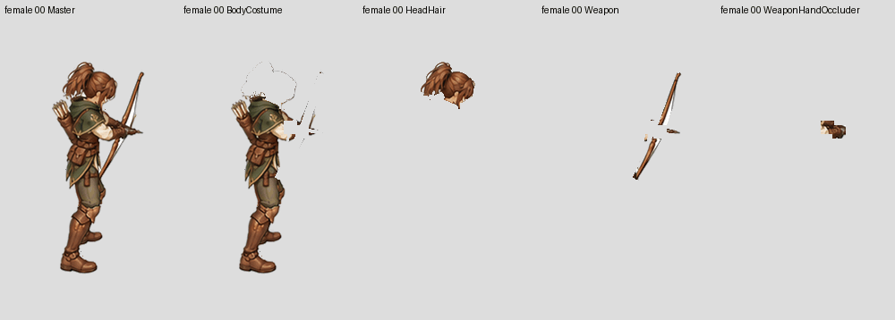
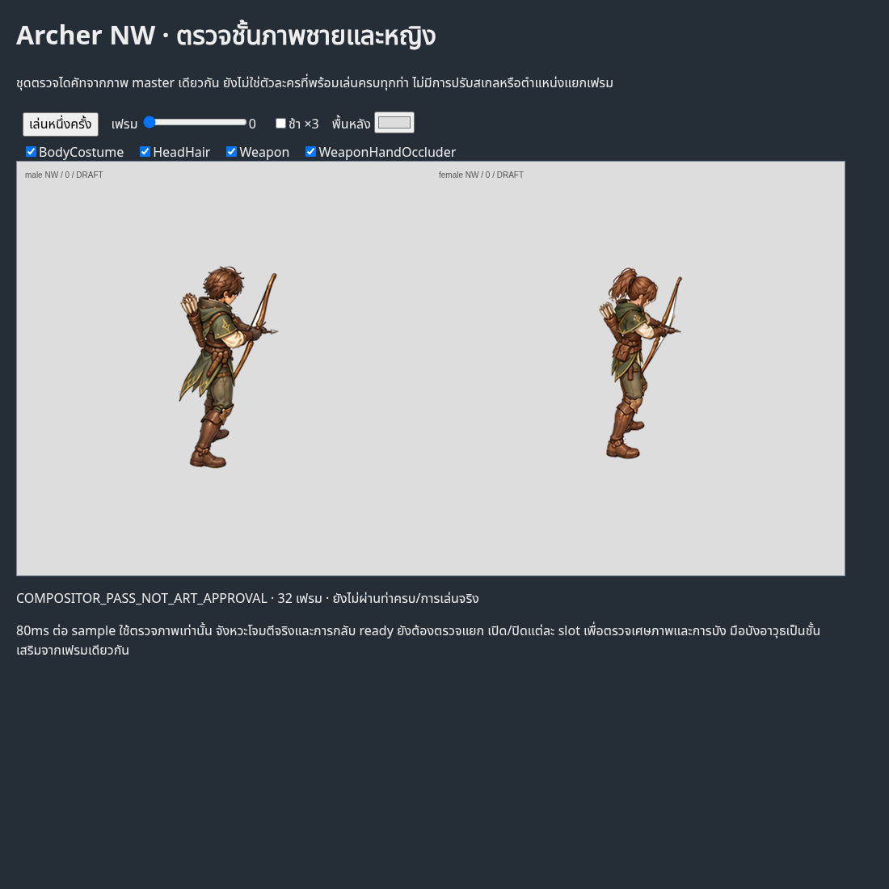

# Archer NW same-frame ownership repair — 27 October 2026

Work continues toward the six-character goal. This checkpoint fixes visible
part ownership in **32 frames** (16 male +16 female), without changing or moving
any complete-master RGBA pixels. This is not all-action character completion.

## What changed

Reviewed disconnected bracer/sleeve fragments were returned from HeadHair to
BodyCostume. Male pose9 has a bounded SAM2-supported front-bracer boundary;
female pose8 has a bounded material exclusion for a hood fragment below the
ponytail. The original masks and model alternatives remain available for audit.
BodyCostume still contains the complete clothed body and all limbs.

The two observed hand regions are now a separate WeaponHandOccluder layer,
using only their existing same-frame BodyCostume pixels. HeadHair and Weapon
ownership are protected during that hand extraction. No new limbs or hidden
surfaces were generated.







Slow inspection: [male](male-parts-slow.gif), [female](female-parts-slow.gif).
The GIFs repeat one-shot samples for inspection;80ms sample steps and240ms
terminal hold are review timing, not a gameplay event contract.

## Actual compositor verification

[Interactive PNG inspector](index.html) loads the actual individual parts and
uses `AstraeonModularSprites.draw`, the game's compositor. It plays once by
default and supports frame stepping, slot toggles and background changes.

Actual Chromium compared all32 recompositions to their corresponding original
master PNGs: **zero pixel mismatches and zero page errors**. Source positioning,
scale and canvas are unchanged. This check does not prove full anatomical
quality, final body fit, attack timing, transitions or actual gameplay.



## Reproduction

From the repository root, replay the retained same-frame source masks and
annotations through the factory tool. Use a fresh output directory:

```bash
python tools/character_factory_v3/apply_manual_head_polygons.py --masters authoring/characters/factory-v3/patch-0.0.1/review/archer-coherent-recovery-masters-v2-20261026/male/NW/Master --previous authoring/characters/factory-v3/patch-0.0.1/review/archer-NW-authoring-cutouts-v4-20261026/male --annotations authoring/characters/factory-v3/patch-0.0.1/review/archer-NW-head-semantic-repair-20261027/male/annotations.json --output /tmp/archer-male-NW-parts-replay
python tools/character_factory_v3/capture_visible_pilot_browser.py --review docs/character-factory/review/patch001-archer-head-ownership-20261027
```

Use the corresponding female paths to reproduce the other16 frames.
`ownership-repair-source.py` documents the exact mask authoring steps, retained
SAM2 proposal and bounded exclusions; the resulting source masks are pinned
inputs. `preview-source.py` records fixed GIF crops and inspection timing.
No image generation is needed to reproduce these cutouts.

See [ownership transfers](head-ownership-proof.json),
[same-frame RGBA proof](same-frame-proof.json),
[Chromium measurements](browser-report.json), and the actual part sheets under
the source review directory.

## Still open

Other Archer cameras, final runtime registration, guide/paint pose comparison,
remaining body/edge defects, hidden surfaces, hairstyle/costume swaps and all
remaining actions must pass before character admission. Head-only boundary
cleanup and exact recomposition do not authorize that admission. Coverage
remains **2/96 technical imports,0/6 newly complete characters**.
