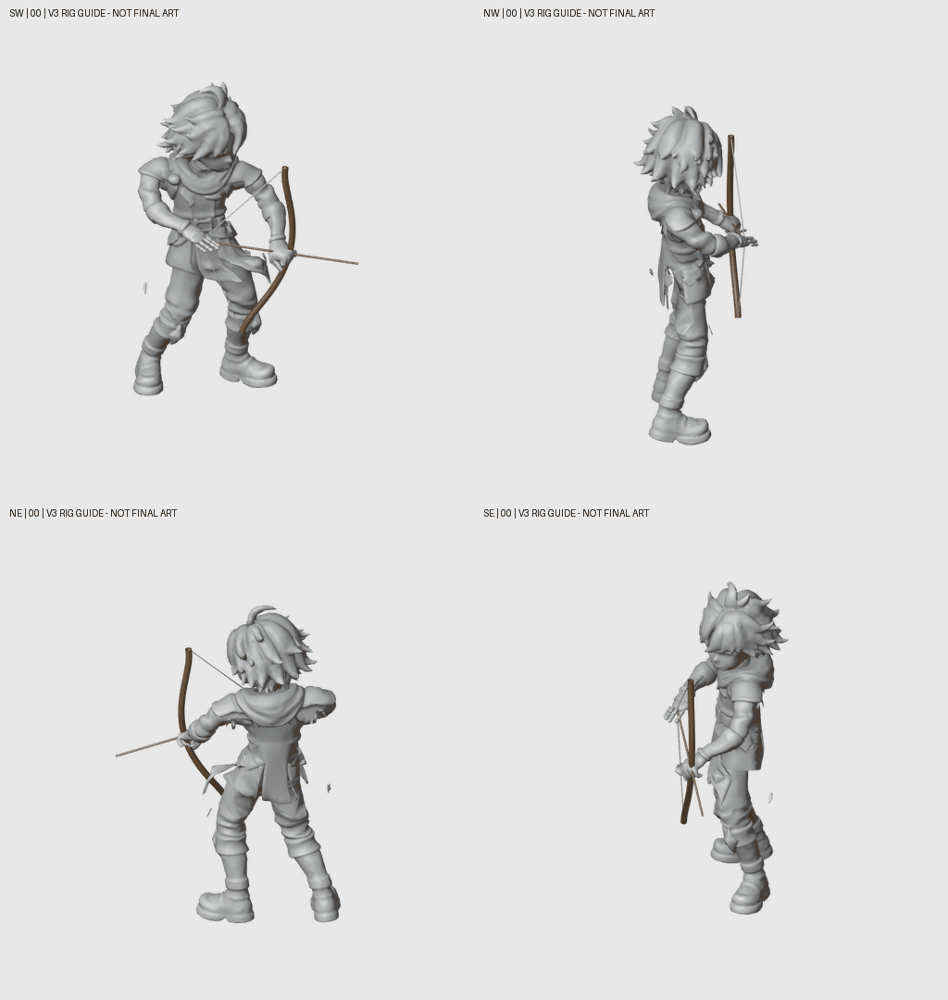

# Archer rig-first leg correction — 26 October 2026

**Required production order:** rig motion → exact paintover for each actual frame/camera → same-frame BodyCostume / HeadHair / Weapon cuts → recomposition. BodyCostume is the entire clothed body, including arms, hands and legs. A generated strip is not proof that its anatomy traces the rig.

The owner rejected both the fragmented limb assembly and the following coherent-native-v2 sheet for bad legs/boot shape drift. Those images are not production parts. Their segmentation/promotion stopped. A single-frame repair against the old guide is also unapproved and superseded by this rig diagnosis.

## Measured cause and correction

- Original target-rig right boot sole was on the support plane, but the left sole floated **0.0063–0.0422 m**. Whole-body lowest-vertex floor alignment did not preserve both target boot contacts after proportion retargeting.
- Actual ankle XY travel reached **0.2919 m** during a standing bow shot. V1 corrected sole height only; it did not solve this sliding.
- The first anchored-support attempt (V2) reversed the knee bend plane in near-straight source poses. Contact and saved-matrix checks alone did not reveal anatomical quality. **V2 is rejected and must not supply paint guides.**
- V3 transports the original knee bend plane from the old leg axis to the new support axis. All 32 knee planes match within **0.0081°**; no pole reversals.
- Both actual weighted boot soles are within **0.0000093 m** of the support plane. Ankle XY range is below **0.00000071 m**. Upper-body matrices differ by **0**. Foot orientation and all real cameras stay unchanged. Ready/recovery maximum matrix difference is **2.21e-6**. No endpoint frame was invented.
- This is an **authored target-rig contact/support adaptation** of the retained KayKit bow source, not a claim that native source motion is unchanged. Mesh2Motion stays preferred; its bundle has no dedicated bow clip.

All 64 derived captures were inspected in the complete contact pages. This establishes a usable source-motion candidate for paintover; final character illustration, smooth painted playback, prop/cutout semantics and gameplay are still unapproved.

## Correct current source previews

These are **3D guides**, not final character art. The 80 ms sample-index preview is not production event timing.

[Slow GIF](grounded-support-v3-four-views-slow.gif) · [all legs 0–7](all-leg-poses-00.jpg) · [all legs 8–15](all-leg-poses-08.jpg) · [native bones versus rejected painting](native-bones-versus-rejected-paint.jpg).

The other provisional V1/V2 GIF filenames in local scratch are not current sources. Use only the V3 links above.

## Reusable editable rig and evidence

[V3 Blender/GLB kit](../../../../authoring/characters/factory-v3/patch-0.0.1/rig-kits/archer-grounded-support-v3-20261026/README.md) contains the common 60-bone skinned reference rig, fixed cameras/sockets and one derived 16-pose action. Reopened Blend maximum matrix error **1.64e-6**; imported GLB maximum error **2.90e-6**, all 16 × 51 matrices checked. It is not six finished class/sex meshes.

[Controls/captures](../../../../authoring/characters/factory-v3/patch-0.0.1/research/archer-anchored-support-v3-20261026/) include source hashes, frozen repair script, per-foot geometry checks and the knee-plane audit. The original shared 48-action library and its full manifest are unchanged.

Factory planner and all 96 active paint-job policies now state the owner’s exact-frame workflow. Existing **268 factory tests pass** ([log](factory-tests.log)). Tests and rig source checks do not approve the artwork. Actual imported jobs remain **2/96**, zero newly complete playable characters. Preserve approved Swordsman art and long trails.
