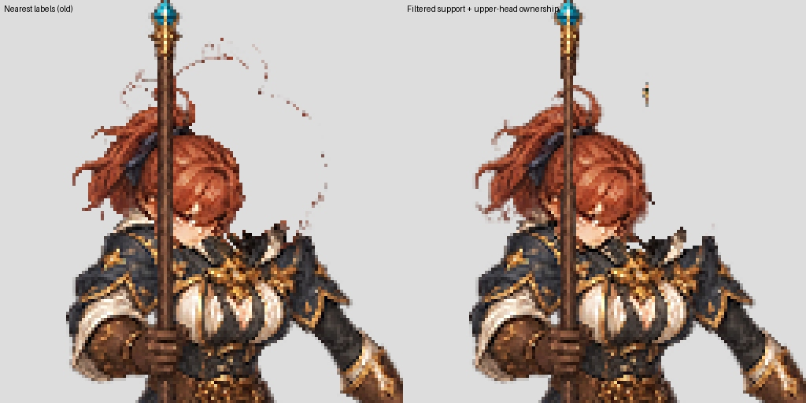
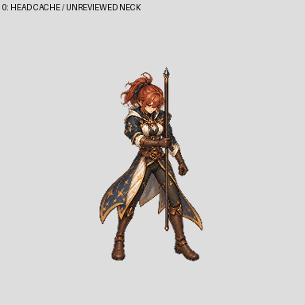

# Filtered head ownership and bow study

Goal remains active: 0/6 newly complete characters and 2/96 technical artwork imports. No new runtime asset is admitted.

The previous head mask used nearest-neighbour resampling even though the master was filtered with bicubic interpolation. This left old hair edge pixels in BodyRest when swapping HeadHair. `project_filtered_part_coverage.py` projects the masked raw alpha through the same fixed viewport and global bicubic fit. A three-pixel raw edge guard and a bounded native upper-head ownership correction reduce residual old-hair outlines. The same-frame source masters are preserved and visible-pixel reconstruction remains exact for 24 frames. Mixed boundaries and the remaining small fragments require review.

[Slow preview](mage-preview-slow.gif). This is a repeatable review preview, not a runtime transition. Mage body proportions, neck/collar and staff occlusion still require correction. A bounded collar experiment was also made; it has not been approved as a complete frame.

For Archer, source-image bow proposals cover 64 of 96 frames; 32 have unresolved prompts. Even successful proposals include incomplete string/arrow/hand boundaries and need native semantic review. They are not usable weapon slots yet.

`python -m unittest discover -s tests/character_factory_v3` passed 368 tests, including actual Blender integration. Filter coverage has seven focused checks including clipping and fractional-registration rejection. See `factory-tests-368.log`.

Source labels, per-frame receipts and producers are retained under `authoring/characters/factory-v3/patch-0.0.1/review/`; the tracked helper is `tools/character_factory_v3/project_filtered_part_coverage.py`. Reproduction of the filtered study uses `projection-source.py` in the v5 study followed by `repair-source.py` in the v7 study. Generated paint model/seed remain unavailable; saved raw inputs are the reproducible starting point.
