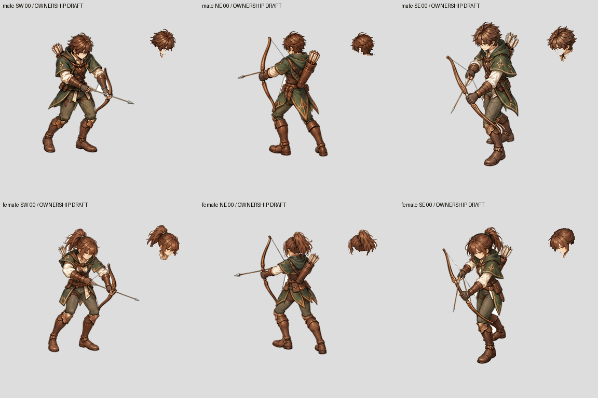
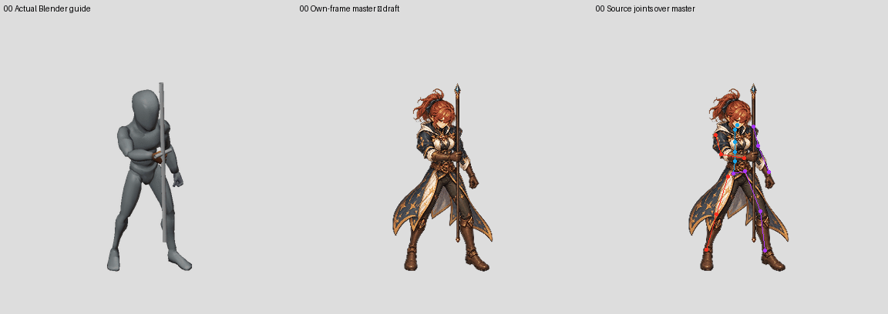

# Patch0.0.1 — full pilot head ownership and source replay checkpoint

Goal **ACTIVE**. Newly complete characters **0/6**; technically imported artwork **2/96** jobs; scope **114 logical action instances**. This checkpoint does not admit another character or complete action.

## Actual changes

- Preserve all24 independent Mage SW raw paintings, prompts and input hashes. One shared fit and whole-frame integer registrations only; no copied legs or per-frame body resizing. Four older keys use the earlier equally sized viewport; the other20 use the recorded Y-shifted viewport. The source camera and scale did not change.
- Replay the captured, pinned torso/head fit and target-facing gaze when exporting Blender source skeletons. All66 bones are exported for24 poses; seven recorded joint positions/rotations are checked against the capture. The independent capture freeze already checks66 bones per render.
- Add immutable source/master comparison: six projected source joints match capture metadata within **0.000071 authoring pixel**. This validates projection, not painted anatomy. All24 source overlays are retained.
- Complete HeadHair ownership proposals for **96 Archer frames** (male/female × SW/NE/SE ×16). Keep the18 previously reviewed key exports byte-for-byte in RGBA. Correct native forearm, arrow-shaft and raised-sleeve ownership. Masters are unchanged.
- Complete **24 Mage HeadHair proposals**. Restore headband holes from the same original pixels; retain real staff occlusion gaps. No hidden hair or neck is invented.
- Persist editable native ownership labels. Fresh exports reproduce **240 parts** exactly in RGBA (192 Archer +48 Mage) without SAM2 or generation. These labels are source authoring data.
- Run the actual existing JavaScript modular compositor in Chromium: **120 native-canvas comparisons, zero mismatched pixels**, no page errors. This is an inspector check, **not gameplay capture**.

`BodyRest` explicitly still includes weapons. It is not a completed BodyCostume slot. The study receipt cannot be used as a runtime intake receipt.

**Validation:** all361 factory tests pass, including actual Blender integration. The protected896 original Swordsman files match their saved hashes.

## Review media

Archer six painted view/sex sequences with same-frame extracted head inset:



[Slow Archer](archer-six-view-head-slow.gif) · [head frames0–3](archer-head-contact-00.jpg) · [4–7](archer-head-contact-01.jpg) · [8–11](archer-head-contact-02.jpg) · [12–15](archer-head-contact-03.jpg)

Mage actual Blender guide / own-frame draft / source joints:



[Slow Mage](mage-source-slow.gif) · [all24 source-joint overlays](mage-source-joint-contact.jpg) · [24 extracted heads](mage-24-head-cutouts.jpg) · [interactive native-canvas inspector](index.html)

Mage GIF uses24fps sampling quantized to GIF centiseconds, plus200ms terminal review hold. Archer uses80ms per recorded pose and240ms terminal review hold. GIF restarts are review playback, not approved attack/cast transitions.

## Defects still open

- Mage upper-body/head proportions, robe details and shoe shapes vary between independently generated paintings. Source overlays locate these deviations; none is accepted by a sole-edge check alone. Frames5/11 have particularly different shoe silhouettes, which must be distinguished from ankle registration.
- A measured source-gaze shared-head preview exposes unpainted neck/collar regions and original-head edge residue. **Rejected for production**. Do not hide this by scaling the head or copying another frame's body.
- Mage staff crossing the head needs complete weapon/hand occlusion, not the provisional narrow-pole preview mask. HeadHair0 alone does not prove a reusable complete cast.
- Archer full native cutout boundaries, bow/string/arrow ownership, hand occlusion, anatomical continuity and outfit swaps still need review. Exact recomposition does not establish semantic correctness.
- No new six-fit baseline approval, full gameplay action transitions, costume variants, or complete playable characters are claimed.

## Reproduce

From repository root; use fresh output paths:

```bash
python authoring/characters/factory-v3/patch-0.0.1/painted-candidates/mage-female-single-frame-trace-20261027/review-fixed-fit.py
python tools/character_factory_v3/replay_visible_ownership_study.py \
  --recipe authoring/characters/factory-v3/patch-0.0.1/review/archer-remaining-view-head-complete-proposals-v6-20261027/authoring-state/recipe.json \
  --output /tmp/archer-head-replay
python tools/character_factory_v3/replay_visible_ownership_study.py \
  --recipe authoring/characters/factory-v3/patch-0.0.1/review/mage-female-target-gaze-sequence-heads-v3-20261027/authoring-state/recipe.json \
  --output /tmp/mage-head-replay
python -m unittest discover -s tests/character_factory_v3
```

Source Blender replay uses `export_evaluated_guide_skeleton.py --source-guide .../research/target-facing-mage-gaze-20261027/four-view-capture --direction SW --output <fresh.json>` under Blender4.3.2. Frozen helpers and capture hashes remain pinned; ordinary production profiles are unchanged.

Image generation tool model/seed are not exposed. Bitwise regeneration of the raw paintings is not claimed. Saved raws, exact prompts, input hashes, original source motion, masks and downstream commands are retained. Head proposals used SAM2.1 Hiera Tiny checkpoint SHA256 `7402e0d864fa82708a20fbd15bc84245c2f26dff0eb43a4b5b93452deb34be69`.

## Next gate

Keep the preserved tall Swordsman baseline. Correct the Mage own-frame masters and neck/weapon occlusion, finish Archer weapon ownership, then review each pilot in actual gameplay before expanding to other actions. Goal remains all three classes, both sexes, every required action and genuine asset swaps.
