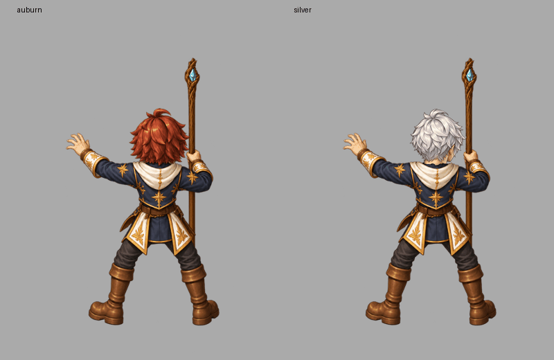

# Layered Mage hold and real runtime checks

This checkpoint is **not a completed playable character**. Patch coverage remains **2/96 imported paint jobs; 94 missing; zero newly completed playable characters**.

## Actual assets

- One NE Mage hold action, 16 source-driven poses, two independently replaceable hairstyles (auburn and separately drawn silver).
- Hidden neck/outfit pixels authored under the head; continuous staff pixels reconstructed behind hand and sleeve in a separate rear weapon pass.
- Old hair edges returned from body ownership; cloth fragment returned from weapon ownership. Kept original visible drawing pixels; explicit near-opaque alpha repair changes alpha by at most five levels.
- Five native overlapping role families: rear weapon, body/costume, head/hair, front weapon and hand occluder. Hidden pixels survive animation and atlas packing.
- Same 64 non-head pixel objects reused between hairstyle variants. No repeated frame generation, camera movement, frame-wise figure fitting, endpoint clone or crossfade.
- Frozen implementation replay: both 101-file motion outputs and the 14-file first atlas package match byte-for-byte (216 files total). Final separate-role atlas has its own replay evidence.
- Real game compositor: 32 poses, 64 comparisons on light/dark backgrounds; maximum channel rounding difference 1/255; no page errors. This measures source composition, not gameplay admission.
- Factory tests: 239 passed. Direct Node runtime suite: 40 passed.

## Real game status

Legacy saves for classes 0, 3 and 12 still move and perform their authored basic attack state (Mage casts). No page/resource errors. These are legacy compatibility checks, **not new patch characters**.

Fresh character creation is blocked by a real missing resource: `assets/characters/swordsman-male-patch001/sprite.json` returns 404, so the create button stays disabled. That production package was already absent at the baseline; this checkpoint does not bypass the gate or substitute legacy artwork.

## Still open

All required actions/directions and both sexes across the three classes, complete costume/weapon swap families, full large-motion shoulder/cap and occlusion quality, gameplay timing/events, complete six-character runtime packages and ordinary new-character gameplay. The newly drawn ivory/burgundy costume and additional static camera paintings require registration before use. Large-arm casting studies with shoulder gaps stay rejected.

