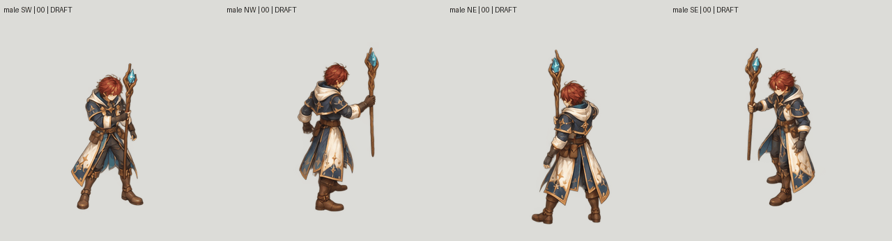
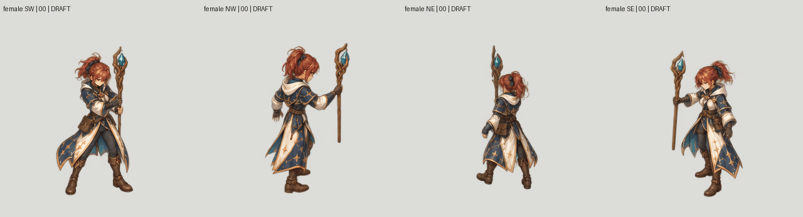

# Mage continuity audit — 26 October 2026

**Drafts rejected for final admission.** Coverage remains 2/96 imported jobs,
zero newly complete characters. The preserved tall Swordsman is unchanged.

Eight coherent whole-character sheets cover male/female Mage, four real source
cameras and 24 spell poses. They follow the original Mesh2Motion human guide,
not independently generated limb parts. These are painted drafts, not proof of
exact source tracing, natural anatomy, stable identity or correct staff grip.

## Frame extraction repaired

The transparent sheets contain 24 large connected figures each. Some boots and
staff pixels cross internal grid lines. Fixed cell cropping would sever them.
The component extractor assigns complete figures to their original cell origin
on a shared 512 canvas, preserving assigned RGBA pixels exactly without fitting
or resizing. It recovers 16,595 pixels outside nominal cells. No opaque figure
is clipped by the outer sheet boundary. Small detached low-alpha noise is
recorded separately; this is not a claim of preserving every raw-sheet pixel.

## Why one planted foot is insufficient

A whole-master integer translation can hold one boot still while the other boot
or body proportions change. The new diagnostic checks both visible soles in
screen order. With a 3px native tolerance, only female SW passes this narrow
measurement throughout; three groups contain nonrigid foot drift and four have
ambiguous overlapping boot components. Ambiguous observations require reviewed
landmarks. Even the passing measurement does not approve anatomy, source pose
or all-frame smoothness. No candidate is admitted to runtime.

The prior one-foot registration outputs are retained as rejected diagnostics,
not corrected production sprites. Six male NE frames fail the second-sole
check. See the [full audit](two-visible-sole-audit.json) and
[boot observations](male-NE-boot-observations.jpg).

## Original-placement previews

One fixed 320px viewport includes the recovered overhanging pixels. Native-scale
GIFs use 80ms sampling and a 240ms terminal inspection hold. They are diagnostic
one-shots repeated for inspection, not certified seamless gameplay cycles.

Slow GIFs: [male](male-slow.gif), [female](female-slow.gif).

## Continue production

Correct complete master anatomy and pose against the actual guide before
BodyCostume / HeadHair / Weapon cutting. Keep every limb within BodyCostume.
Do not reuse frozen legs, stretch body parts, independently fit per-frame crops
or treat a segmentation reconstruction score as semantic approval. Remaining
work includes reviewed boot association, full body/head/staff stability,
recovery pose/timing, semantic cuts, swap proofs and all other actions.
