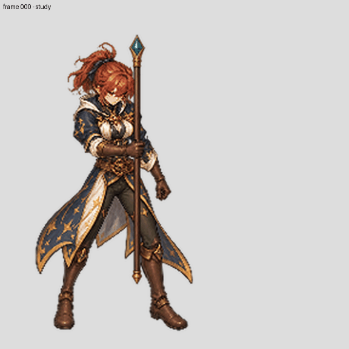

# Mage frame 001: separated-parts experiment

After own-frame staff underpainting, a same-frame SAM2 proposal was refined to move upper hair fragments from BodyCostume into HeadHair. The head, body and hand layers recompose the underpainted image with zero visible RGBA mismatches. An independently drawn staff is placed with its shaft at authoring x=398, near the frame's projected guide right-hand middle-joint x=398.3. This is a preliminary placement: a finger joint is not proof of correct grasp or staff rotation.

The GIF alternates only frames 000 and 001 for registration review; it is not a complete animation. [Part overview](parts-review.jpg) · [head and body detail](head-body-detail.jpg) · [hand and grip detail](grip-detail.jpg) · [one-frame staff swap](weapon-swap-comparison.jpg). The two staff variants use identical body, head and hand images; pixels outside the union of the weapons are unchanged. This isolated check does not establish that the hidden body and hand geometry work for arbitrary weapons.

The hand occluder contains some cuff/costume pixels. Although the assembled view appears continuous, this ownership has not passed a swap and occlusion audit and is not suitable for production yet. The body has no independently authored hidden neck surface, and the staff's own-frame transform and full motion need review. All other frames, directions and runtime remain open. This experiment changes no game artwork; coverage remains 0/6 newly complete characters and 2/96 technical imports.

Rebuild the underpainting from saved raw and mask, then generate the SAM proposal with the saved `producer.py` under `review/mage-underpaint001-head-sam-study-20261028` using the recorded SAM2 checkpoint, then run `python authoring/characters/factory-v3/patch-0.0.1/review/mage-frame001-separate-parts-study-20261028/producer.py`. Original generated artwork can be rebuilt downstream from saved raw; the image-generation model and seed are not available.
