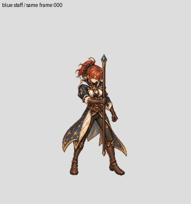

# Mage female SW frame000 head ownership refinement — draft

This refines **one frame** of the separate-staff trial. It does not change patch coverage: 0/6 newly complete characters, 2/96 technical imports.

A segmentation proposal was made from the actual own-frame staff-underpainted master. The selected mask excludes the sampled collar points. Its internal holes are filled only where source pixels exist, the principal head component is retained, and existing upper hair ownership is kept so hair fragments do not remain in BodyCostume. Small detached lower components return to the body/collar. All pixels come from that same master.

[Head mask before/after](head-mask-before-after.jpg) · [HeadHair and BodyCostume ownership](head-and-body-ownership.jpg) · [two-staff swap](staff-swap-review.jpg)

The GIF alternates two weapon appearances for the **same still frame**, not a motion. BodyCostume, HeadHair and WeaponHandOccluder are the same files in both compositions. No output pixels outside the weapon union changed. A fresh rebuild reproduces all five RGBA files; removing the weapon and composing body, head and hand reproduces all visible pixels of the underpaint master.

Semantic review of the head/collar edge and hand grip is still required. The staff under the visible hand and surfaces hidden by the head are not a complete general-purpose underlay. Hair/costume substitutions, the other23 frames, the other camera views, gameplay and temporal stability have not passed. The single-frame numerical checks are not a visual or runtime acceptance.

Saved source master, mask candidates, selected-mask SHA256, original and variant weapon assets, label-building producer and exact rebuild proof are under `authoring/characters/factory-v3/patch-0.0.1/review/mage-underpaint000-head-sam-study-20261028`, `mage-frame000-four-visible-parts-v5-20261028` and `mage-frame000-staff-swap-pilot-v2-20261028`. Model/seed for generated artwork remain unexposed; downstream reproduction uses saved raw images.
