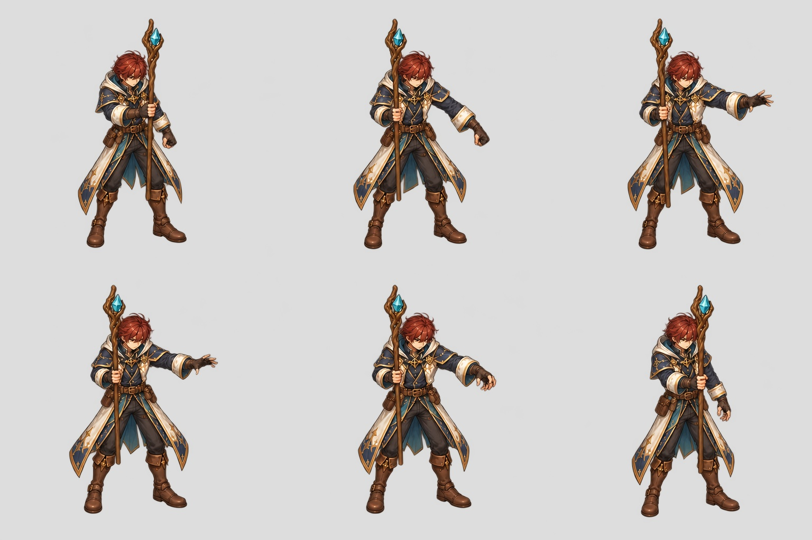
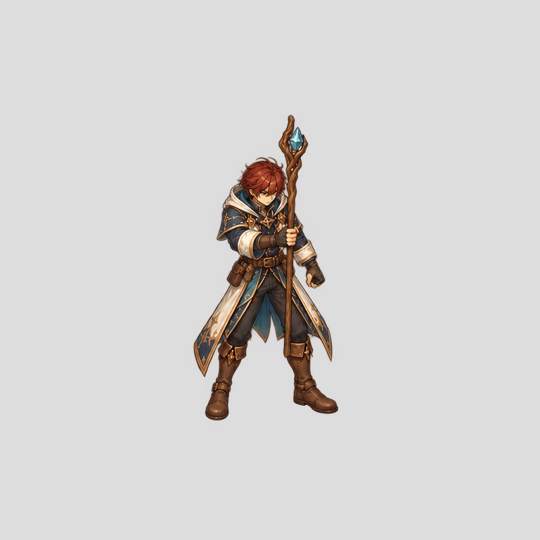

# Mage actual paint repair study — 27 October 2026

New painted male SW keyposes from the actual source frames 0,4,8,12,18,23,
using the source guide camera and existing Mage design identity. Complete bodies
were painted before extraction; no independent limb assembly. Native sheet is
1536x1024, six 512 cells. Transparent background verified (alpha 0..254).

The GIF holds each selected pose for 650ms. It is NOT the full animation and
NOT a smoothness proof. Generation is not exact tracing: visual inspection finds
boot/contact placement differs from source. Candidate remains unapproved and
requires source-landmark comparison and complete-master correction before
in-betweens or semantic cutouts. No runtime imports added; coverage 2/96.

Complete-component extraction retains each whole figure at its original cell
coordinates on a 768 canvas with offset128. Extraction receipt and frozen code
are under authoring review/mage-six-keypose-masters-20261027.

A separate all-six/eight-view design contact is available in authoring review/
six-fit-design-size-reference-20261027. It shows design studies, not registered
anatomical size acceptance.
