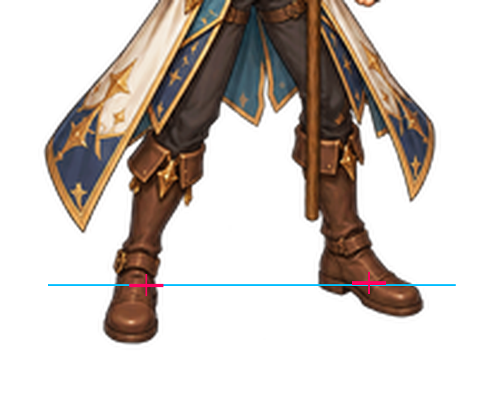
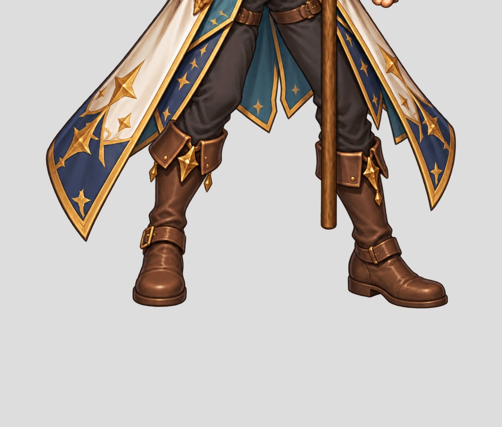

# Source-constrained master painting blocker

The six-character goal is NOT COMPLETE. Completion is blocked on the pilot
master-art geometry gate. Existing tooling and source motion remain available;
this is not a repository, credential, runtime, or license blocker.

A complete six-pose paint study, shared-scale registration, full canonical
projection, explicit-coordinate pose0 repaint and two local lower-body paint
corrections were attempted. The local correction with visible floor markers
still places raster sole points at [254,487] and [670,489] rather than
[244,476] and [616,472] in the800x680 review crop. Conditional runtime errors
are1.1614px and4.4229px (review/4 *0.3125). These are raster observations,
not manually certified anatomical landmarks; they do not prove correct pose.

Neither local patch was merged into its complete master. Original upper-body,
coat, staff and prior accepted Swordsman art remain unchanged. No new runtime
imports or art acceptance. Current coverage2/96, zero newly complete characters.

## Required to unblock

A source-registered complete pilot master must be corrected with sufficiently
precise painting control, or supplied as corrected artwork. Review both feet,
head/neck, pelvis, knees, hands/grip and costume continuity. Then qualify the
full sequence before semantic cutting and expanding to six characters. The
current generative editing attempts have not achieved that precision. Do not
replace this with per-limb warps, frozen templates, idle substitutions or a
relaxed quality threshold. Engineering tests cannot remove this art blocker.

315 factory tests passed, including actual Blender regressions; retained log
is technical evidence only. No claim is made that the full patch is playable.
Exact image requests, source crops, raw results and rejected-contact reports
remain under painted-candidates/mage-keypose-repair-20261027.
