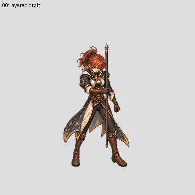

# Mage neck continuity — work in progress

The prior shared-head preview had clearly transparent gaps below the chin, notably frames 7–9, 11–14, 16, 18–21. It was rejected. The requested patch remains **incomplete: 0/6 newly complete characters and 2/96 technical imports**.

This study adds individually generated, bounded neck/collar underpainting in 12 affected frames, retaining the source head and staff pixels. The generated patch is translated locally to align the collar; neither the body nor a limb is resized or frozen. Positions are preliminary: optimizing a gap-region metric is **not** visual or anatomy acceptance. The source head had a 14-pixel staff fragment; ownership was returned to the original frame's body/rest and the fragment was removed from the head asset.

[Slow GIF](mage-layered-slow.gif) · [neck contact](neck-contact.jpg) · [source versus painted start/end](start-end-source-vs-painted.jpg)

The full cleaned head is preserved as its own actual RGBA layer through all24 frames. The staff-front corridor is another visible study layer. The remainder of the staff and gripping hand is still embedded in BodyRest; it is **not** a completed replaceable Weapon. **Rejected:** inspection confirms the staff-front corridor contains hair and costume pixels. It cannot be used as a weapon or occluder layer. The earlier narrow shaft-alpha check did not catch this semantic error. [Inspect all24 isolated staff-front proposals](staff-front-contamination.jpg).

Audit: all24 head RGBA layers match the shifted clean source head; all24 PIL layer recompositions reproduce their saved draft masters; a narrow shaft alpha sample has no missing opaque source pixels. A fresh rebuild matched **96 RGBA exports**. This is arithmetic and a limited alpha check; it does not verify anatomy, transitions, browser/game rendering, full weapon ownership or swaps.

The start/end contact still shows painted costume and staff placement changing despite closely related source poses. Boot and body continuity remain open, including existing sole diagnostics in frames5,11 and16 that need anatomically reviewed landmarks. The entire 24-frame motion, neck boundary, arm/weapon grip, view directions and gameplay transitions must pass before admitting this pilot. GIF restarts are for review only.

Raw generation outputs, exact prompts, input hashes, native masks and saved producer scripts are retained under the corresponding `authoring/characters/factory-v3/patch-0.0.1/painted-candidates/mage-neck-connection-pilot-20261028` and `review/mage-neck-*` folders. The image generation model and seed are not exposed; bitwise regeneration of original generated pixels is not claimed. Downstream files reproduce from saved raws and masks.
