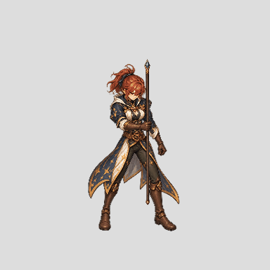

# Mage female SW: own-frame head recovery, diagnostic

The shared-head preview created real transparent neck gaps in the PNG composites. It is rejected. This preview restores each frame's own HeadHair and BodyRest from the same painted master, without applying a head from a different pose. The cropped GIFs use a single fixed viewport; their restart is for review and is not a certified transition.

[Slow preview](own-frame-slow.gif) · [24 enlarged head and collar details](own-frame-neck-contact.png) · [frame hashes and reconstruction audit](audit.json)

All 24 frame compositions reproduce the visible RGBA of their corresponding masters. Visual inspection of the contact sheet shows the previous obvious transparent gaps are absent in these own-frame images. This does not prove that head masks are semantically clean, nor that head swaps are possible. BodyRest still contains the staff and hand, so this is not an interchangeable weapon package. Costume, body, staff placement and movement still drift; gameplay and transition checks remain open. No runtime art was replaced, and this is not a finished action.

Rebuild from the saved source with `python docs/character-factory/review/patch001-mage-own-frame-head-recovery-20261028/build.py`. Coverage remains **0/6 newly complete characters and 2/96 technical imports**. The single-frame independently painted staff and head separation remain separate experimental work.
