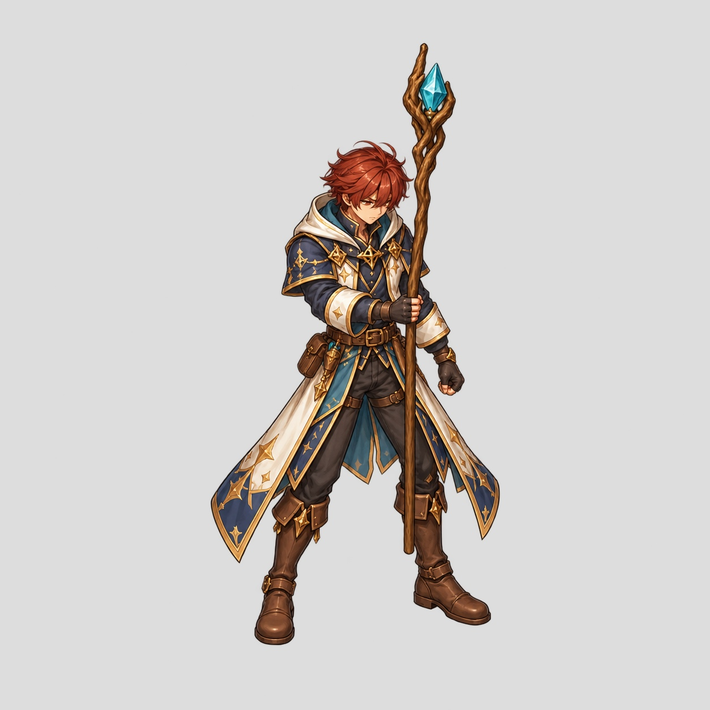
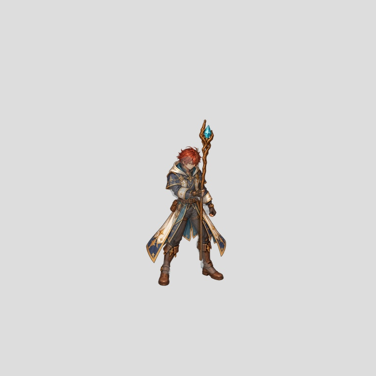

# Actual Mage pose0 repaint

New high-resolution single-pose paintover request uses projected source
coordinates rather than screen-left/right shorthand. Source geometry owns the
pose; the Mage identity supplies design only. Raw image1254 square; transparent
background preserved. Whole-image normalization restores the exact source crop
into the canonical768 authoring frame, with no per-figure fit.

This remains a candidate requiring landmark/contact review. Attractive detail
is not exact tracing or animation acceptance. No in-between frames, semantic
cutouts or runtime import were manufactured from an unapproved starting pose.
No motion GIF is claimed for a single pose. Goal remains active, coverage2/96.

Exact request and source/canvas receipt are included beside these images.
