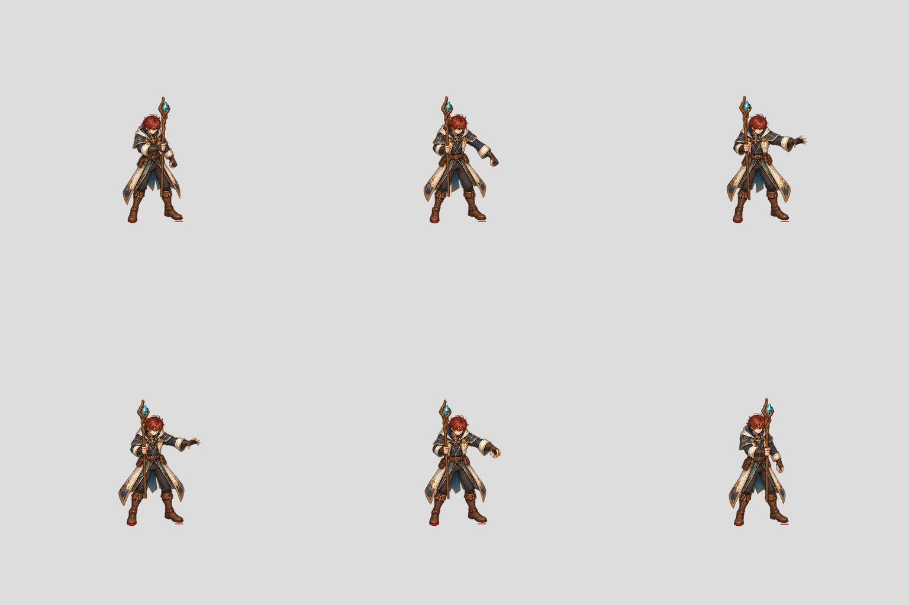
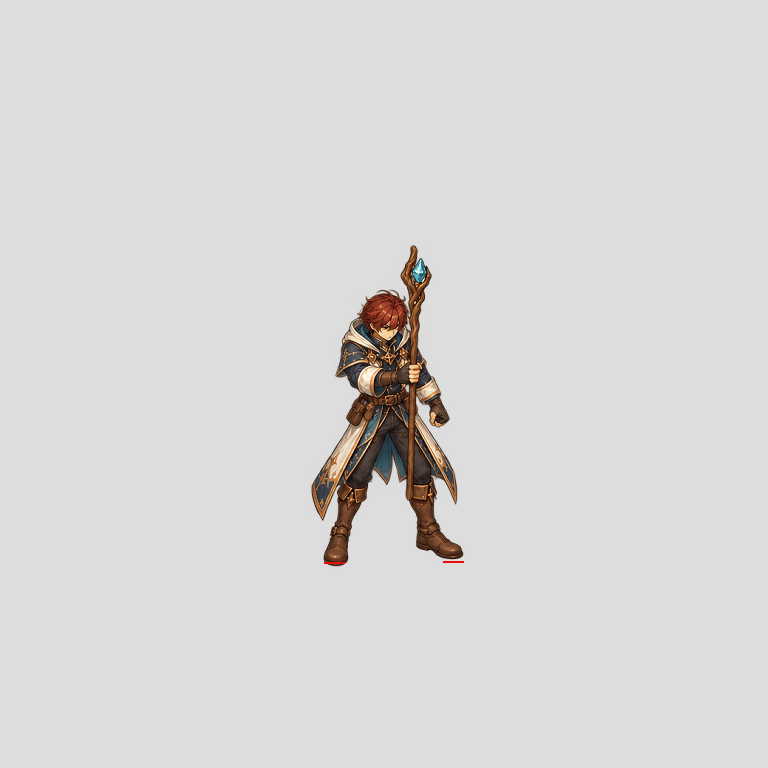
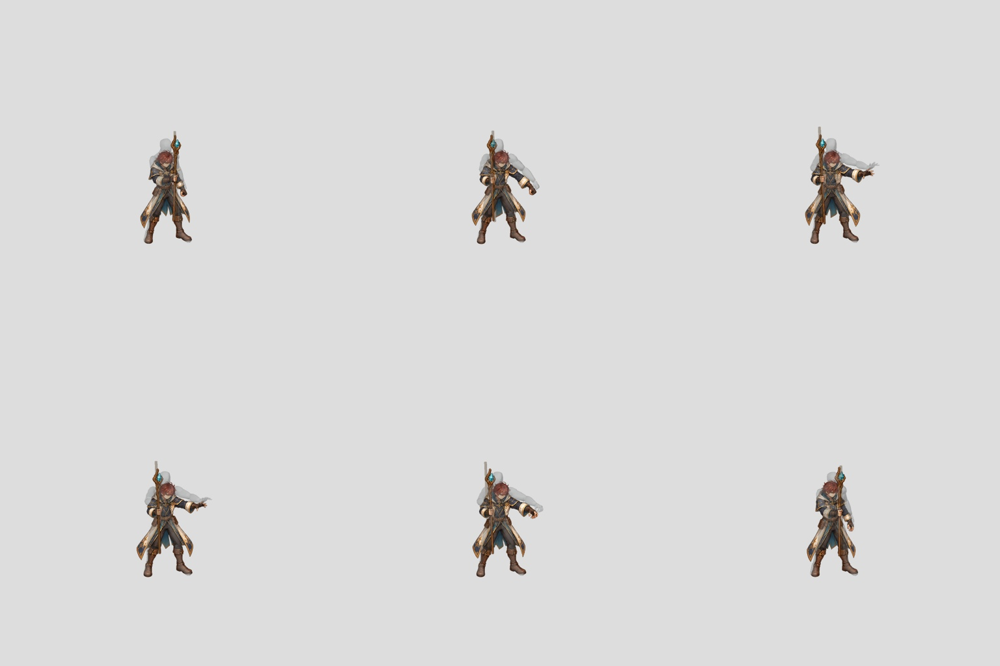

# Shared-scale Mage contact study

One global scale (0.7387753851) and whole-master translations align the six new
keypose paintings against the corresponding source raster boot contacts. No
per-frame scale, limb warp, frozen legs or independently generated body pieces.

Maximum paired fit residual is 3.8899 authoring pixels, approximately 1.216
runtime pixels at the configured 0.3125 scale. This exceeds the proposed 1px
contact threshold. Screen-ordered raster sole points are not manually approved
anatomical landmarks. The fit is a diagnostic and is NOT a paintover acceptance.

The transformed artwork remains unadmitted. Other landmarks (head, pelvis,
hands, knees, staff) require actual guide comparison and coherent master paint
correction. The six samples do not establish full 24-frame smoothness.

Reusable fit helper has three passing regression tests: one common scale with
translations, preservation of nonrigid residuals, rejection of coincident feet.
Frozen recipe and helper are retained beside authoring review outputs. Current
coverage remains 2/96, zero complete new characters; goal remains active.

## Canonical projection correction

The first diagnostic cropped an 800px guide viewport to 512px before placing it
in a 768 canvas. That is not the full-frame source projection required by the
production plan; its runtime error conversion was conditional, not evidence of
final game size. A second study uses the complete 1536 source image resized
uniformly to 768 (scale0.5), with no source crop or per-pose fitting.

One shared painting scale is 0.5772967984. Paired raster-sole fit residual is
3.12492 authoring px (0.97654 at runtime scale0.3125). This is a mathematical
fit, not independently observed output landmarks or anatomical approval. Even
this narrow threshold does not certify full body size or correct pose tracing.

[Canonical fit data](canonical-receipt.json). Full-master outputs and frozen
recipe are retained under mage-six-keypose-canonical-fit-20261027. The previous
fit remains a rejected framing study; no runtime admission is added.
