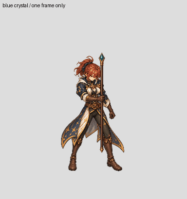

# Mage frame000 separate staff and swap — pilot only

One Mage female SW source frame has an own-frame bounded staff background underpainting, a separate newly painted staff, the visible hand occluder, a same-frame body/costume cutout and a head/hair proposal. A second visibly different crescent staff is swapped using the same body, head and hand files; pixels outside the two weapons' union remain unchanged. The swap image below alternates **one still frame**, not a complete action.

[Full-size swap](staff-swap-review.jpg) · [four visible parts](parts-review.jpg) · [grip detail](grip-audit.jpg) · [own-frame underpaint](underpaint-before-after.jpg)

The original shaft under the glove first remained in BodyCostume because the protected rectangle was too large. The revised underpainting protects the actual same-frame glove polygon and removes the exposed shaft below it. The unchanged glove is the optional foreground occluder. The original master is retained; only the bounded underpaint region was modified, with zero changes outside the effective mask or inside the protected glove.

Both weapon images are complete painted assets without person/garment pixels. Their faint disconnected background pixels (maximum alpha2) were removed from the cutout. The alternate uses its own uniform weapon scaling to the provisional common top and bottom points. The body and limbs are not rescaled or assembled from other poses. The body/neck/head cutouts and new weapon are all still **drafts**; the head boundary below the chin, hidden surfaces, hand occlusion and grip/socket alignment require native semantic review.

A fresh rebuild of the four parts plus composite matched five RGBA files exactly. The result is **one frame, one sex, one camera** and has not been tested in gameplay. It does not pass the patch's required four-view complete-action or three-class/two-sex variant gates. The staff-free body underpainting has not been generated for the other frames.

Generation raws, exact prompts, input hashes and cutout producers are saved with `painted-candidates/mage-staff-*` and the related `review/mage-*frame000*` folders. Model and seed were not exposed, so bitwise regeneration of the raw image is not claimed; downstream assets reproduce from the saved raw and masks. Goal remains active, coverage0/6 newly complete characters and2/96 technical imports.
