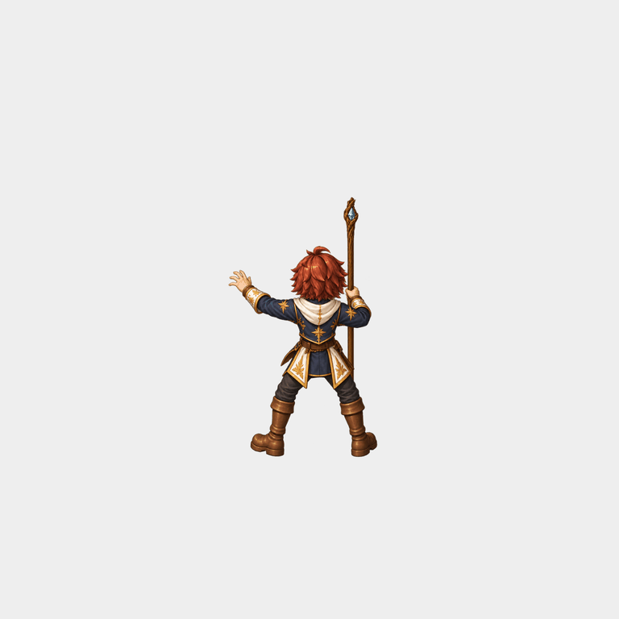

# Mage high detail native channel draft

One high resolution illustrated template, calibrated once before animation, follows the original native Mesh2Motion channel joints for all 16 poses. Camera and actor scale stay fixed. This replaces per-frame painting for this bounded hold study only.

- Staff motion: 16/16 within tolerance; maximum error 0.449 native pixels after one fixed decorative crystal offset.
- Native loop seam: 2.551 pixels; maximum ordinary adjacent displacement: 3.756 pixels.
- Four visible cutout roles plus two empty effect slots; exact visible RGBA recomposition.
- Hidden surfaces, equipment swaps, other directions, gameplay integration and owner art approval remain open.
- Patch ledger remains 2/96 imported jobs, 94 missing, zero newly complete characters.

