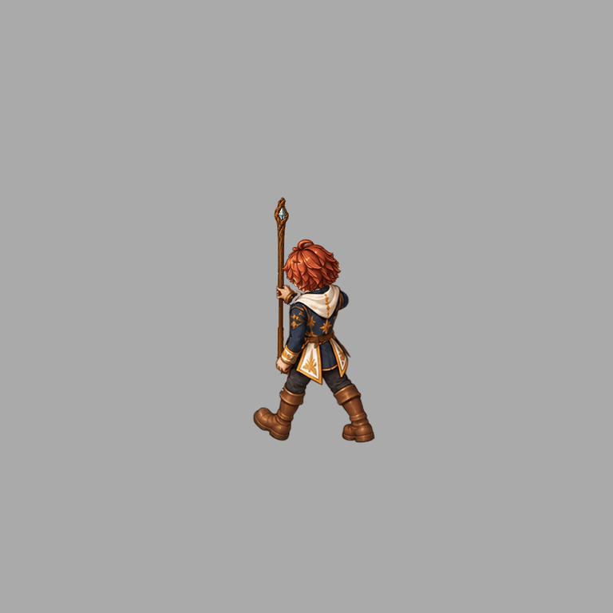
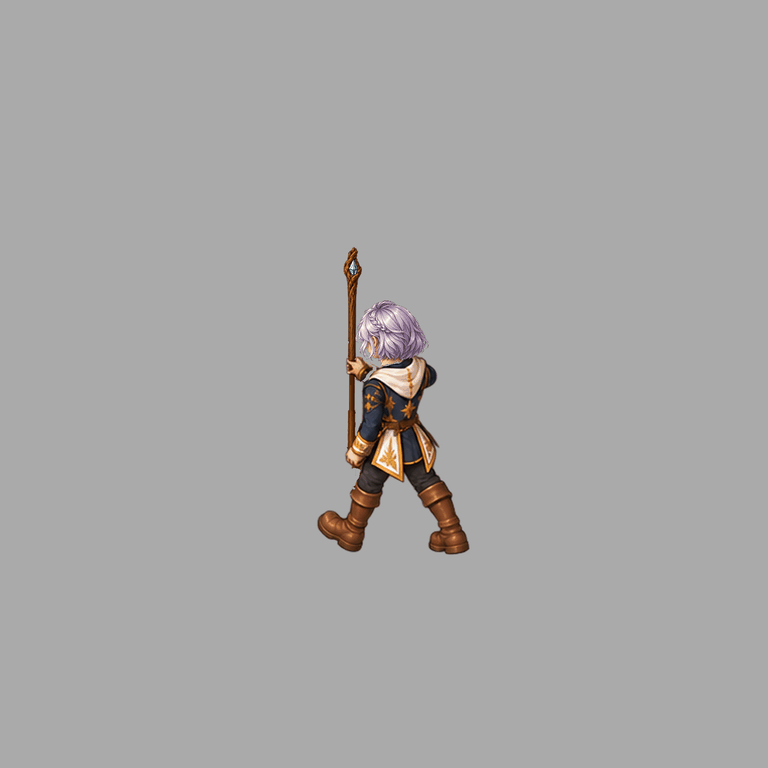

# Patch 0.0.1 — native Mage walking checkpoint, 26 October 2026

This is one NE walking study, not a completed character package.

## Delivered in this checkpoint

- Sixteen actual Mesh2Motion Walk samples, fixed native Blender camera, complete independent head, staff and gripping hand.
- Male auburn and female silver-braid head variants. All 48 non-head layer files are reused unchanged under the covered shared costume.
- Repaired shoe poses 2/3/4 from a complete guide-painted boot, transported from source pose 2 using native foot matrices and toe endpoints. Pose 7 receives a background shoe completion. No unrelated opaque body pixels change in the background completion.
- Four independently composited roles; six atlas pages and 112 unique objects for both variants.
- Actual game compositor: 32 poses, 64 light/dark comparisons, maximum channel difference 2/255; head/weapon toggles exercised; no page or resource errors.
- Python suite: 268 passed, including actual Blender pose and render checks.
- Frozen shoe-repair replay: 80 PNGs reproduced byte for byte. Missing replay helper dependency was found and included before publishing this checkpoint.

## Still incomplete

Only this NE walking study and the preceding Mage casting study are demonstrated. All three classes, both sexes, all required actions/directions, costume variants and real gameplay admission remain unfinished. Factory import count remains 2/96; zero newly complete playable packages. Browser composition success does not approve anatomical drawing or animation smoothness. Body packing correction uses an observed head proxy and is not a full pose guarantee.

Staff and hand grip anchors are bound to native controls. Shoe endpoint proximity is not proof of ground contact. Additional camera views need independently reviewed artwork; torso guides for eight actual cameras have been captured but are not finished painted assets. Protected Swordsman artwork and its long trail were not edited.

## Evidence

- [Browser comparison](browser-report.json), [screenshot](browser.png)
- [Frozen replay](frozen-replay-proof.json)
- [Python tests](python-tests.log)
- [Immutable guide cache deduplication](guide-cache-storage-proof.json): byte-identical captures retain every path and hash, sharing read-only inodes. Editable artwork and motion sources were not deduplicated.

Run the review from the repository root with an HTTP server and open this folder's index.html. The preview uses source game composition code and the separate native walking atlas.
