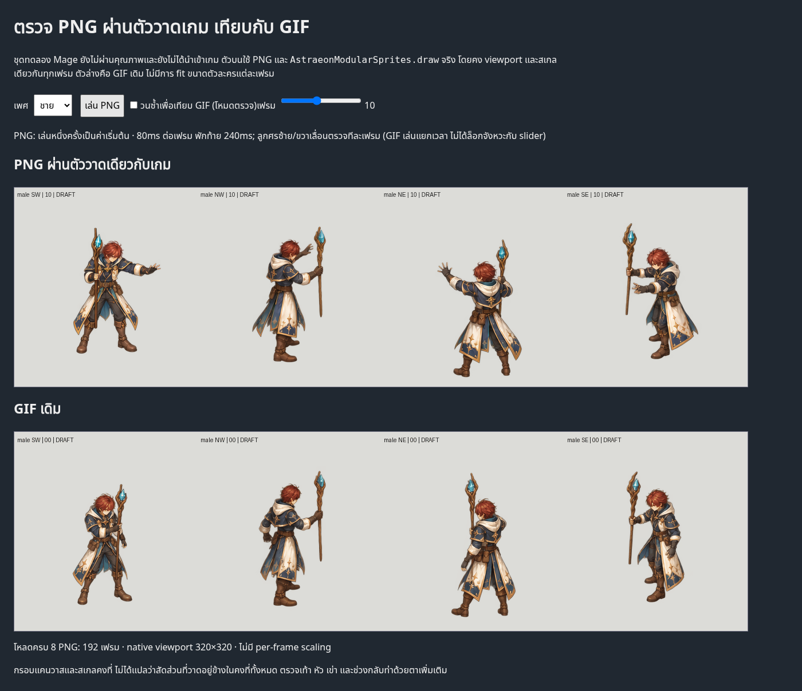

# PNG, GIF and game-compositor geometry — 27 October 2026

## Findings

**The Mage drift is present in the source PNGs. It is not solely a GIF artifact.**
Playing these exact uncorrected paintings through the game compositor preserves
that drift. These Mage drafts are **not installed as playable game characters**;
this check does not claim to reproduce a current live Mage gameplay scene.

1. **Source art / high priority:** the prior two-sole audit detected nonrigid
   foot drift in male SW, male NE and female NE. Four side/overlapping views
   require reviewed boot landmarks. Female SW passes that narrow foot test only.
   Whole-frame translation cannot fix a changing distance between boots or
   changing drawn proportions. No painted animation is newly approved.
2. **Review playback:** the existing GIF repeats a one-shot spell sequence with
   a 240ms terminal inspection hold. The restart can look like an extra pop.
   The new PNG inspector defaults to one-shot playback; repeat is explicitly
   optional. These are not final gameplay events/timings.
3. **Encoding:** all 192 decoded GIF frame/view crops best match their expected
   PNG at offset **[0,0]** in the ±1px translation check. No viewport clipping.
   Maximum average color error is below 0.49/255. This supports palette change,
   rather than an extra GIF geometry shift, for these files.
4. **Actual browser compositor:** Chromium rendered all 192 frame/view pairs
   using the repository's `AstraeonModularSprites.draw`, restoring the fixed
   canvas before filtering. Every browser output best matches the source at
   offset **[0,0]**; maximum average error is below 0.092/255. Zero page errors.
   This is an actual browser raster check, not just a mocked draw assertion.

## Character size: what is and is not established

- Complete Mage masters: **512×512** canvas, shared unscaled source placement.
- Review viewport: **320×320** for every frame/view, native scale **1**. The
  viewport does not clip any visible pixels. No frame is independently fitted.
- A constant canvas does **not** guarantee constant body proportions inside it.
  The foot findings above establish source-art inconsistency despite fixed
  destination dimensions.
- The bounds below are **all opaque art, including staff/arms/coat**, not
  anatomical crown-to-sole body height. Weapon motion and pose naturally affect
  these bounds; they must not drive per-frame auto-scaling.
- The future patch policy specifies a 240×240 runtime canvas with reference
  height 88. These new 512 masters have not been admitted to that policy. Their
  intended final in-game body height and consistency against the tall Swordsman
  remain unapproved. The existing compositor uses a shared reference height and
  root anchor; it does not normalize each frame's visible bounds.

| Mage view | Male opaque art height | Female opaque art height |
|---|---:|---:|
| SW | 197–220 px | 219–231 px |
| NW | 222–236 px | 225–239 px |
| NE | 217–251 px | 209–233 px |
| SE | 213–231 px | 216–244 px |

## Inspect without GIF

Open [the PNG/GIF inspector](index.html) through a local static server rooted at
this repository. Select sex, pause, use the frame slider or left/right arrows.
The top canvas uses the same `modular-sprites.js` draw function as the game.
The bottom GIF runs its own clock; it is not synchronized to the slider.

[Female screenshot](female-chromium-png-player.png).

## Evidence / reproduction

- [192 source/GIF comparisons](geometry-audit.json)
- [192 actual Chromium draw comparisons](browser-draw-evidence.json)
- [Frozen browser capture recipe](browser-capture-source.py), run from repo root
  with Python Playwright and `/usr/bin/chromium` installed.
- [309 factory tests](factory-tests-309.log), all passing, including four new GIF geometry regressions.
- [Real compositor regression checks](runtime-node-tests.log)
- Source placement / two-foot evidence remains in
  [the previous continuity report](../patch001-mage-continuity-audit-20261026/README.md).

`audit_gif_source_geometry.py --masters <whole-master-root> --previews
<fixed-preview-root> --output <fresh-directory>` reproduces PNG/GIF measurements
and native PNG strips. Chromium evidence is for source rendering at fixed scale,
not a full gameplay scene or completed class package. Coverage remains **2/96**
imported jobs, **zero newly complete characters**.
