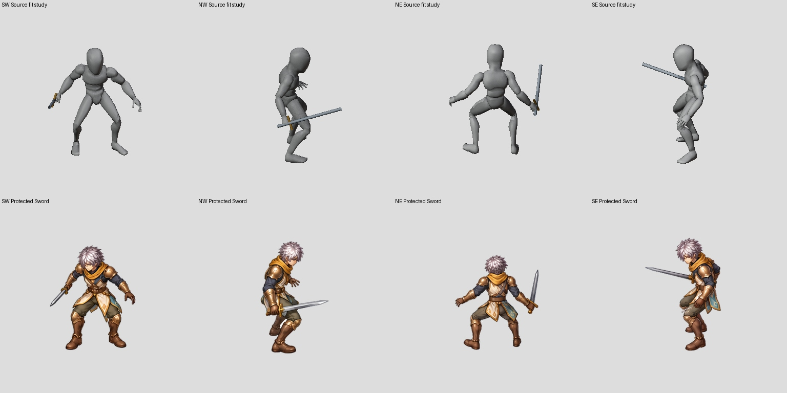
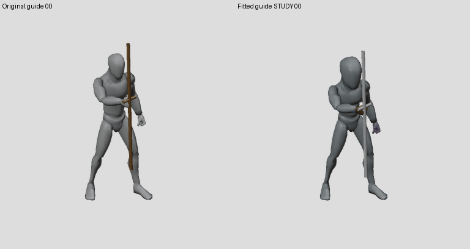
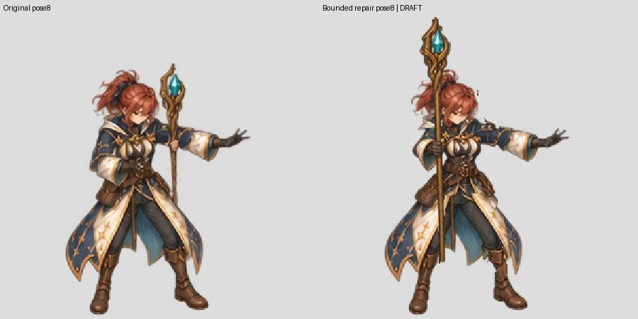

# Complete painting references and anatomical-fit study — 27 October 2026

The six-character goal remains ACTIVE. This is a source/reference checkpoint;
**2/96 technical imports,0/6 newly complete characters**. No new painting or
guide proportion profile is admitted to the game here.

## A concrete reference-preparation error fixed

The recent experimental Mage reference crop `[250,250,550,550]` cut visible
guide pixels in **24/24 poses**, including the feet. The underlying original
guide PNGs are intact. This defect concerns the recent cropped reference trial;
it does not explain away the older Mage master-PNG anatomy/continuity defects.

`prepare_clear_guide_batches.py` now checks the union of every captured pose/view
before making any reference output. It rejects clipped/edge-touching bodies or
weapons, empty poses, inconsistent source canvases and invalid viewports. It
pins each input PNG hash and records the actual minimum foreground margin.
Existing outputs cannot silently receive mixed reference data.

The new study crop `[224,224,576,576]` has at least15 authoring pixels of margin
around all24 full bodies and props. Actual execution of the old clipped crop
now fails before creating an output directory. Six regression tests cover this
gate; the complete factory suite passes **346 tests**, including its actual
Blender contact/freeze checks.

## Proportion study, not a production replacement

Projection overlays against the protected tall Swordsman establish that the
approved images are an aesthetic authority, not exact per-joint ground truth
for the raw human guide. Do not change the original artwork or automatically
retarget the source to each painted deviation.

An isolated guide-only fit tests a0.75 torso-chain length and1.3 head scale.
The original leg lengths, root/pelvis and lower-body matrices remain protected.
The same source actions, frame samples and fixed camera are used. The1.6 head
trial was too large and is retained as an earlier comparison, not selected.

Actual Blender captures include four Sword cameras at the initial source pose
and24 Mage poses, plus1536px and colored-hand references. The fitted Mage
capture preserves root/pelvis/foot positions within floating-point precision;
maximum protected lower-body matrix component error is below2e-6. This is an
authored proportion adaptation, not unchanged mocap. Source files are intact.
The profile remains a proposal until motion, body fit and paint review pass.




[Slow guide comparison](guide-fit-slow.gif), [fit measurements](fit-study-proof.json).

## Painting work continues

A bounded female Mage pose8 repair moves the staff toward the actual right-hand
grip while preserving its own original head and lower-body pixels, outside
intentional weapon occlusion. Native cloth seams/remaining source-pose offsets
still require review; pixel protection is not an anatomical acceptance test.



A later full-strip trial with complete fitted references still inherited a
crossed holding-arm pose from its full-body appearance seed. The next key-pose
trial separates identity/material crops from actual motion guides and tests
bounded corrections of the existing masters. No failed trial is imported.

## Reproduction

```bash
python -m unittest discover -s tests/character_factory_v3
python tools/character_factory_v3/prepare_clear_guide_batches.py --guide authoring/characters/factory-v3/patch-0.0.1/research/tall-guide-proportion-pilot-20261027/mage130-capture --output /tmp/mage-complete-reference --cell 768 --viewport 224 224 576 576
```

The isolated Blender jobs, source-code snapshots, actual captures and profile
proofs are under `authoring/characters/factory-v3/patch-0.0.1/research/tall-guide-proportion-pilot-20261027/`.
Use the pinned producer versions beside each capture to reproduce historical
studies. Production source-guide IDs/configuration and all896 original
Swordsman baseline files remain untouched by these studies.
