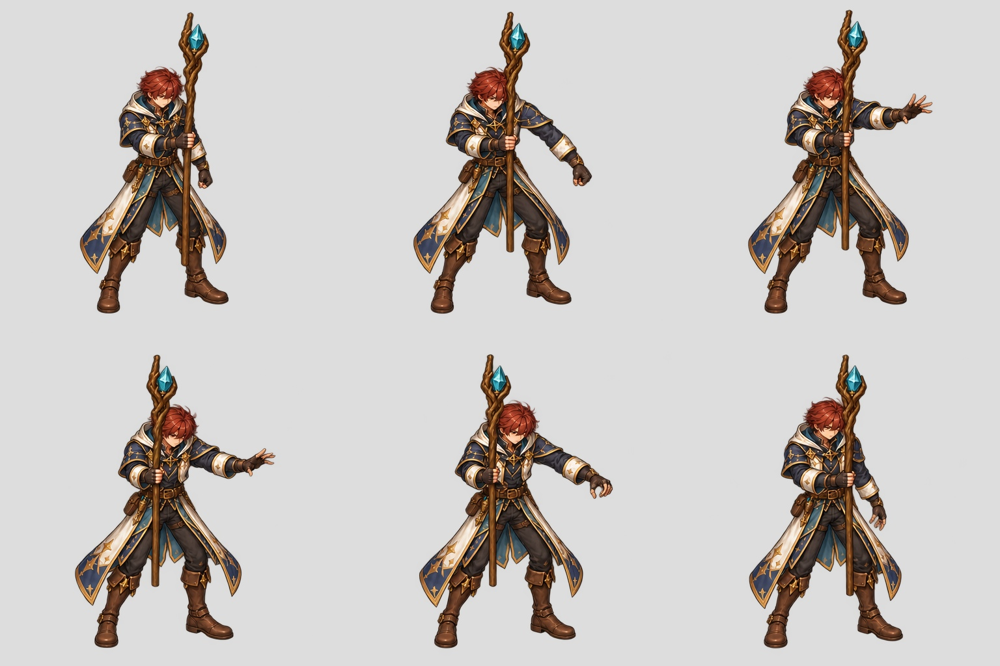
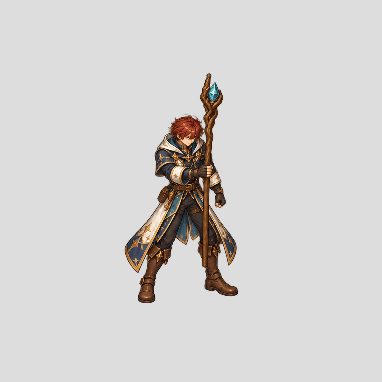
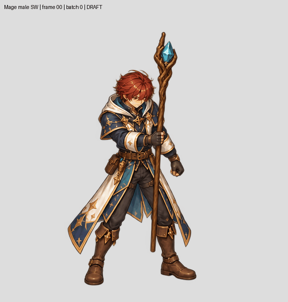
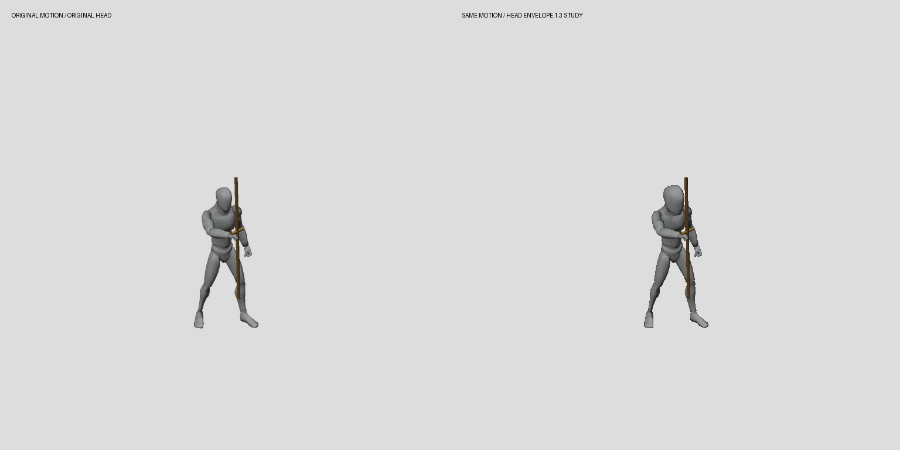

# Resumed six-character production

Owner explicitly resumed the goal. It is active, not complete. Failed image
attempts and provisional raster contact metrics are not a reason to stop all
work. No acceptance threshold has been relaxed.

## Actual painted work

New six-keypose Mage SW study uses the detailed pose0 repaint as identity seed,
with actual guide samples0,4,8,12,18,23. Full coherent bodies are extracted
without figure fitting or separate limb assembly. Art/pose/temporal review
remains open; no new runtime admission.

## Complete action inventory

[inventory.csv](inventory.csv) / [inventory.json](inventory.json):114 logical
actions across six characters,96 unique paint jobs,2 imported coverage receipts.
Source PNG presence is counted independently from art or gameplay approval.
Every logical action resolves exactly one matching paint job and source job;
Mage24-frame and16-frame sequences stay separate. No job is marked complete
from an import alone. Three new inventory regression tests pass.

The new contact observations are raster diagnostics only. They cannot establish
that the same anatomical foot contact was measured, or approve full body size.
Continue master/source comparison, coherent correction and full sequence review
before semantic cutting and production expansion.

## Full24 pilot and source-time playback

All24 actual Mage SW samples are now painted in four six-frame batches,
extracted at unchanged grid origins on common768 canvases. No per-frame or
per-batch figure scale fitting is applied. Complete-component extraction uses
minimum figure area10000 for these high-resolution figures; receipts retain
fragment assignments and clipping diagnostics.

[Slow review](full24-slow.gif) / [batch-boundary contact](full24-batch-boundary-contact.jpg).

Native source ranges total40 frames at24fps, approximately1.667s. Preview uses
actual cumulative segment timing rounded to GIF10ms ticks, plus a200ms terminal
inspection hold. This is a repeated one-shot inspection, not approved gameplay
events or a seamless loop. Batch-to-batch figure size and costume continuity
still need correction. No new runtime imports or art acceptance.

## Isolated guide-proportion study

A head-envelope mesh derivative is available for design-fit comparison. It
changes283 of7391 vertex positions; animation/skeleton JSON and all non-geometry
BIN bytes are unchanged.348 foot vertices remain exact. Actual Blender capture
retains projected skeleton landmarks within0.000071px and world landmark
positions within the recorded tolerance. This is an isolated guide study, not
a new production mannequin or finished character model.

The approved tall Swordsman remains the design authority. This study explores
how proxy proportions affect painting; it does not establish the final six-fit
size standard or override source/art acceptance.
