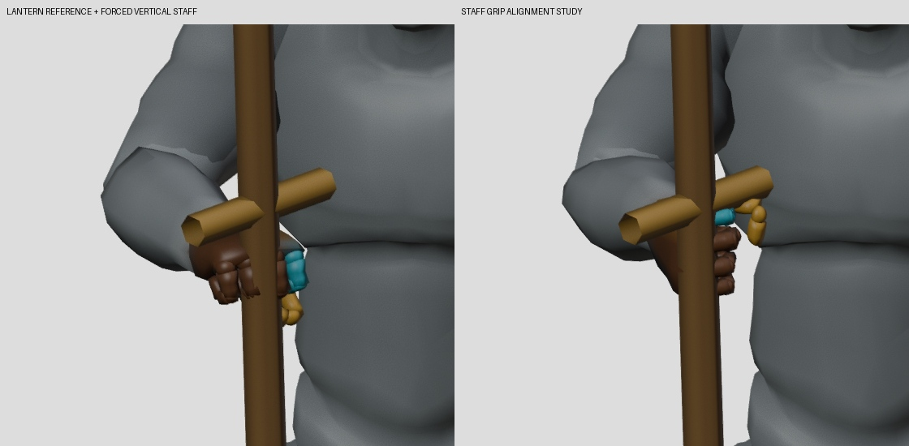
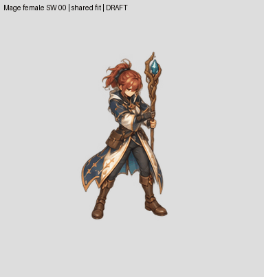
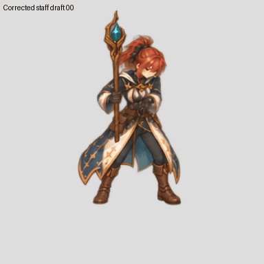

# Mage staff grip and continued painting — 27 October 2026

Goal remains ACTIVE. Technical imports remain **2/96**, complete new
characters **0/6**. No new artwork is admitted by this checkpoint.

## Actual source defect corrected

The lantern reference kept the right wrist at a plausible position but left
the index-to-pinky knuckle axis almost perpendicular to the forced upright
staff. A bounded reference adaptation rolls the forearm 86.82 degrees and
flexes the wrist 18.61 degrees before capturing the prop reference. The seven
body anchors stay unchanged within floating-point precision; the staff now
follows the real gripping-finger axis. This is an authored grip adaptation,
not unchanged mocap. The source GLB and canonical renderer remain unchanged.



The production BasicAttack/SkillAction guide captured all 24 poses in four
views. The proof checks actual staff-axis and grip-axis distance on all96
renders. Actual Blender4.3 replay also matches 24 evaluated poses /66 bones;
both world positions and joint rotations are verified. See [measurements](guide-proof.json).

The factory pins the adapter and math hashes, rejects missing/stale grip
evidence, and regenerates Mage source families without changing the
Swordsman/Archer geometry identities. Historical Mage captures are retained.

## Paint review remains open

The earlier female SW whole-master sequence has a narrow relative raster-sole
residual of0.691 runtime pixels after one shared baseline fit. That measurement
does not certify anatomy: its casting staff was held on the wrong side.

The new whole24-pose correction places the staff in the correct hand/side, but
still changes the head/body proportions and staff inclination in some poses.
Its two-raster-sole diagnostic reaches4.719 runtime pixels. It is a retained
correction candidate, not a replacement for the stable lower body. Further
bounded corrections must protect each frame's own already-good pixels and
undergo seam/anatomy review. No frozen-leg substitution is approved.





## Reproduction and verification

```bash
python tools/character_factory_v3/patch001_factory.py plan
python tools/character_factory_v3/patch001_factory.py guides --class Mage --actions BasicAttack,SkillAction --workers 1
/usr/bin/blender --disable-autoexec -b -t 2 --python-exit-code 1 --python tools/character_factory_v3/export_evaluated_guide_skeleton.py -- --source-guide authoring/characters/factory-v3/patch-0.0.1/guides/fcfd5fa441325973a7db --direction SW --output /tmp/mage-grip-replay.json
python -m unittest discover -s tests/character_factory_v3
```

339 tests passed, including actual Blender contact/freeze checks. These tests
do not establish painted-art or gameplay acceptance. The refreshed inventory
lists114 logical actions /96 unique paint jobs; PNG presence is separate from
art, cutout, swap and gameplay approval.
