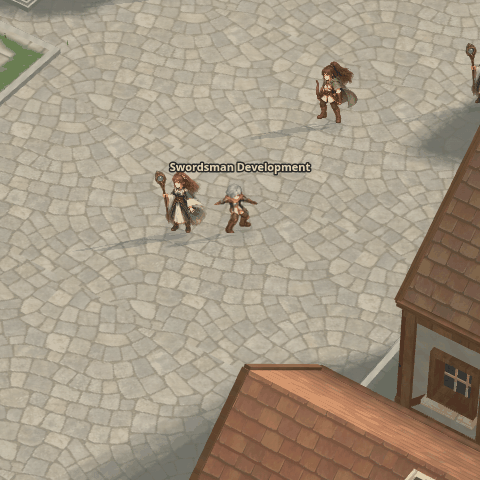

# Development Swordsman BasicAttack: game capture limit

This GIF was captured from the actual Wayfarer Capital game canvases with the explicitly selected `v3-painted-v2` candidate. It plays once, because BasicAttack is a one-shot. The script records each observed new animation row/column and its game timestamp while the action plays.

Only **3 columns (1, 2, 3)** were observed in this software-rendered browser run, with large elapsed intervals. A rerun after fixing the observer to wait until the gameplay state actually leaves attack still observed only those three columns, ending in Idle. The capture misses the rest of the attack and cannot establish its smoothness, trail timing, complete swing or recovery; the evidence does not by itself establish why columns were missed. This GIF is diagnostic evidence of the capture limitation, not an acceptable final animation. The repeated source frame screenshot in [the earlier real-game check](../patch001-swordsman-development-gameplay-20261028/README.md) provides a separate still. Full game recording at adequate rendering speed and complete art remain open.

The frame numbers and GIF delays are in [capture.json](capture.json). To reproduce, serve the repository locally and run `python docs/character-factory/review/patch001-swordsman-game-attack-gif-20261028/capture.py --output /tmp/astraeon-game-attack`; use `/usr/bin/chromium` and Playwright. Game time is sampled at requestAnimationFrame; the GIF's 10 ms quantization and held final frame are documented in the receipt. The capture crops the game canvases to a fixed 480×480 area; it does not reposition the character. No runtime art changed. Patch coverage remains **0/6 newly complete characters and 2/96 technical imports**.
