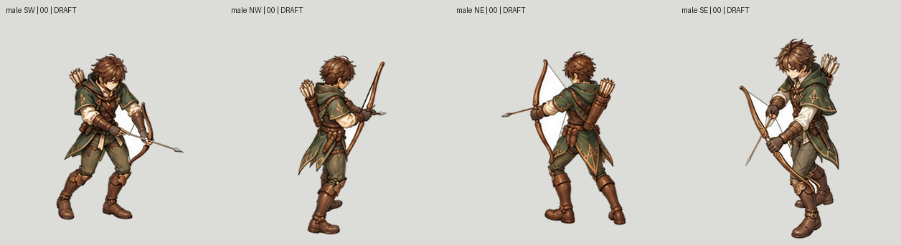
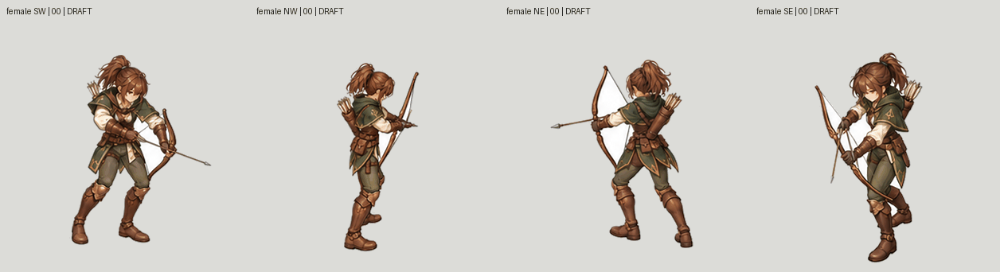
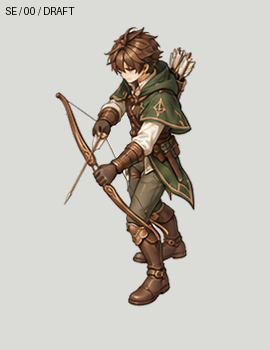
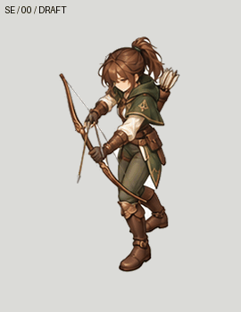
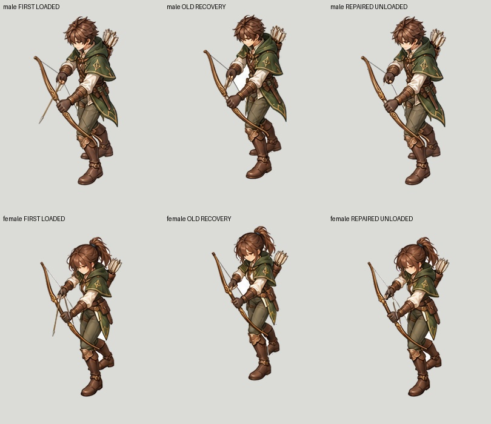

# Tall guide library and coherent Archer checkpoint — 26 October 2026

**Work remains active. Runtime coverage is 2/96 imported jobs; zero newly complete
characters.** This checkpoint is not patch 0.0.1 acceptance.

## What changed

The earlier tall Swordsman remains the visual authority. All 896 pinned original
files still match. Archer painting uses one coherent complete clothed body per
frame and camera. BodyCostume contains every arm, hand and leg together;
HeadHair and Weapon are cut from that same painted frame. Independently
generated limb assembly is not used by this candidate.

- A reusable original Mesh2Motion human guide kit now contains 66 bones, 48
  sampled actions / 796 poses, eight real cameras and nine verified sockets in
  both editable Blender and GLB formats. This is a guide mannequin, not six
  finished character meshes. Timing remains uniform authoring sample playback.
- Motion selection records 57 class/action choices, shared across both sexes.
  Mesh2Motion is preferred. Normal bow Draw/Release is basic attack; upward bow
  clips are reserved for ArrowRain. Heavy and spinning sword attacks remain
  skills. Six native KayKit bow clips have separate comparison GIFs.
- Eight complete Archer paint sheets cover male/female × four diagonal views ×
  sixteen source poses. Extraction uses a common viewport and no per-figure
  fitting. These sheets are still drafts, not evidence of exact joint tracing.
- SE male/female studies now register all three layers with one observed pelvis
  translation. Pelvis observations are manual estimates under clothing, not
  independent anatomical ground truth. No limb deformation or separate layer
  fitting occurs. Other views are not yet registered.
- SE recovery reuses the first painted body only after comparing **all 66
  source bone matrices** between poses 0 and 15: maximum error
  `5.960464477539062e-7`. The arrow is removed using bounded local corrective
  paint: 529 male / 425 female changed pixels, zero changes outside the repair
  mask relative to the reused first pose. A separate explicitly seeded white
  air gap is removed from both male endpoints. Head and lower-body pixels now
  match exactly between the repaired endpoints. Intermediate joins remain open.
- Native transparent 3072×3072 sheets are included for Master, BodyCostume,
  HeadHair and Weapon, with sixteen 768×768 cells each. All 128 cells match the
  corresponding registered frame pixels; all 32 recompositions match exactly.

## Continuous GIFs

### Four-view draft comparison

These preserve the current paint before registration; placement drift is visible.

### SE recovery repair

Repeated one-shot review at 80ms per sample, plus a 240ms terminal inspection
hold. This is not a certified seamless animation or final gameplay timing.

Slow versions: [male](male-SE-recovery-slow.gif),
[female](female-SE-recovery-slow.gif).

## Reusable files and reproduction

- [Original tall guide rig kit](../../../../authoring/characters/factory-v3/patch-0.0.1/rig-kits/original-tall-guide-library-v2-20261026/README.md)
- [Motion choices](../../../../authoring/characters/factory-v3/patch-0.0.1/research/motion-selection-20261026.json)
- [Whole-sheet source and generation requests](../../../../authoring/characters/factory-v3/patch-0.0.1/painted-candidates/archer-tall-source-reset-20261026/README.md)
- [Repaired male part sheets](../../../../authoring/characters/factory-v3/patch-0.0.1/review/archer-same-pose-recovery-v3-20261026/male-SE/Sheets/)
- [Repaired female part sheets](../../../../authoring/characters/factory-v3/patch-0.0.1/review/archer-same-pose-recovery-v3-20261026/female-SE/Sheets/)
- [Pixel and preservation checks](pixel-proof.json)

Extraction, placement and recovery tools retain input hashes, exact annotations
and frozen implementation copies beside their output receipts. Use fresh output
directories when replaying; previous candidates are not overwritten.

## Still failing / next work

The SE release pose needs a tighter foreshortened bow-arm paintover against its
actual guide. Other intermediate frames still have body/foot/size drift. The
three other views need registration and same-frame cutouts. Hair/hood/quiver
boundaries, white fringes, glove/weapon occlusion and hidden surfaces need visual
cleanup before swaps can be approved. The local no-arrow correction is confined
to its mask; its entire generated body is never substituted into the sequence.

Complete hairstyle/costume swap demonstrations, all other actions for all six
characters, production timing/events and actual game admission remain unfinished.
Exact pixel reconstruction and source matrix equality do not certify those gates.
