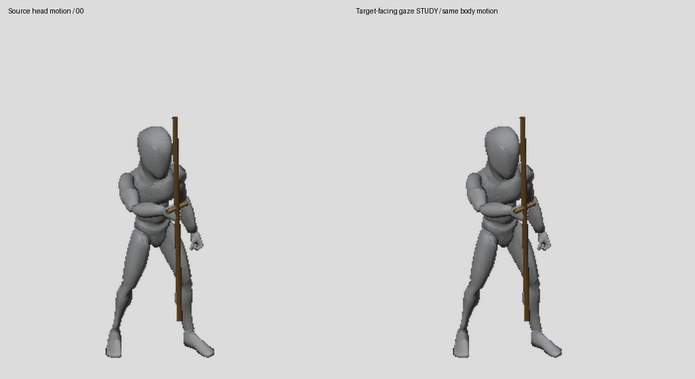
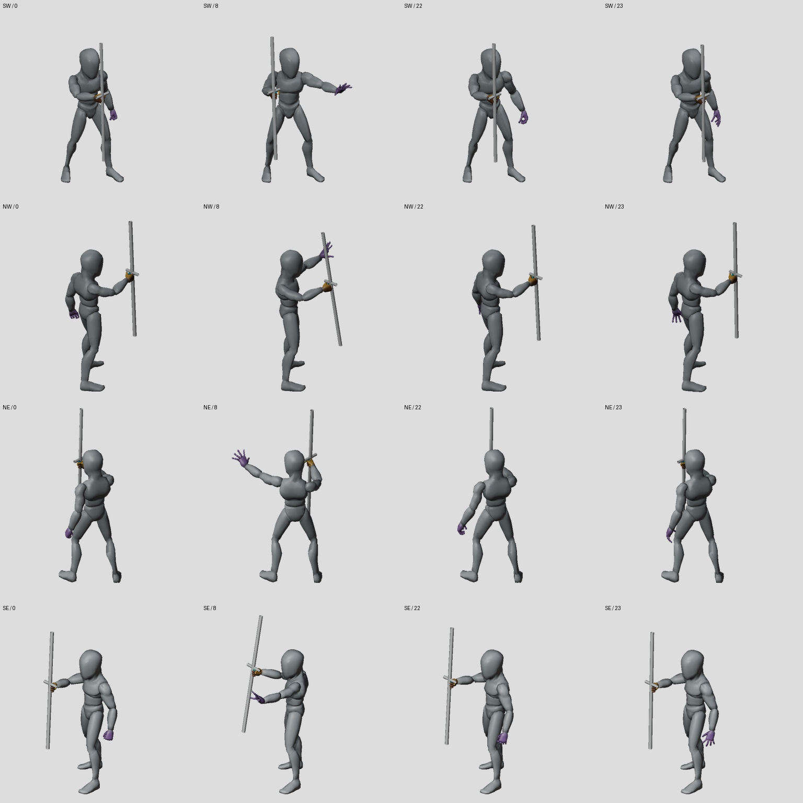
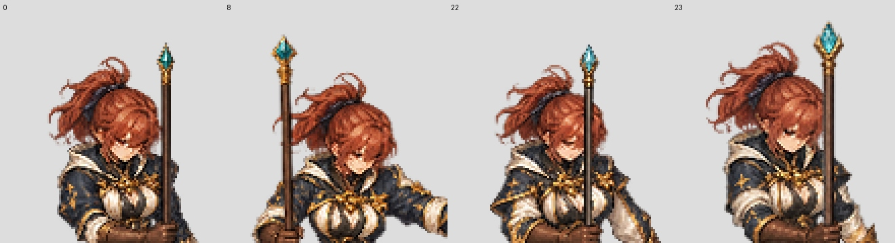
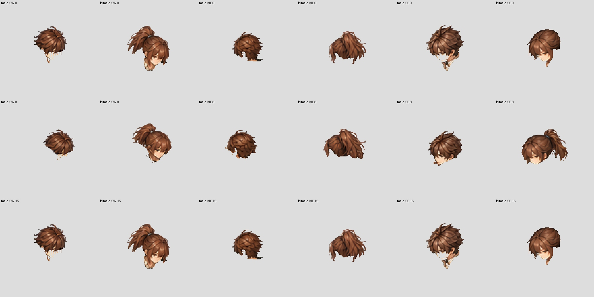

# Mage source gaze and Archer ownership checkpoint — 27 October 2026

Goal remains **ACTIVE**: Swordsman, Mage and Archer, male and female, all patch
actions, usable modular sprites and variants. Coverage remains **2/96 technical
imports, 0/6 newly complete characters**. These studies add no finished character.

## Actual cast gaze and a measurable head pose family

The isolated Mage cast study retains the initial head orientation as the torso
performs the source cast. Maximum head counter rotation is **36.75°**. This is an
authored motion adaptation; the original Mesh2Motion GLB is intact.

- Captured **24 poses × 4 real cameras = 96 pose/views**, at1536px.
- All **64 other body bones** retain their world matrices exactly during the
  gaze operation. Head position error is at most **2.39e-7m**.
- Actual render freeze checks cover all66 bones in every rendered image;
  maximum world matrix component error is **7.16e-7**.
- All96 actual rendered staff checks retain the existing knuckle/grip contract.
- Camera, body fit, source samples and foot motion remain fixed.

The resulting head orientation families record a real camera, fixed orientation,
character fit and per-frame projected head anchor. They make a reusable painted
head possible. Approved head extraction, neck underpainting, occlusion and seam
review are still required before that reuse can enter production. The study is
**not adopted into production configuration** in this checkpoint.



[Slow source GIF](gaze-source-slow.gif) · [measurements](measurements.json).
The GIF restarts for review and holds the last frame200ms; the source action is
one-shot. It does not establish runtime transitions or gameplay event timing.



Reference preflight also caught a one-source-pixel SE sole crop in the original
SW-only viewport. All96 references now fit a shared704px-square viewport
`[448,480,1152,1184]`, with at least20 source pixels of margin. The shared crop
origin changes; the source camera and pixels per meter do not.

## Coherent single-frame painting studies

Strip trials retained some wrong holding poses despite complete guides, so the
current correction study paints individual actual frames with appearance-only
material crops. Four existing key studies use **one shared scale0.9393939** and
translation, followed by whole-frame integer registration. No limb or body is
resized separately.

The three non-calibration keys have maximum two-visible-sole raster residuals
of1.12,1.42 and2.50 authoring pixels. This is a narrow registration diagnostic.
**Head size, garment details and source-pose continuity still require repair.**
These older keys precede the new gaze profile; matching body reuse requires the
head slot to be updated and the complete master reviewed. They are not accepted
animation frames or runtime imports.



## Archer semantic ownership

Reviewed18 key head masks across SW,NE,SE and both sexes. Bounded annotations
return **566 forearm/hood/equipment pixels** to the rest of each same-frame
master. All18 visible recompositions are exact and masters remain unchanged.
The head proposals had confused bright hair with facial skin and had included
nearby bracers/quiver fragments. Prompts now use actual image points and the
reviewed exclusions rather than misplaced guide-hand negatives.



This is18 key ownership reviews, not completion of all96 remaining-view frames.
`BodyRest` in this study still contains the weapon; it is deliberately not
represented as a complete BodyCostume/Weapon runtime package.

## Verification and continuation

**347 factory tests passed**, including a new actual Blender cast regression
that exercises head counter rotation, protected body joints, actual render
freeze and staff grip. [Full test log](factory-tests-347.log).

All896 protected original Swordsman files were rehashed and are unchanged.

Next: finish the24-frame coherent Mage pilot, author reusable pose-compatible
HeadHair and a complete neck/collar boundary, verify weapon ownership/grip, and
inspect the full sequence before runtime intake. Expand Archer ownership from
the reviewed keys to the complete timelines, then continue the six-character
production rounds in the goal document.

```bash
python -m unittest discover -s tests/character_factory_v3
blender -b --factory-startup --python tools/character_factory_v3/render_target_gaze_guide_study.py -- --job authoring/characters/factory-v3/patch-0.0.1/research/target-facing-mage-gaze-20261027/four-view-job.json --output /tmp/mage-target-gaze-reproduction
```

Pinned jobs, producer snapshots, full captures and head pose-family measurements
are retained under `research/target-facing-mage-gaze-20261027/`. Single-frame
inputs, prompts, source hashes and the shared normalization recipe are retained
under `painted-candidates/mage-female-single-frame-trace-20261027/`.
The image tool does not expose its model version or seed. Raw outputs and exact
input hashes are retained for downstream reproduction; bitwise regeneration of
the painting request is not claimed.
