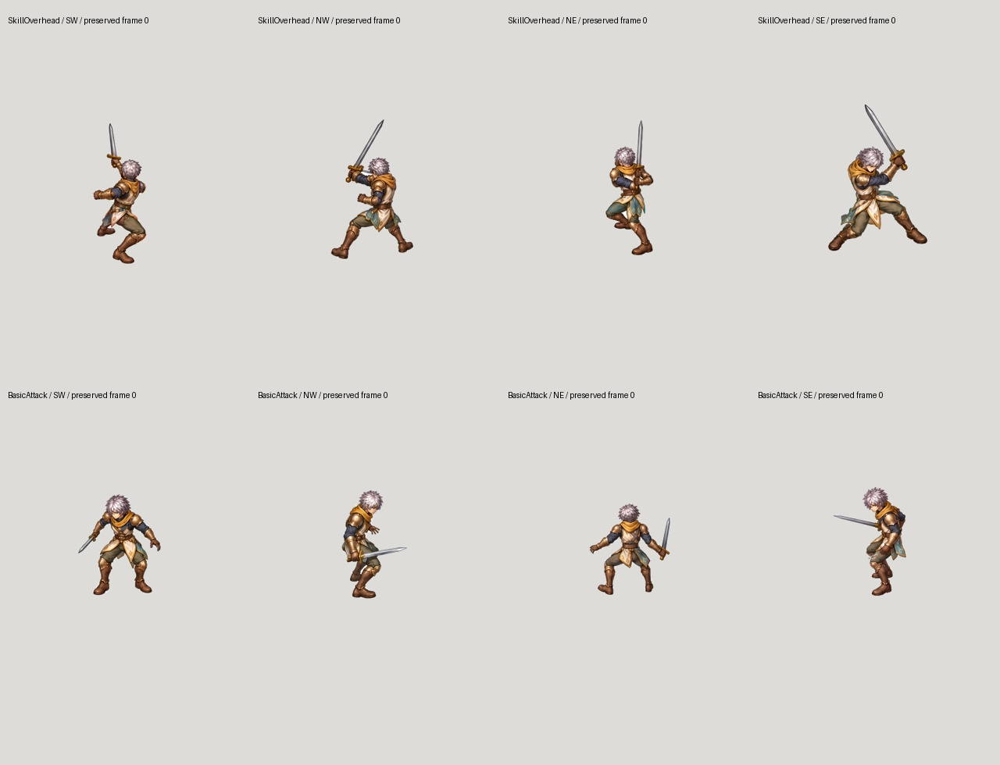

# Restore the earlier tall Swordsman baseline

The owner explicitly reaffirmed the earlier taller four-direction Swordsman on
26 October. Its proportions and painted quality are the visual baseline for
the other classes. Recent compact Archer studies do not supersede it.

## What the old factory actually did

1. Capture real SW/NW/NE/SE cameras on the original Mesh2Motion rig, without
   retargeting. BasicAttack uses `Sword_Attack`; the retained skill uses
   `Sword_Regular_B` and recovery. Mesh2Motion remains preferred.
2. Paint complete coherent character poses. The retained per-view prompt asks
   for sixteen poses in one sheet, with the guide defining pose/camera and the
   identity seed defining proportions and materials. It does not generate limbs.
3. Extract frames at a common pixel scale. Annotate pelvis, head and weapon.
   Translate the whole pose and every part together onto the source anchor.
   No independent part scaling or body deformation.
4. Cut **BodyCostume / HeadHair / Weapon from that same frame's master pixels**.
   BodyCostume includes the complete arms, hands, torso, hips and legs.
5. Preserve same-frame hand overlap and separate front/back sword trails.
   Export part sheets and verify exact reconstruction in the compositor.

Read `build_simple_attack_factory.py`, `build_four_direction_attack_review.py`,
`register_layered_action.py` and `layered_action_catalog.json`. The retained
`basic-attack-simple/{direction}/generation-provenance.json` files contain the
actual prompts. Historical whole-sheet generation does not prove exact anatomy
matching: retain the owner's newer exact-guide paintover and stability checks.

## Read-only evidence

`baseline-proof.json` pins 896 original master/part/effect files and records
128 exact BodyCostume + HeadHair + Weapon recompositions. No original pixels,
timing, rig, cutouts or sword trails were edited. Proportion measurements are
visible silhouette measurements at each camera, not anatomical head counts.

The latest separate headless-body proposal has a collar gap and costume drift;
it is not a production source. The rig-bound bow V2 tilts incorrectly at rest
and also fails visual review. Resume from coherent whole-frame masters using
the earlier tall design, then cut the same-frame parts. Do not promote those
studies or the rejected Archer sheet simply because numerical checks pass.

**Coverage remains 2/96 imported jobs; no newly completed playable character.**
This restores the implementation reference, not completion of patch 0.0.1.
