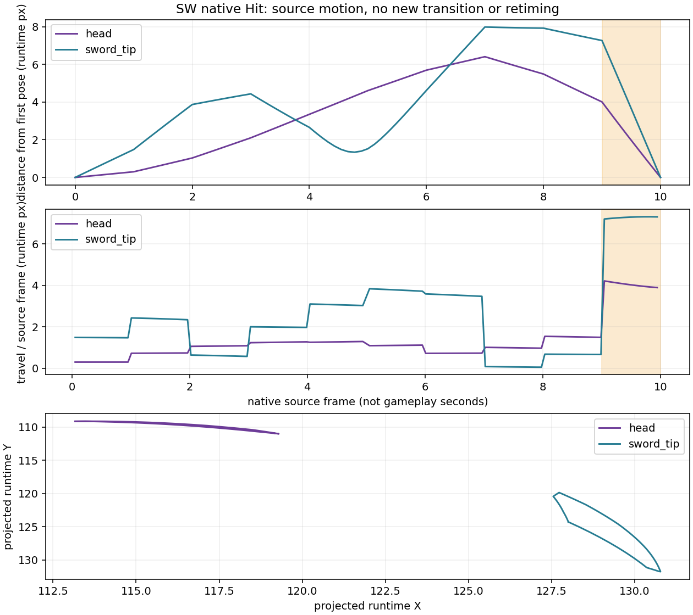
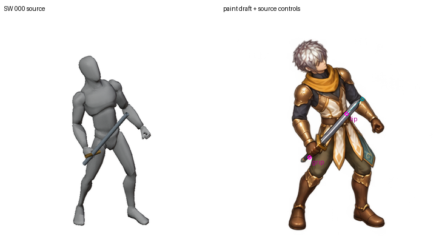

# Native Hit recovery and coherent paint attempt, 2 November 2026

The repaired guide is now checked through the native source's complete recovery,
and a new whole-sheet painting attempt is retained as rejected production art.
Neither result completes an action or character.

## What the source actually does

A headless Blender 4.3.2 audit evaluates 97 distinct native samples: the previous
12 recorded sample times, seven intermediate samples between each pair, and the
remaining exact integer source-key times. All 12 recorded world-landmark sets
match exactly in all eight views. All 66 bone world matrices at source frame 10
match source frame 0 exactly. The source GLB and fingerprint of all action keys,
handles, interpolation and mute flags remain unchanged.

The original action range is **0–10**. Earlier sheet descriptions use slot indices
000–011; slot 011 samples source frame 10, not source frame 11. The tail is a
native interpolated return to the first pose, rather than an instantaneous
position discontinuity. LINEAR component curves still change velocity at keys;
adding samples alone does not remove that change. In SW, the head travels
1.519 runtime px over source 8→9 and4.007 over9→10; the sword tip travels0.675
then7.264. This measures projected source movement, not gameplay speed, visual
acceptance or sole contact. Foot bone origins are not certified sole points.



[Standalone SVG](native-recovery.svg) · [all-view interval values and proof](proof.json)
· [full native keys and97 evaluations](../../../../authoring/characters/factory-v3/patch-0.0.1/research/swordsman-hit-native-recovery-20261102/audit.json).
The native return, existing trim/Idle blend and prior floor-IK studies remain
subject to motion review; no source retiming or new transition was adopted.

## New whole-sheet paint: rejected for production

One image edit used the corrected source contact sheet and protected tall male
Swordsman identity together, requesting all12 poses in one4×3 sheet with real
3072×2304 detail, transparency and unchanged source placement. It returned an
RGBA1448×1086 sheet: **362×362 native pixels per slot**, below the768×768 authoring
requirement. No enlarged pixels are claimed as newly drawn detail. The service
exposes neither model/seed nor a native size/pose/mask parameter in this tool;
the requested size was textual and this response did not honor it. This single
result does not establish every possible provider output size.

The draft also misses visible source sword controls. Approximate painted tips
were marked manually on native slots000/007/011 at[235,131], [240,161] and
[236,131]. Their distances from the source tips are9.726,6.911 and9.925 runtime
px, with a3-native-pixel radial annotation uncertainty (0.829 runtime px). These
are endpoint diagnostics, **not the anatomical sole-contact acceptance test**.
Magenta circles mark source grip/tip; teal marks the approximate painted tip.
The same fixed source crop[448,520,1088,1160] is used throughout; there is no
per-frame bounding-box registration, limb warp, cleanup or geometry repair.



[Slot007](SW007-controls.png) · [slot011](SW011-controls.png)
· [normal one-shot](paint-normal-one-shot.gif) · [slow one-shot](paint-slow-one-shot.gif).
Every source slot is shown once.100/300 ms preview timing is diagnostic, with
no GIF loop extension; it is not actual gameplay timing. Full raw transparent
output, reference contact, exact prompt, generation receipt and source manifest
are retained in the [isolated candidate directory](../../../../authoring/characters/factory-v3/patch-0.0.1/painted-candidates/swordsman-hit-snapshot-wholesheet-20261102/).

## Reproduction and limits

```sh
blender --disable-autoexec -b -t 2 --python-exit-code 1 --python tools/character_factory_v3/audit_hit_native_recovery.py -- --manifest authoring/characters/factory-v3/patch-0.0.1/painted-candidates/swordsman-hit-snapshot-wholesheet-20261102/source-manifest.json --output /tmp/hit-native-audit-fresh.json
python tools/character_factory_v3/review_hit_native_recovery.py --audit authoring/characters/factory-v3/patch-0.0.1/research/swordsman-hit-native-recovery-20261102/audit.json --candidate authoring/characters/factory-v3/patch-0.0.1/painted-candidates/swordsman-hit-snapshot-wholesheet-20261102 --output /tmp/hit-native-review-fresh
```

All eight deterministic review artifacts reproduce byte-for-byte into a second
fresh directory. A second independent Blender process reproduces the complete
dense audit JSON byte-for-byte. Process logs and implementation hashes are
recorded; stochastic image generation is not guaranteed to reproduce.
The two new Python tools compile. No new unit tests were added for these
read-only diagnostics. The existing repaired production Hit capture still
validates as `CACHED_GUIDE`. All896 protected baseline hashes match. The GLB
importer emits duplicate-fcurve warnings for the unrelated Sword_Regular_C_RM
clip; those messages are retained in the Blender log, not hidden as a clean log.

No original master, factory plan, shared renderer, runtime asset or acceptance
flag changed. This single SW draft lacks native768 detail, exact geometry,
seven other directions, semantic cutouts, underpaint, variants and gameplay.
No sole-contact pass or actual gameplay test is claimed. Completion remains
**0/6 characters**, with historical2/96 technical imports unchanged and not
recertified here. User authorization remains in force; additional approval is
not the missing prerequisite.
