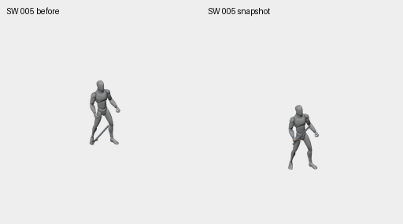

# Hit declared-pose render repair, 2 November 2026

Swordsman Hit now renders the pose used to place its weapon proxy and record its
landmarks. Blender previously reapplied the native rig object's animated
translation during render: six diagnostic bone origins moved by as much as
29.47003 runtime pixels from the declared pose. At the exact render boundary,
the new opt-in wrapper snapshots object/bone matrices, temporarily detaches the
active action, restores that snapshot, and checks all 66 evaluated bone world
matrices. All source action keys, handles, interpolation and mute flags have the
same fingerprint before and after. The original GLB, shared canonical renderer,
source samples and cameras remain unchanged.

All 12 samples × 8 views were captured both with observation only and with the
snapshot guard. Maximum world-matrix component error falls from 0.57587624 to
0.000000775; maximum projected diagnostic-joint displacement falls from
29.47002857 to 0.000015994 runtime pixels. Cameras, declared landmarks, weapon
endpoints and source samples match across the two captures. These are render
consistency measurements, **not anatomical sole contacts or art acceptance**.



[Native before](SW005-before-native.png) · [native corrected](SW005-snapshot-native.png)
· [eight views](eight-views-frame005.png) · [normal one-shot](eight-views-normal-one-shot.gif)
· [slow one-shot](eight-views-slow-one-shot.gif). GIFs show every source sample,
including the existing reset tail, with no loop extension. The diagnostic
100/300 ms frame durations do not establish final gameplay timing.

The verified guide `f21a6dab07976b27ec15` replaces `97bca857f2dea9909fa2` only for
Swordsman Hit. Two pending paint records were rebound; 47 unrelated guide
records and 94 unrelated paint records are unchanged. Old planning files and
art remain intact. Counts remain 114 logical instances / 48 guides / 96 paint
jobs. The real new capture validates and returns `CACHED_GUIDE`; observation-only
captures cannot pass its new receipt gate. See [adoption proof](adoption-proof.json)
and [capture comparison proof](proof.json).

33 selected tests pass, including stale hashes, missing/changed PNGs, nonfinite
matrices, incomplete coverage, unchanged key data, fresh render folders, scope
checks, failed-write rollback and idempotent adoption. The broader legacy
`test_factory_v3.py` ran 28 tests with 11 FileNotFoundError records from assets
excluded by this sparse checkout; it did not pass. Exact output is retained in
[selected-tests.txt](selected-tests.txt) and [legacy-factory-tests.txt](legacy-factory-tests.txt).
All 896 protected tall baseline hashes match. Seven pre-export review artifacts
reproduce byte-for-byte from the same captures.

## Reproduce

Run at repository root with Blender 4.3.2 and the recorded source GLB present.
Use fresh output directories; retained manifests contain all tool/source hashes.

```sh
blender --disable-autoexec -b -t 2 --python-exit-code 1 --python tools/character_factory_v3/render_hit_snapshot_guides.py -- --job docs/character-factory/review/swordsman-hit-render-snapshot-20261102/job.json --output /tmp/hit-observed-fresh --observe-only
blender --disable-autoexec -b -t 2 --python-exit-code 1 --python tools/character_factory_v3/render_hit_snapshot_guides.py -- --job docs/character-factory/review/swordsman-hit-render-snapshot-20261102/job.json --output /tmp/hit-guarded-fresh
python tools/character_factory_v3/review_hit_render_snapshot.py --observed /tmp/hit-observed-fresh --guarded /tmp/hit-guarded-fresh --output /tmp/hit-review-fresh
```

Full 1536px captures live in the ignored local guide cache and temporary
observation directory; manifests and selected native PNGs are retained here.
The wrapper is explicit and limited to unadapted native Hit_Chest; it is not
silently applied to staff/retargeted/transition studies. The adoption helper
requires a verified capture, preserves existing art and supports rollback for
handled write failures; concurrent planning writers and power loss are outside
that transaction guarantee.

The native reset tail, ready/idle transition, true sole contact, foot sliding,
weight, knee continuity, full grip and blade clearance still require review.
No painted master, cutout, variant or gameplay package was admitted. No actual
gameplay test was run. Completion remains **0/6 characters**, with the historical
2/96 technical imports unchanged and not recertified by this source repair.
