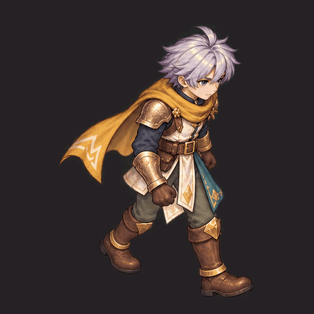
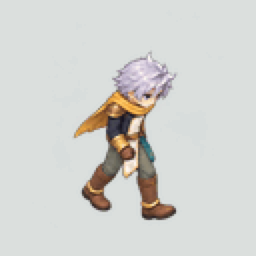

## Latest: frame continuity and reusable placement checks v14

[Frame-by-frame game comparisons, equal-speed before/after GIF and new tools](continuity-v14/README.md) preserve the user's accepted v13 leg identity while recording its rejected continuity. A geometry-first whole-eight candidate reduces measured surface-registration jumps. RO/King Lucas native frames, ToS occlusion evidence, source-bone trajectories, unknown-first templates, raw failures and corrected-observation receipts are retained. New anatomy/contact/spacing and complete painted parts remain unapproved; head stability is not production acceptance.

## Previous: W walking expanded to 8 frames v13

[Eight-frame preview and preserved approved keys](ro-walk-eight-v13/README.md) match the audited RO Swordman walk count. New slots1/3/5/7 retain approved pixels exactly; intermediates remain review candidates. Includes 600ms reference-cadence, 1333ms source-cadence and equal-speed four-key comparison.

## Latest: pelvis/depth checks and a user-confirmed W sheet v12

[W approval, E/W cutaways and independent image-structure checking](profile-depth-v12/README.md) distinguish the accepted W sheet from the later rejected third pose. Forty real source-depth passes and the user's contour rule strengthen proximal identity review; calf-only v11 match conclusions are withdrawn. The pixel comparator flags the rejected pose's structure, with explicit semantic limits. E and complete painted modular production remain unfinished.

## Latest: eight-facing walk and occluded-leg image review v11

[Actual 8-view GIF, source-owner comparison and improved tools](eight-direction-v11/README.md) add 32 painted frames, 96 real source-owner passes, image-bound rejection controls and independently marked pixel traces. Initial SE pose 2 and revised E pose 3 are user-confirmed rejected images; the E correction is separately rechecked. Four local crossing matches leave 32 unresolved regions, and NE remains rejected for an attachment-side change. All complete art/motion/modular painted-part/release gates remain blocked.

## Iteration 10: higher-detail art and anatomical leg inspection

[Detailed 512-square motion masters and review tool](quality-review-v10/README.md) follow the user's three newly supplied quality references. A reusable [source-bone anatomical checker](../../skills/modular-eight-direction-sprites/references/anatomical-continuity.md) compares connected legs and time-continuity against the actual baked rig, including the loop seam. The standalone HTML supports annotation, visibility/uncertainty, onion skin and export. Actual artwork still requires review; 37 regression tests and 20 browser checks establish bounded tooling behavior, not artistic correctness.

## Iteration 9: one original walk, modular source and painted playback

[Painted walk GIF and review](walk-test-v9/README.md) test eight sparse poses in our own fantasy anime style over a newly built original modular character. The saved 41-sample action, eight physical facings, complete SE parts and actual hair swapping are included. Real footwear floor penetration was found and repaired with fixed-length IK. Two imagegen whole-sheet attempts retain pose/shape drift; painted anatomy and production parts remain unapproved. A shared grid-row calibration corrects a sheet displacement without per-frame fitting. [Reproduction commands](../../skills/modular-eight-direction-sprites/studies/walk-test/README.md).

## Iteration 8: preset animations, skeleton transfer and contact gaps

[New study and comparison boards](preset-retarget-v8/README.md) sample eight CC0 presets at 339 real timestamps, preserve source/root transforms and expose endpoint failures on a fresh proportion skeleton. [Reusable preset/retarget guide](../../skills/modular-eight-direction-sprites/references/preset-retargeting-practice.md) draws on official Mixamo/Godot documentation, five selected papers, two patents and pinned Rokoko code. Other providers are allowed; KayKit is an additional audited candidate, not an executed transfer. No original animation or art approval is established.

## Iteration 6: commands, skeleton guides and frame studies

The [v0.6 executable review pipeline](../../skills/modular-eight-direction-sprites/scripts/README.md) now builds/checks/packages the original rig proof in isolated directories. [Actual fresh-build evidence and the review ZIP](pipeline-v6/README.md) include 64 anatomical guides and 32 browser checks. [External motion studies](motion-reference-v6/README.md) include 213 decoded samples from RO, King Lucas and Fyna. Art, locomotion, exact color and production-game integration remain unapproved or unimplemented; the release command explicitly blocks them.

# Sprite animation research — rig, sprites and Ragnarok

Working branch: `research/modular-sprites-full-body-2026-10-11`. Stay on this branch for subsequent iterations. It was created from the newest observed head, `character/production-factory-v2` at `e130b217da3ba9e56cce7d1e33bf29f20daedd7a`; obsolete main and rejected branch art are excluded from study.

## Historical original rig proof v4 — unapproved

**Technical prototype; art, acting and effect unapproved.** Complete separately authored body/head/hair/equipment geometry now produces eight-direction attack sprites with invariant anatomical right-hand weapons. Painted v3 is rejected and is retained only as failure evidence.

[Complete v4 review package](silver-scarf/rig-proof-v4/README.md) · [Four diagonal attack views](silver-scarf/rig-proof-v4/attack-four-diagonals.gif) · [Separate-part sources](silver-scarf/rig-proof-v4/separate-parts.png) · [Editable source](silver-scarf/rig-proof-v4/silver-scarf-modular-source.blend)

Seventeen part/effect passes, eight views, eight keys and 48 logical loadouts provide a bounded repeatable export exercise. Independent full-scene ownership/alpha checks pass; exact color comparison retains six differing pixels and remains failed. The current export passes 31 actual browser behavior checks, including the optional four-diagonal view policy; earlier 21-check evidence remains separately labeled as baseline. These are technical checks, not art approval.

## Reusable knowledge

- [Current SKILL.md v0.14](../../skills/modular-eight-direction-sprites/SKILL.md)
- [Walk spacing, registration and reproduction checks](../../skills/modular-eight-direction-sprites/references/walk-spacing-and-registration.md)
- [Deep sprite-rig production study](../../skills/modular-eight-direction-sprites/references/sprite-rig-production.md)
- [Pinned GitHub skill comparison](../../skills/modular-eight-direction-sprites/references/github-skill-study.md)
- [Ragnarok hard reference and eight-to-four action views](../../skills/modular-eight-direction-sprites/references/ragnarok-hard-reference.md)
- [Original rig exercise and reproduction commands](../../skills/modular-eight-direction-sprites/studies/rigged-parts/README.md)
- [Earlier full-body repair findings](../../skills/modular-eight-direction-sprites/references/full-body-attack-repair.md)
- [Rejected painted v3 and provenance](silver-scarf/attack-v3/README.md)

The target is reliable mass production. An approved final turnaround, sprite acting/effect quality, additional actions and rig families, and actual game integration remain unfinished. No claim of mastery, final art approval or original-client ACT/SPR binary compatibility is made.

The [RO action-direction audit](../../skills/modular-eight-direction-sprites/references/ragnarok-hard-reference.md#eight-selectable-directions-versus-four-drawings) directly checks eight selected Swordman action blocks: standing, walking **and sitting** have eight distinct views; many tested other actions reuse four diagonals. An anomalous head-region sample remains explicitly documented.

Iteration 5 adds an [original four-key art study](silver-scarf/art-study-v5/README.md), [primary artist/coherence research and proposed art direction](../../skills/modular-eight-direction-sprites/references/original-ro-art-direction.md), and a [tested mid-key trail-expiry repair](silver-scarf/rig-proof-v4/effect-exposure-check.json). The body retains eight poses; effect exposure no longer runs 90 ms late. The new image board is unapproved, flattened direction study, not a modular production seed.
