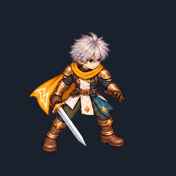
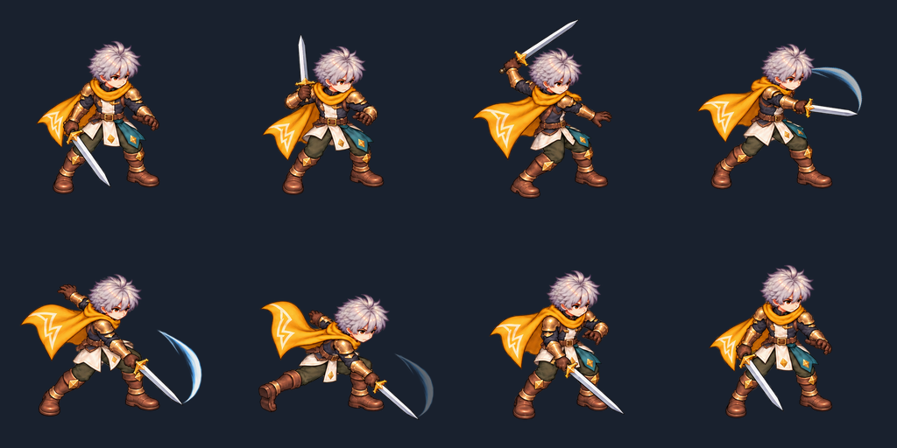

# Sprite animation research — review here

Working branch: `research/modular-sprites-full-body-2026-10-11`. The user designated this as the only working branch for this research and future sprite iterations.

This branch starts from `character/production-factory-v2` at `e130b217da3ba9e56cce7d1e33bf29f20daedd7a`, the newest branch head observed when creating it. Existing character art is excluded from the study. The work below is isolated from the game runtime.

## Current attack candidate

The previous 24-pose attack was rejected for shaking; the six-pose remake was rejected for a stationary lower body. V3 adds knee compression, hip travel, torso coil/rotation, counter-arm movement, rear-leg extension and recovery. It has eight timed entries over 800 ms, seven distinct body drawings, and a separate sword trail. Its approximately ten-entry/second average cadence is an authored choice, not a universal Ragnarok rate.



[Normal GIF](silver-scarf/attack-v3/attack-full-body.gif) · [Quarter-speed GIF](silver-scarf/attack-v3/attack-full-body-slow.gif) · [Body without trail](silver-scarf/attack-v3/attack-body-only.gif) · [Download package](packages/silver-scarf-full-body-attack.zip)



[Download the standalone HTML preview](silver-scarf/attack-v3/standalone-preview.html) using GitHub's download control, then open it in a browser. It embeds the GIFs and pose sheet and has no SVG or JavaScript dependency. GitHub does not run the interactive HTML preview in a file view.

## Research and reproducible evidence

- [Reusable SKILL.md](../../skills/modular-eight-direction-sprites/SKILL.md)
- [Fresh full-body research, source links and rejection lessons](../../skills/modular-eight-direction-sprites/references/full-body-attack-repair.md)
- [Original eight-view blocking study](../../skills/modular-eight-direction-sprites/studies/full-body-attack/README.md)
- [Original interactive modular motion lab](../../skills/modular-eight-direction-sprites/studies/motion-lab/README.md)
- [Candidate details and provenance](silver-scarf/attack-v3/README.md)
- [Timing and registration manifest](silver-scarf/attack-v3/attack-manifest.json)
- [Actual Chromium preview report](silver-scarf/attack-v3/browser-report.json)

GIF durations, decoded loop endpoints and figure bounds passed. Chromium normal one-shot, quarter-speed looping, interruption and trail-toggle checks passed. Contact sheet, body-only strike and browser captures were visually inspected. The original rig's numerical contacts and bone lengths are separate evidence; they do not prove the painted art matches every contact target or has no jitter.

## Remaining work

This is a one-facing candidate awaiting visual assessment. The head, clothes and sword remain flattened together; only the trail is a separate layer. Other painted directions, interchangeable equipment coverage, fine-detail coherence and actual game integration remain unfinished. Existing branch assets are not approved references, and no third-party study artwork is redistributed in this package.

To inspect the interactive candidate locally from the repository root:

```sh
python -m http.server 8770 --directory research/sprite-animation/silver-scarf
```

Open `http://localhost:8770/attack-v3/preview.html`. The candidate includes its original generated source PNGs, aligned body/trail frames, strips, APNG, assembly code and preview controls. Browser evidence applies to this isolated preview, not in-game combat.
