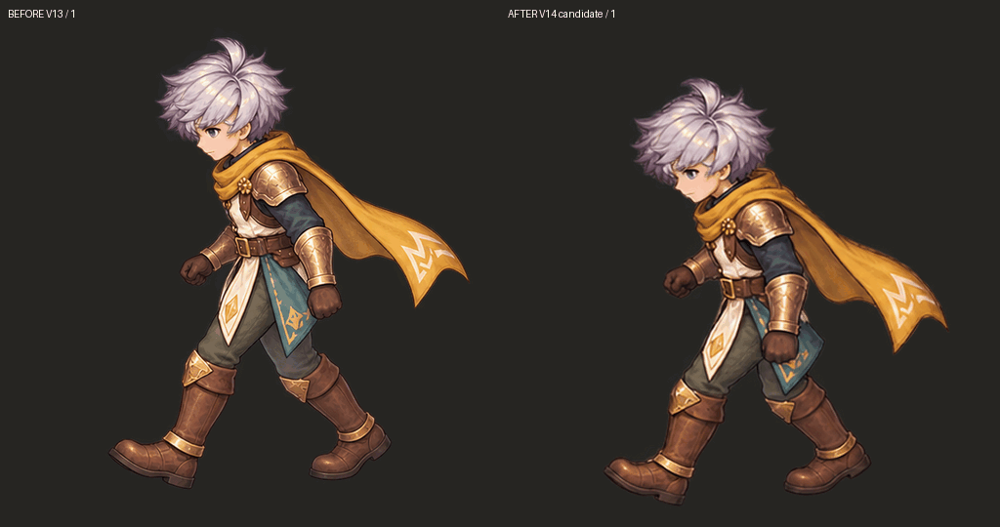
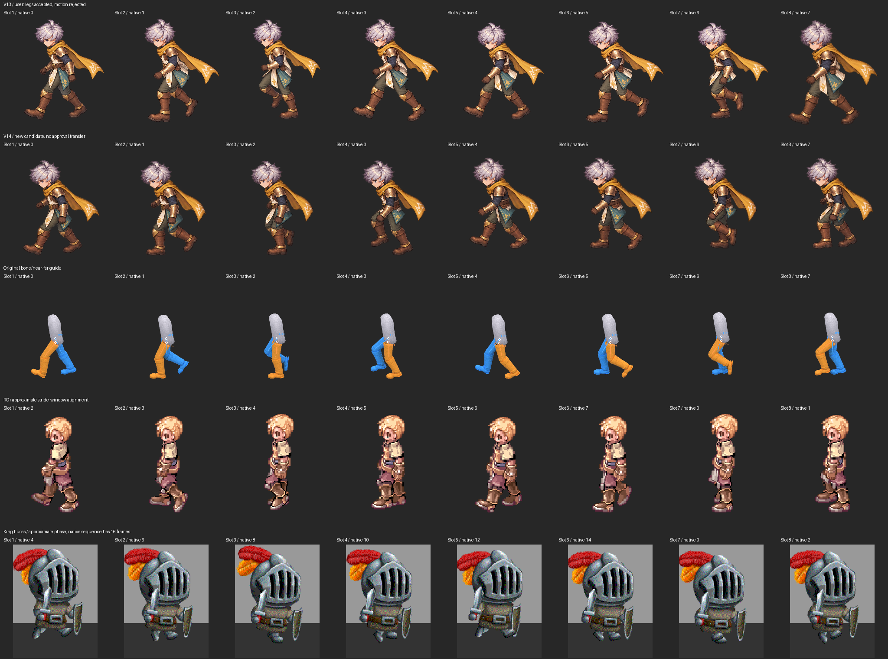

# เดิน W: เทียบทีละเฟรมและแก้ continuity v14

**ผู้ใช้ยืนยันขาของ v13 ถูก แต่ไม่รับความต่อเนื่องของคลิป** รอบนี้เก็บคำตัดสินกับ SHA ของทั้ง8เฟรม แยกจากคำอนุมัติเดิมของ v12 และทดลองภาพชุดใหม่โดยไม่แก้เลื่อน/สเกลรายเฟรมเพื่อให้คะแนนผ่าน



[GIF ใหม่](attempts/geometry-first/walk-ro-cadence.gif) · [APNG เต็มสี](attempts/geometry-first/walk-ro-cadence.png) · [ความเร็ว source1.333s](attempts/geometry-first/walk-source-cadence.gif) · [ครบ8เฟรม](attempts/geometry-first/frames-review.png) · [เครื่องมือดูเทียบทีละเฟรมแบบ offline](frame-review.html)

**สถานะ:** ตำแหน่งผิวหัวต่อเนื่องขึ้น แต่ spacing ของบางก้าวยังต้องแก้และภาพใหม่ยังไม่รับรอง anatomy/น้ำหนัก/foot-lock ไม่โอนคำอนุมัติขาของ v13 ให้ภาพใหม่ ไม่มี painted replacement parts ครบจากชุดนี้

## เทียบเรฟจริงตามเฟรม



| ชุด | จำนวนและเวลาที่ตรวจ | ใช้วิเคราะห์ / ข้อจำกัด |
| --- | --- | --- |
| RO male Swordman W |8 exposures ×75ms =600ms|หัวและตัวเปลี่ยนตำแหน่งน้อย เท้าผ่านช่วงก้าวตามลำดับ เป็น community conversion ไม่ใช่ FPS ตายตัวของ client |
| King Lucas walk2 |16 exposures ×30ms =480ms|ดูการยกเท้า การเปลี่ยนมุมตัวและขนาดหมวกที่คงรูป เรฟหันขวา ไม่ mirror ภาพหรือนำไปเป็นพิกเซลตัวละครเรา |
| King Lucas walk1 |13 exposures ×30ms =390ms|เดฟมีการเปลี่ยน acting ของก้าวด้วย จึงไม่ใช้เปรียบเทียบว่าเพิ่มเฟรมอย่างเดียวทำให้ดีขึ้น |
| Tree of Savior trailer window |33 exposures, PTS12.000–13.066667s|[ครบ33ภาพ](evidence/tos-all-33-review.png):ฉากเคลื่อน กระโปรงบังขา หลายเฟรมแรกถูกเสาบัง ไม่อ้าง recovered knee/footplant |
| Original rig W |8 keys จาก41 source samples|กระดูกจริง+depth/owners ใช้ชี้เป้าหมายและ spacing ไม่ถือว่า redraw ตรงเพราะใส่เลข source ให้มัน |

[RO native loop](ro-native.gif) · [King Lucas native loop](king-native.gif) · [ข้อมูล source/capture เดิม](../motion-reference-v6/README.md) · [ToS PTS/provenance](../motion-reference-v7/README.md)

ROเริ่มคนละช่วงกับ sourceเรา แถวเทียบจับคู่ native indices **2,3,4,5,6,7,0,1** ส่วน King Lucasใช้ช่วงก้าวคร่าว ๆ **4,6,8,10,12,14,0,2** ทั้ง16เฟรมยังเลือกดูตามลำดับจริงได้ใน HTML นี่ไม่ใช่การจับคู่กระดูก/เวลาสัมผัสพื้นเหมือนกันทุกเกม [Mapping](evidence/phase-mapping.json) ระบุ fixed display scale/crop ไม่มี bbox fit รายเฟรม ไม่มีภาพเกมอื่นเป็น input ของ imagegen

| ช่องเรา / source | เรฟ RO native | สิ่งที่พบใน v13 → ทดลอง v14 |
| --- | ---: | --- |
|1 /0|2|ช่วงขาหนึ่งนำ:ใช้เป็นต้นรอบ เปรียบเทียบกับ8→1ด้วย |
|2 /5|3|หลังรับน้ำหนัก/เท้าหลังปล่อย:ชุดใหม่วาดต่อจากชุดเดียว ลดการเปลี่ยนรายละเอียดระหว่าง batch |
|3 /10|4|ขาเคลื่อนผ่าน:ชุดใหม่ยังแยก ankle กว้างกว่าสัดส่วนที่ sourceชี้ ต้องตรวจเพิ่ม |
|4 /15|5|v13กลับเป็นท่าเหยียดกว้างซ้ำ ชุดใหม่มีfar/right footขยับมาด้านหน้า แต่support footยังออกหลังมากเมื่อเทียบsource |
|5 /20|6|อีกข้างนำ:เปลี่ยนน้ำหนักและตรวจ near/farต้นขาใหม่ ไม่อนุมัติจากตำแหน่งผ้า teal |
|6 /25|7|ปล่อยเท้าหลังอีกข้าง:spacing profileใกล้sourceมากกว่าบางช่อง แต่ยังไม่ยืนยัน contact |
|7 /30|0|ขาเคลื่อนผ่านอีกข้าง:ยังมี spacing warning ต้องดู knee/ankle arcและchain |
|8 /35|1|v13เป็นท่าเหยียดซ้ำและตัวเลื่อนไปด้านซ้าย ชุดใหม่มีการเข้าหาก้าวถัดไปและลดการกระโดดของหัว แต่spacingยังเตือน |

## เครื่องมือวัดจากภาพและตรวจข้อมูลการวัด

[CLI ใช้ซ้ำ](../../../skills/modular-eight-direction-sprites/scripts/walk-continuity.py) ตรวจ SHA,canvas,ระยะเวลาทุก exposure,ช่วงlast→first,การเปลี่ยนbatch และจุดผิวเดียวกันที่ระบุว่า track ได้ ขาแบบ screen-sorted ใช้เฉพาะunsigned spread **ไม่คำนวณความเร็วของ anatomical leg จากการเรียงซ้ายขวาบนจอ**

|การวัด|v13เก่า|v14candidate|หมายความว่าอะไร|
|---|---:|---:|---|
|จุด pupilที่ตรวจใหม่:กระโดดสูงสุด|53.6px|8.5px|manual visible points พร้อม uncertainty4px ไม่ใช่ hidden Head bone |
|จุด pupil:8→1|53.6px|8.1px|นับ seamจริง ไม่มีการหยุดที่เฟรม8แล้วให้ผ่าน |
|พิกเซลกลุ่มผม:centroidกระโดดสูงสุด|47.7px|10.8px|independent calibrated palette-region measurement ไม่ใช่ semantic detector |
|พิกเซลกลุ่มผม:8→1|47.7px|10.7px|ไม่มีการ warpภาพเพื่อวัด/ให้ผ่าน |
|unsigned ankle-spacing profile:ต่างจากsourceสูงสุด|0.443|0.251|normalizeหนึ่งครั้งต่อทั้งคลิป ไม่ใช่เปอร์เซ็นต์ anatomy accuracy |

[รายงาน v13](check/v13-continuity.json) · [รายงาน v14](check/v14-continuity.json) · [RO visible observations](check/ro-continuity.json) · [กราฟ](continuity-measurements.png) · [ตำแหน่งจริงของ source Headทั้ง41samples](evidence/source-head-trajectory.json)

ผมพบว่าการปัก pupilครั้งแรกบางจุดคลาดไปถึงหู ทำให้ค่าที่เคยรายงาน66pxเกินจริง **ยกเลิกผลนั้นแล้ว** เก็บ [failure record](evidence/observation-marking-failure.json) และ inputเก่าไว้ ตรวจใหม่บน [v13 eye grid](evidence/v13-eye-grid.png)/[v14 eye grid](evidence/v14-eye-grid.png) จากนั้นดู overlayจริงทุกเฟรม: [ก่อนแก้](evidence/v13-visible-observations-review.png) · [candidate](evidence/v14-visible-observations-review.png) buckleที่ถูกแขนบังกลับเป็นunknown ไม่ใช้แทนwaistที่คาดเดา

มี image-feature test แบบ fixed-ROI SIFT/RANSAC ด้วย แต่จำนวนfeature matchesไม่พอหลายเฟรม ทั้งคลิปยัง **INCONCLUSIVE** ไม่ลดเกณฑ์เพื่อทำให้ผ่าน ตัวpalette probeใช้สี/ROIที่ calibrateสำหรับผมเงินของตัวนี้เท่านั้น งบเตือน20pxบน512canvasเป็นเกณฑ์ทดลอง ต้องตั้งใหม่เมื่อเปลี่ยนตัวละคร/สี/กล้อง ไม่แปลว่าทั้ง animation ผ่านถ้าไม่เตือน

Source-spacing budget0.15 ยังเตือนช่อง **3,4,7,8** ของcandidate จุดlogical ground rootจากภาพ/footplantยังไม่ถูกยืนยัน [ตรวจ anatomical/source ใหม่](leg-review.html) จึงยัง REVIEW_REQUIRED ไม่ให้headนิ่งกลบขาที่ผิด ไม่ให้unknownได้PASS

## ประยุกต์ผล ไม่แก้ด้วยFPSอย่างเดียว

v13ผสมภาพจากสามการเจน ทำให้ registration/หน้าตาเปลี่ยนข้ามbatch จำนวน8เฟรมไม่ได้แก้ปัญหานี้ รอบแรกของv14ใช้referenceแบบfour-keyทั้งชีตอีกครั้ง ผลยังเหยียดขาซ้ำและชนขอบcell โปรแกรมแพ็กปฏิเสธ [Raw failure](evidence/W-eight-raw.png) · [Receipt](evidence/attempt-1-failure.json)

รอบสองให้ **actual eight-phase geometry เป็นเรฟหลัก + approved appearanceเพียงเฟรมเดียว** แล้วเจนทั้ง8ร่วมกัน [Raw](evidence/W-geometry-first-raw.png) · [Prompt](evidence/geometry-first-prompt.txt) ภาพแพ็กผ่าน ใช้shared scale1.15445จากcell443.5px ไม่มีindividual fit/head freeze/mirror/แก้ขาด้วยPython เก็บชุดเก่าที่ผู้ใช้รับขาไว้ครบ

ก่อน/หลังใช้8เฟรมและ600msเท่ากัน APNG/WebPเก็บ75msตรง ส่วนGIFเก็บเป็น70/80msรวม600ms คู่source-clockยังอยู่ที่1333ms ไม่เร่งFPSเพื่อซ่อนรอยต่อ การลดroot driftของหัวไม่พิสูจน์stance-foot lock,arm actingหรือเสื้อคลุมที่ดี

## ความรู้สำหรับ reproduction

[Guide ใช้กับตัวอื่น](../../../skills/modular-eight-direction-sprites/references/walk-spacing-and-registration.md) · [SKILL v0.14](../../../skills/modular-eight-direction-sprites/SKILL.md) · [Primary-source audit](evidence/source-audit.json)

```bash
# สร้างสัญญาตรวจสำหรับภาพใหม่:ทุกจุดเริ่ม unknown ไม่copyสีผม/คะแนนตัวนี้
python skills/modular-eight-direction-sprites/scripts/walk-continuity.py \
  --init-from-frames path/to/new-character/frames --frame-ms 75 \
  --label new-character-walk --out /tmp/new-character-review.json

# หลังตรวจ/ปักจุดที่เห็นจริงและcalibrateROI/budgetแล้ว
PYTHONPATH=/tmp/astraeon-vision-deps python \
  skills/modular-eight-direction-sprites/scripts/walk-continuity.py \
  --observations research/sprite-animation/continuity-v14/evidence/v14-observations.json \
  --out /tmp/rechecked-continuity.json

# สร้างบอร์ด/GIF/กราฟ/viewerจากข้อมูลที่ผูกhashไว้
MPLCONFIGDIR=/tmp/astraeon-mpl-cache XDG_CACHE_HOME=/tmp/astraeon-font-cache python \
  skills/modular-eight-direction-sprites/studies/walk-test/build-continuity-study.py
```

ตรวจfileจริงทั้ง6clipsแล้ว:8unique frames/clip,RGBAของAPNGและWebPตรงmaster,เวลาได้ตามmanifest [Format](format-check.json) ผ่าน87Python regression testsและ44actual browser checks [Python](evidence/regression-check.txt) · [Browser](browser-check/browser-report.json) เป็นการตรวจเครื่องมือ/file/หน้าreview ไม่ใช่game integrationหรือคำอนุมัติภาพ

งานถัดไปก่อนผลิตหลายตัว:แก้ spacingของ3/4/7/8โดยคุม ownership,ตรวจbody/hip actingและcontactที่ความเร็วเกมจริง,รักษาproportions/clothes,ทำpainted partsพร้อมhidden coverage และทดสอบstop/turn/item swap ไม่ถือว่าการอ่านpaperหรือผลคะแนนหัวที่ดีขึ้นทำให้ pipelineพร้อม mass production

เฉพาะ branch `research/modular-sprites-full-body-2026-10-11`
