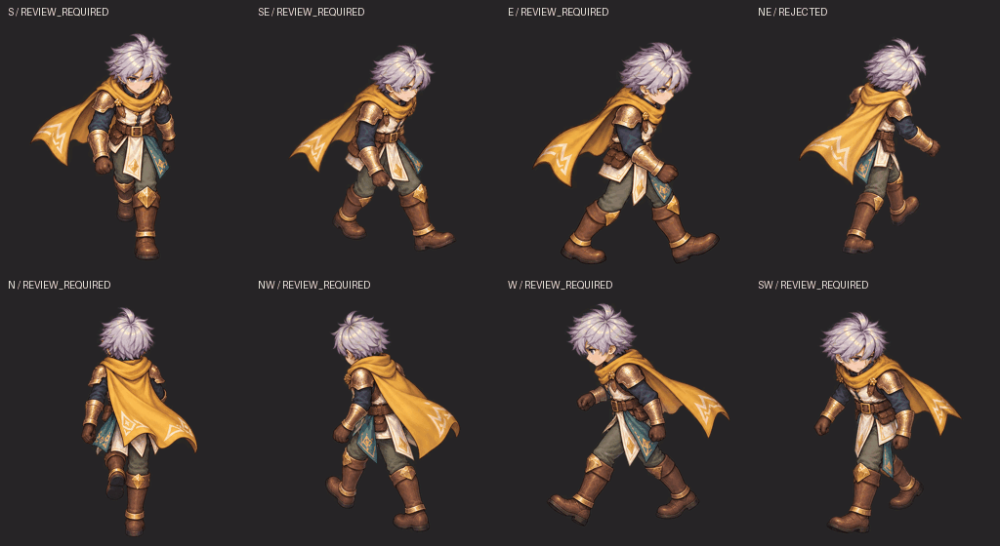

# เดิน 8 ทิศ v11 — ตรวจขาซ้อนจากภาพวาดจริง

รอบนี้ทำ **8 ทิศ × 4 โพส = 32 เฟรม** จาก rig ต้นแบบเดิมที่ถูกต้อง แล้วเจนวาดทับใหม่ด้วยรายละเอียดแบบที่ผู้ใช้กำหนด เก็บ master 512×512 ต่อเฟรม ไม่ mirror ตัวละคร ทุกทิศเป็นภาพทดลองที่ยังไม่อนุมัติ

[GIF รวม 8 ทิศ](eight-direction-review.gif) · [ภาพเปรียบเทียบต้นแบบกับภาพใหม่ครบ 32 โพส](source-art-comparison.png) · [ผลตรวจรวม](review-summary.json)

## แก้เครื่องมือตรงที่พลาด

เครื่องมือเดิมเทียบจุดที่ระบุด้วยมือกับกระดูก แต่ **ไม่ได้อ่านว่าต้นขาในภาพวาดต่อกับหน้าแข้งข้างไหน** พอสะโพกถูกผ้าบังและเข่าซ้อนกัน ค่าคลาดเคลื่อนต่ำจึงไม่พิสูจน์ว่าขาไม่สลับ รอบนี้เพิ่ม:

- ภาพเจ้าของขาจาก geometry จริง น้ำเงิน=ขาขวา ส้ม=ขาซ้าย มีทั้ง visible และ isolated/amodal silhouettes; 32 โพส ใช้ 96 render passes จาก `.blend` เดิม ไม่เปลี่ยนกระดูกเพื่อให้ตรงภาพผิด
- ตรวจการสลับแค่ hip/knee/ankle/toe ด้วย 16 ชุดการจับคู่ และเตือนเมื่อ projected joints ใกล้กันเกินกว่าความไม่แน่ใจที่ระบุ จึงไม่ผ่านจากคะแนนที่หัก uncertainty แล้ว
- อ่าน RGBA จริง ตรวจจุด/สายขากับ silhouette และบังคับตรวจขาที่อยู่หน้าตรงจุดซ้อน 36 บริเวณ พร้อมคลิกไล่เส้นต้นขา–รอยต่อ–หน้าแข้งในภาพใหม่ หากยังแยกไม่ได้ให้ค้างตรวจ
- ธงภาพผิดผูกกับ SHA ของเฟรมนั้น การ import annotation ไม่ลบข้อผิดพลาดที่ยืนยันแล้ว; เปลี่ยนภาพต้องตรวจใหม่
- ตรวจ continuity ของสีผ้าประจำสะโพกเป็น heuristic เพิ่มเติม แล้วตรวจภาพด้วยตาซ้ำก่อนยืนยัน ไม่ใช้สี centroid ตัดสิน anatomy อัตโนมัติ

## ผลตรวจซ้ำหลังปรับเครื่องมือ

| ชุดภาพใหม่ | สถานะ | จุดซ้อนที่มี pixel trace ตรงเจ้าของต้นแบบ / ต้องตรวจ |
| --- | --- | --- |
| S หน้าตรง | REVIEW_REQUIRED | 0 / 8 |
| SE เฉียงหน้าขวา | REVIEW_REQUIRED | 3 / 4 |
| E ขวา — แก้ใหม่หลังผู้ใช้ชี้เฟรม 3 | REVIEW_REQUIRED | 1 / 5 |
| NE เฉียงหลังขวา | **REJECTED** | 0 / 4 |
| N หลัง | REVIEW_REQUIRED | 0 / 1 |
| NW เฉียงหลังซ้าย | REVIEW_REQUIRED | 0 / 4 |
| W ซ้าย | REVIEW_REQUIRED | 0 / 6 |
| SW เฉียงหน้าซ้าย | REVIEW_REQUIRED | 0 / 4 |

**ภาพ SE เฟรม 2 เดิมที่ผู้ใช้ชี้ว่าสลับขา ยังถูกปฏิเสธ** ใน [case ภาพเดิม](evidence/rejected-SE/check/continuity-report.json) ข้อผิดพลาดมาจากคำยืนยันของผู้ใช้ ไม่อ้างว่าโมเดลตรวจภาพค้นพบเอง

ชุดใหม่ SE มีเส้นตรวจจากภาพจริงสามบริเวณตรงกับ foreground owner ของต้นแบบ แต่สะโพกที่ถูกบังและหนึ่งบริเวณซ้อนด้านบนยังไม่ยืนยัน จึงไม่สรุปว่าทั้งเฟรม/ทั้งคลิปถูกต้อง มีจุด internal joint/boot contour ที่ระบุเป็น **estimated** อย่างเปิดเผย ไม่คัดลอก reference points มาอ้างว่าตรวจพบในภาพ

ชุดใหม่ **NE เฟรม 2–3 ผ้าสีเขียวย้ายจากสะโพกไกลไปสะโพกใกล้** ผิด slot ซ้ายตาม anatomy: ตรวจภาพจริงแล้วบันทึกข้อผิดพลาดรายเฟรม จึงเป็น REJECTED ทั้งคลิป ส่วน W มี palette-anchor flag ที่ยังต้องตรวจว่าเป็นการย้าย attachment จริงหรือผลจาก pose/root projection

ระหว่างตรวจ ผู้ใช้ส่งภาพ **E เฟรม 3** และยืนยันว่าขายังสลับ [ภาพ/annotation/rejection เดิม](evidence/rejected-E-revision1/check/continuity-report.json) ถูกเก็บแยกไว้ แล้วเจน E ใหม่อีกครั้งโดยแก้สายขาขวาออกหน้าและขาซ้ายถอยหลัง พร้อมผ้าสีเขียวคงกับสะโพกซ้าย ตรวจ pixels ของภาพแก้ใหม่แล้วมี local foreground trace ตรงหนึ่งบริเวณ แต่การกางขา/มุมขาที่ยังคลาดต้นแบบ สะโพกที่ถูกบังและบริเวณอื่นยังไม่ผ่าน ไม่ย้าย annotation ที่ยืนยันจากภาพเดิมมาใส่ภาพใหม่

รวมสี่บริเวณที่ตรวจเฉพาะจุดแล้ว กับ **32 บริเวณที่ยัง unresolved** ไม่ใช่ความแม่นยำ 4/36 หรือเปอร์เซ็นต์ anatomy ภาพใหม่ทั้งแปดยังไม่ผ่าน motion/anatomy acceptance และยังไม่พร้อม mass production

## เปิดเครื่องมือตรวจภาพ

ดาวน์โหลด HTML แล้วเปิดใน browser; GitHub blob แสดง source HTML ใช้ self-contained images ได้โดยไม่ต้องติดตั้ง dependency

| ทิศ | ภาพเคลื่อนไหว | เครื่องมือตรวจ | Source-owner guides |
| --- | --- | --- | --- |
| S | [GIF](master/S/walk-quality.gif) | [HTML](master/S/leg-review.html) | [ภาพสี](source-owners/S-owner-guide.png) |
| SE | [GIF](master/SE/walk-quality.gif) | [HTML](master/SE/leg-review.html) | [ภาพสี](source-owners/SE-owner-guide.png) |
| E | [GIF](master/E/walk-quality.gif) | [HTML](master/E/leg-review.html) | [ภาพสี](source-owners/E-owner-guide.png) |
| NE | [GIF](master/NE/walk-quality.gif) | [HTML](master/NE/leg-review.html) | [ภาพสี](source-owners/NE-owner-guide.png) |
| N | [GIF](master/N/walk-quality.gif) | [HTML](master/N/leg-review.html) | [ภาพสี](source-owners/N-owner-guide.png) |
| NW | [GIF](master/NW/walk-quality.gif) | [HTML](master/NW/leg-review.html) | [ภาพสี](source-owners/NW-owner-guide.png) |
| W | [GIF](master/W/walk-quality.gif) | [HTML](master/W/leg-review.html) | [ภาพสี](source-owners/W-owner-guide.png) |
| SW | [GIF](master/SW/walk-quality.gif) | [HTML](master/SW/leg-review.html) | [ภาพสี](source-owners/SW-owner-guide.png) |

เลือกบริเวณซ้อน ดู source-owner canvas เทียบภาพวาด แล้วใช้โหมด “ตำแหน่งจุดซ้อน” คลิกจุดจริงในภาพวาด ใช้โหมด “ไล่เส้น” คลิกตามขาที่อยู่หน้าอย่างน้อยสามจุด ตรวจตัวตน/รอยต่อก่อนติ๊กยืนยัน ถ้าไล่ไม่ได้ให้ unknown ตรวจข้อต่อ/continuity แยกต่างหาก Export JSON แล้วรัน checker ใหม่; ผลเดิมใช้ไม่ได้ทันทีที่แก้ annotation

ภาพ crop ที่ยังไม่มี actual art point ใช้ตำแหน่ง source เพื่อช่วยเปิดบริเวณและติดคำว่า **UNCALIBRATED** ไม่ใช่ผลจับคู่ขาจากภาพอัตโนมัติ ตัวเครื่องมือยังไม่มี semantic pose detector ที่เชื่อถือได้สำหรับสไตล์เรา

## หลักฐานและขอบเขต

**56 Python regression tests และ 30 browser checks ผ่าน** ครอบคลุม side exchange, mixed-chain ambiguity, ภาพไม่มี pixel support, deleted/relabelled crossing, hash/เวลา/กระดูกเปลี่ยน, การไล่เส้นและ import ไม่ลบธงผิด การทดสอบเครื่องมือไม่ใช่การอนุมัติภาพวาด

[Python output](evidence/regression-check.txt) · [Browser report](browser-check/browser-report.json) · [SE เฟรม 2 พร้อม image trace](browser-check/SE-pose-2-desktop.png) · [Mobile](browser-check/SE-mobile.png) · [NE rejected](browser-check/NE-rejected-mobile.png) · [วิจัยและวิธีทำซ้ำ](../../../skills/modular-eight-direction-sprites/references/occlusion-image-review.md)

ใช้ motion Quaternius `Walk_Loop` CC0 จาก [แหล่งที่ตรวจเดิม](../source-motion-v7/README.md), rig original modular [v9](../walk-test-v9/original-modular-walk.blend) และ permitted [v10 art quality reference](../quality-review-v10/master/frames/00.png) รอบนี้ไม่ศึกษา character asset เดิมของเกมที่ถูกปฏิเสธ ไม่ mirror และไม่มีอาวุธในการทดสอบเดินนี้

Source keys 0/10/20/30, cycle 1.333333373 s, ทิศ S/SE/E/NE/N/NW/W/SW ที่ rotation 0/45/90/135/180/225/270/315°. Tool คืนภาพ 1254 square ใช้ cell 627 square, scale ร่วม 512/627, row offset **0** รอบนี้ ไม่ใช้ -20 ของ v10 ไม่มี per-pose bbox fitting หรือวาดแก้ anatomy ด้วย Python

แต่ละทิศมี APNG/RGBA และ lossless animated WebP เต็มสี 1333 ms และ GIF palette ร่วมพื้นมืด 1330 ms ตรวจทั้ง 24 คลิปว่า 4 decoded frames ไม่ซ้ำ และ PNG/WebP มี alpha/visible RGB ตรง master [ผลตรวจ](review-summary.json) ไฟล์ raw initial/revised และ prompts อยู่ใน [evidence](evidence); conditioning guides และ inputs มี SHA ใน [generation provenance](evidence/generation-provenance.json)

ภาพวาดเป็น flat whole-frame candidates ไม่ใช่ hair/equipment layers ที่สลับได้ ส่วน geometry แบบแยกชิ้นยังอยู่ใน v9 และไม่พิสูจน์ว่าชุดวาดทับแปดทิศมี hidden replacement parts ครบ Support/foot-lock/COM balance ยังไม่ตรวจยืนยัน การใช้ได้จริงและความมั่นใจขั้น mass production ยังเป็นงานต่อไป

[SHA inventory](inventory.json) · ทำงานและ push เฉพาะ branch `research/modular-sprites-full-body-2026-10-11`
