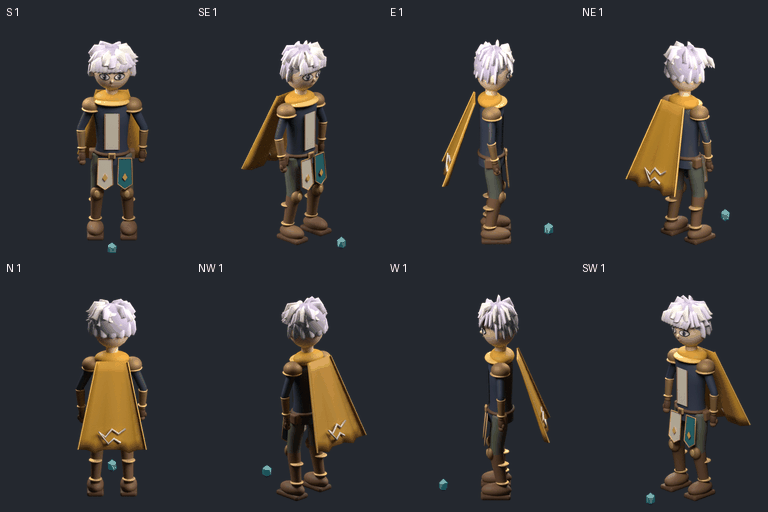

# v44 — ทดลอง sprite pipeline แบบ local ฟรี

**ใช้เครดิต0 / ไม่มี provider job หรือ upload** ตามคำสั่งล่าสุด ยกเลิกข้อเสนอ Tripo แล้ว รอบนี้ใช้ Blender และเครื่องมือ local ที่ติดตั้งอยู่ งานภาพด้านล่างเป็น **โมเดลสีต้นแบบสำหรับตรวจ rig/motion ยังไม่ผ่านคุณภาพภาพวาดของเกมเรา** ไม่ใช่ตัวละคร final และไม่แทนภาพที่ผู้ใช้อนุมัติในv39

[8pose / จังหวะเดิม](eight-view-key.gif) · [เปิด reviewer แบบ offline](review.html) · [ภาพเทียบกับ art ที่อนุมัติ](approved-vs-local.png) · [ผลตรวจ](audit.json) · [Know-how ละเอียด](KNOW-HOW.md)

## ของที่ทำจริง

สร้างตัวละครต้นแบบ original ในเครื่อง:115mesh ที่เชื่อมกระดูกจริงทั้งหมด มีผิวแขน/ขาต่อเนื่อง เสื้อเกราะ ผ้าคลุม ถุงมือ บู๊ท ใบหน้าและผม ตัวเดียวกันถูกเรนเดอร์ด้วยกล้องจริง8ทิศ แยกกลุ่ม authoring `body_outfit` กับ `complete_head`; ไม่เพิ่มสล็อตแขนขาสำหรับผู้เล่น

ท่าเดิมเป็น pickup ก้ม/เอื้อมมือขวา/ยก/กลับมายืน ใช้8anchorจากv43 เพิ่มภาพระหว่าง pose ผ่าน target curves + IK ไม่สร้างขาซ้ายขวาใหม่ทีละภาพ มี64ภาพ8key +216ภาพ27sample +64ภาพownership ที่มีdepth occlusionจริง ทุกภาพใช้ scale/ตำแหน่งชุดเดียวจากneutral ไม่แก้ให้พอดีแยกทีละเฟรม

ตัวตรวจเปิดไฟล์ที่บันทึกจริงอีกรอบและวัด157ช่วงเวลา เท้า/bone length/socketถือของ/hinge frame คลาดเคลื่อนระดับประมาณ10^-7world units; weightรวมครบ ไม่มี mesh หลุดจากmodifier ผิวแขนขา4ชิ้นปิดจริง ดูตัวเลขและขอบเขตที่ [saved-rig-inspection.json](saved-rig-inspection.json) ตัวเลขเหล่านี้ไม่รับรองacting, anatomyทุกมุม, collision,ภาพวาด หรือข้อมือทุกแบบ

## ไฟล์ทำงานต่อ

- [Blenderต้นฉบับพร้อม animation](original-character.blend) — แหล่งหลักของภาพ preview
- [GLBส่งออกครั้งแรก](original-character-experimental.glb) — **ไม่ผ่านsurface roundtrip** แม้โครงสร้างถูก ดู [ผลเทียบกลับจริง](glb-roundtrip.json)
- [GLBพร้อมcorrective morphทดลอง](original-character-corrected.glb) · [ผลroundtripของตัวแก้](corrective-glb-roundtrip.json) — เทียบผิวกลับครบ40sample คลาดสูงสุดประมาณ0.00000128world units; ยังต้องตรวจข้อจำกัดก่อนใช้ ไม่ใช่การรับเข้าเกม
- [เครื่องมือสร้าง](build-character.py) · [ตรวจsaved rig](inspect-saved-rig.py) · [ตรวจหลักฐาน/current captures](audit.py) · [ทดสอบnegative controls](regressions.json)

GIFแบบdenseใช้27ภาพ:26ช่วง×50ms +ถือท้าย600ms รวม1900ms เท่ากับGIF8exposureที่ใช้เทียบ ต่างกันที่การสุ่มภาพระหว่างpose ไม่ใช่คำอ้างว่าROใช้27เฟรมหรือการอนุมัติclockใหม่ หน้าreviewเล่นครั้งเดียว, มีgridและsource bones; เส้นบนภาพคือprojectionจากrig ไม่ใช่AIตรวจข้อต่อจากภาพวาด

## ข้อผิดพลาดที่จับได้และเก็บไว้เรียนต่อ

| เคสจริง | ปัญหา | ตัวตรวจเพิ่ม |
|---|---|---|
| attempt1 | rest basisผิด ชิ้นส่วนหมุนผิดตั้งแต่bind | actual `matrix_local` และ evaluated rest vertices |
| attempt3 | renderกลับไปเฟรมแรก แม้กำหนดposeใหม่ | clockจริง +ตรวจbonesหลังrender +เทียบpixelsที่นิ่งผิดปกติ |
| attempt4 | convertเส้นเผลอลบArmature modifierของ10meshข้างเคียง ทั้งที่weightยังครบ | ตรวจmodifierที่เปิดใช้งานจริงทุกmeshและsaved animation |
| GLBแรก | LBSนำเข้าไม่เหมือนDQต้นฉบับ; cape shellหาย | reimportจริงเทียบผิว ไม่หยุดแค่อ่านheader/weight |

ภาพยังไม่ตรงartเดิม:หน้าผม/รายละเอียดชุด/รูปทรงยังเป็นblockout และผ้าคลุมยังแข็ง ไม่มีการรับรองว่างานนี้ผ่านสายตาผู้ใช้หรือพร้อมmass production ขั้นถัดไปต้องปรับทรงและงานภาพของโมเดลเดียวกันด้วยวิธีlocal พร้อมตรวจintersection/ผิวต่อเนื่อง และทดสอบการเปลี่ยนhead/bodyเป็นชิ้นงานจริง

ยังไม่แก้ทับหลักฐานv30–v43 หรือภาพเดินWที่อนุมัติ ทำงานเฉพาะbranch `research/modular-sprites-full-body-2026-10-11` เช่นเดิม

ผลรวม:28bounded checks +16negative controls +11browser controls ผ่าน; หน้าreviewตรวจภาพจริง216เฟรมครบ ไม่มีnetwork request แต่[ผลตรวจงานภาพ](quality-review.json)ยังไม่ผ่านfinal art
