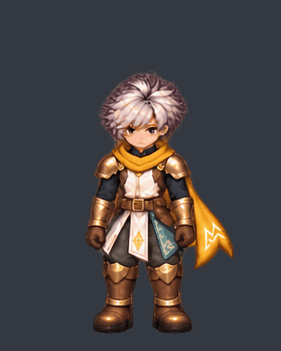
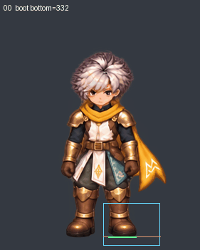
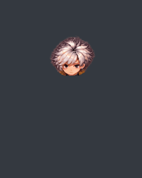
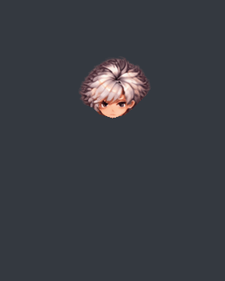
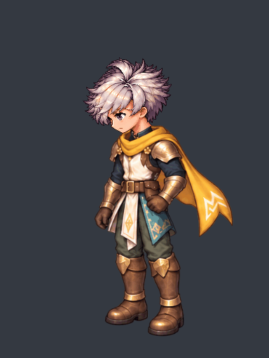

# ท่าก้ม: ทดลองแก้ด้วยเครื่องมือฟรี พร้อม GIF ตรวจจริง

รอบ v60 ใช้เครื่องมือในเครื่องทั้งหมด ไม่มีการซื้อ เรียก imagegen หรือส่งงานให้บริการที่คิดเครดิต ดู [บัญชีการใช้เครื่องมือ](cost-ledger.json) งานภาพเคลื่อนไหว **ยังไม่ผ่าน production**: ทดสอบวิธีแก้ช่วงลุกกลับแล้ว แต่ภาพต้นทางยังมีเท้าเปลี่ยนตำแหน่งและขนาด จึงยังไม่ขยายภาพชุดนี้ไปท่าอื่น

## ภาพเดิมและการทดลองแก้ช่วงลุก

ภาพเดิม 16 ภาพ มีรอยกระโดดช่วง 7→8 และภาพจบต่างจากภาพเริ่ม:



แบบทดลองใช้ภาพทั้งตัว 0…7 แล้วกลับลำดับ 7…0 โดยไม่แก้พิกเซล ไม่ย้ายเท้า ไม่ยืดตัว และไม่ประกอบแขนขาใหม่ รวม 16 exposures จาก **8 ภาพต่างกัน** ไม่ใช่ภาพวาดใหม่ 16 ภาพ ไม่มีการอ้างว่าเฟรมซ้ำทำให้ลื่นขึ้นเอง การย้อนท่าก้มไม่แทนการหยิบวัตถุหรือการสะบัดผ้าช่วงลุก:


| ตรวจจากภาพจริง | เดิม | ทดลองกลับทาง |
|---|---:|---:|
| ยอดหัวกระโดดมากสุดต่อเฟรม | 70 px | 20 px |
| ความเร่งยอดหัวมากสุด | 11,111 px/s² | 2,469 px/s² |
| contour/ลำดับก้มลุกตามเกณฑ์เดิม | ไม่ผ่าน | ผ่านเฉพาะเกณฑ์นี้ |
| ภาพสุดท้ายตรงภาพแรก | ไม่ตรง | ตรงพิกเซล |
| ระดับปลายรองเท้าขวาในจอเปลี่ยน | 32 px | 19 px |
| ขอบปลายรองเท้าขวาเคลื่อนแนวนอน | 24 px | 24 px |
| ภาพพร้อมใช้งาน | **ไม่ผ่าน** | **ไม่ผ่าน** |

เกณฑ์เท้ายังเป็น 6 px เท่าเดิม [ผล contour](reverse-recovery-motion-review.json) แยกจาก [ผลเท้า](reverse-recovery-right-forefoot-review.json) ไม่เอาผลผ่านข้อหนึ่งมารับรองทั้งตัว ภาพรองเท้าช่วงแรกกับช่วงลึกมีขนาดต่างกันด้วย การปรับเวลาไม่แก้ขนาดภาพ

## GIF ที่แสดงสาเหตุเท้าลอย



แดงคือระดับอ้างอิงจากภาพแรก เขียวคือปลายพื้นผิวที่ตรวจพบ น้ำเงินคือหน้าต่างเดิมทุกเฟรม เส้นเหล่านี้อยู่เฉพาะภาพวิเคราะห์ ภาพตัวละครต้นทางไม่เปลี่ยน

ตัวตรวจเก่ามี UNKNOWN เพราะหน้าต่างตัดรองเท้าหรือติดแขน จึงเก็บผลเก่าไว้ และเพิ่มหน้าต่างรองเท้าขวาในจอ `[145,285,225,345]` ตรวจได้ครบ 16 ภาพ ใช้พื้นที่ component ขั้นต่ำ 300 px แยกเศษมือที่ตรวจพบ 169/165/194 px ออกจากรองเท้าที่เล็กสุด 551 px การเลือกนี้ผูกกับภาพชุดนี้และการตรวจด้วยตา ไม่ใช่ตัวรู้กายวิภาคอัตโนมัติ ไม่อ้างผลเท้าซ้ายที่ถูกมือบัง และไม่ได้เพิ่มงบการเคลื่อนของเท้า

## หัวพร้อมผม: แก้ ownership แล้ว แต่ขอบยังไม่ผ่าน

หน้ากากหัวเดิมติดผ้าพันคอ/เกราะ และบางท่าตัดคาง:



เส้นแบ่งใหม่โอนพิกเซลชุดกลับไป body และเก็บพิกเซลหัวจากภาพตัวเต็ม ไม่มีการทาสี ย่อขยาย หรือลบพิกเซลภาพตัวเต็ม:



ภาพขยายยังเห็นเศษสีทองด้านข้างและขอบผมถูกเส้นแบ่งตัดในบางเฟรม จึง **ยังไม่อนุมัติ head swap** เก็บหน้ากากครั้งแรกที่ยังติดไหล่ลึกไว้ใน `negative-first-contour/` เส้นแบ่งครั้งปัจจุบันเป็น candidate ไม่ใช่ segmentation สำเร็จ [ภาพขยายขอบหัว](head-contour-inspection.jpg) และ [ผลประกอบคืน](ownership-review.json) ยืนยันเพียงว่า body+head คืนภาพเต็มได้ตรงเดิมทุกเฟรม พิกเซลที่ย้าย ownership ไม่ใช่การวาดท่าใหม่

## ตัวเทียบจากท่าทั้งตัวที่เคยรับรอง



นำภาพทั้งตัว v39 ที่เคยรับรองเฉพาะมุมนี้มาเทียบ โดยแยกแต่ละ hold เป็นสอง exposure รวม 16 exposures / 7 ภาพต่างกัน ระยะรวมยัง 1,900 ms และลำดับพิกเซลตามเวลาเดิมทุกจุด GIF ยุบ hold ติดกันกลับเหลือ 8 encoded frames ตามปกติ ตัวเทียบนี้ไม่ใช่งานวาดใหม่ ไม่ได้แก้สัดส่วน มุมหน้าใหม่ หรืออาการเท้าไหลใน v58

## เครื่องมือตรวจที่นำกลับมาใช้ได้

[ตัวดูเฟรมทดลอง](reverse-recovery-review/review.html) เปิดแบบ offline หลังดาวน์โหลด: เลื่อนทีละเฟรม เล่น 1×/¼× เปิดภาพก่อนหน้า และเส้นอ้างอิงภาพแรก ใช้ PNG ต้นฉบับโดยตรง ส่วน GIF จำกัดสีตามรูปแบบไฟล์และใช้เพื่อพรีวิวเท่านั้น PNG/atlas ไม่ถูก quantize

[ไฟล์แก้ไข Aseprite สี่เลเยอร์](native-editable/pickup-four-slots.aseprite) มี body/head และ weapon/trail ว่างสำหรับมือเปล่า ส่งออกตรวจจริงครบ 16 เฟรม พิกเซล premultiplied ตรงต้นทาง 0 error จังหวะ 90×15+550 ms ไม่เผยแพร่ตัวโปรแกรม Aseprite

ใช้ `tools/sprite-review-pack.py` กับตัวละครถัดไปได้ โดยให้ JSON ระบุ canvas, path, SHA และ duration_ms ทุก exposure:

```bash
python tools/sprite-review-pack.py clip.json --out work/new-character-review
```

เครื่องมือปฏิเสธ SHA เก่า ภาพผิด canvas เวลาไม่ตรงหน่วย 10 ms และการอ้างจำนวนภาพใหม่เกินจริง ไม่เขียนทับโฟลเดอร์ผลเดิม สร้าง GIF, contact sheet, HTML และใบตรวจเวลา GIF ที่ decode กลับจริง ไม่แอบจัดภาพตาม bounding box หรือเท้า

การทดสอบ [18 controls](test-review.json) ผ่าน รวมป้องกันเฟรมปลอมจาก RGB ที่มองไม่เห็น ตรวจ actual native และ actual browser PNG 80 ภาพ [ห้าตัวเล่นใน Chromium](browser-review.json) ผ่านปุ่ม/เส้นเวลา/ความเร็ว/seek/overlay และไม่มี network request ผลเหล่านี้รับรองเครื่องมือ ไม่รับรองคุณภาพภาพศิลป์

## เรฟภายนอกที่ใช้ตัดสินวิธีทำ

- [Krita: Animation with Krita](https://docs.krita.org/en/user_manual/animation.html) แยก key poses, hold และภาพ in-between การเพิ่ม hold ไม่สร้างภาพท่าระหว่างกลาง ใช้ onion skin และตรวจพื้นก่อนเข่า/ส่วนอื่น เป็นเหตุผลให้ทำตัวเทียบเวลาและแสดงเส้นเท้าโดยไม่ย้ายภาพ
- [Aseprite: Frame Duration](https://www.aseprite.org/docs/frame-duration/) และ [Onion Skinning](https://www.aseprite.org/docs/onion-skinning/) ใช้เวลาแต่ละเฟรมและภาพข้างเคียงเป็นเครื่องมือตรวจ ไม่มีคำรับรองว่าการปรับ FPS ซ่อมรูปทรงได้
- [Krita ทางการ](https://krita.org/en/) เป็นทางเลือกวาด frame-by-frame ฟรี ยังไม่ได้ติดตั้งหรืออ้างว่ารัน Krita ในรอบนี้ SPA/Aseprite ที่ build ในเครื่องพร้อมใช้อยู่แล้ว
- [roBrowserLegacy renderer ฉบับตรึง commit](https://github.com/MrAntares/roBrowserLegacy/blob/d0449c2a36eff0210555fa5d086f625c5fd1e006/src/Renderer/Entity/EntityRender.js) เรียก body/head/weapon/weapon_trail แยกกันจริง แต่ ACT หนึ่งเฟรมอาจมีหลายชั้น ไม่อ้างว่า RO ทุกตัวมี body bitmap เดียว
- [ชุดศึกษา RO เดิม 552 responses / 2,504 exposures](../core-family-v56/REFERENCES.md) เป็นเรฟภายนอกที่เก็บ URL/hash แล้ว ผลจากสี่ body families ที่สุ่มดู: idle/walk/sit 8 กลุ่มมุม; pickup/ready/attack1/hurt/dead/skill 4 กลุ่มมุมคู่ ใช้เป็นฐาน scope เดิม ไม่ใช่กฎทุกอาชีพ/monster/หัว อาวุธทุกชนิด และไม่ย้ายภาพ RO มาใช้เป็นตัวละครเรา

[sources.json](sources.json) เก็บ URL/เวลาที่เปิด/แฮช และตรวจ raw renderer ตรงหลักฐานเดิม ข้อสรุปแนวทางผลิตข้างต้นเป็นการประยุกต์ของโครงการ

## งานที่ต้องแก้ต่อ

ต้องวาดภาพทั้งตัวที่รักษารองเท้า ขนาดชุด และปริมาตรเข่าในตำแหน่งอ้างอิงเดิม โดยเฉพาะช่วง 3→4 และช่วงลุกกลับ 7→8…15 รวมถึงแก้ขอบหัวจากภาพเต็มให้ไม่ตัดผม/ติดชุด การกลับลำดับและเฟรมซ้ำไม่ทดแทนภาพใหม่ ภาพอื่น/มุมอื่นยังไม่เดินหน้าจาก candidate ที่ไม่ผ่านนี้ ไม่มีการอนุมัติ anatomy ส่วนที่บังอยู่ หรือ production ทั้ง 48 clips เดิม

รอบถัดไปใช้ผลนี้เป็นหลักฐานอ่านอย่างเดียวและทำเคสใหม่ ห้ามรัน authoring scripts ทับ v60 หลังเผยแพร่
