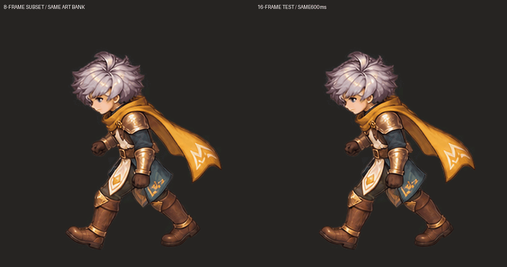
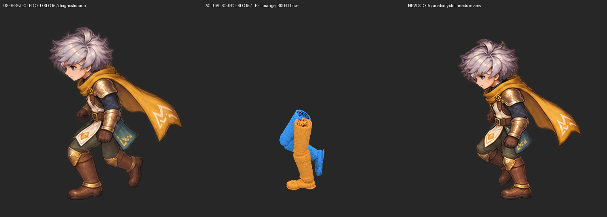

# เดิน W 16 เฟรม: ตรวจพื้นและเฟรม 5 v15

**ชุดทดลองใหม่ ยังไม่รับรอง anatomy/contact หรือ production.** ผู้ใช้ทักว่า v14 ดูกระโดดบนพื้นเรียบ จึงเปิด rig จริงตรวจฝ่าเท้า ถ่าย 16 เวลาจริง แล้วเจนวาดทับในสไตล์เรา ผู้ใช้ปฏิเสธขาเฟรม 5 ของการเจนครั้งแรก เก็บคำตัดสินกับ SHA ของภาพนั้นโดยตรง ไม่ย้ายคำอนุมัติขาของ v13 มาสู่ภาพใหม่



[GIF 16 เฟรม](candidate/walk-ro-cadence.gif) · [APNG เต็มสี](candidate/walk-ro-cadence.png) · [WebP](candidate/walk-ro-cadence.webp) · [ครบ16ภาพ](candidate/frames-review.png) · [หน้าดูทีละเฟรมพร้อมsource/เส้นพื้น](frame-review.html) · [GIF เส้นพื้นและROI](floor-review.gif)

ซ้ายเลือกเฟรม1/3/5/…/15 จากภาพชุดเดียวกับขวา เป็น control8เฟรม ใช้600msเท่ากัน จึงแยกผลจำนวนเฟรมออกจากการเปลี่ยนภาพ/ความเร็วได้ การเทียบ v14 เดิมอยู่ใน HTML แต่เปลี่ยนทั้งภาพและregistration จึงไม่ใช่การทดลองจำนวนเฟรมอย่างเดียว

## เฟรม 5 ที่ผู้ใช้ทัก



ภาพซ้ายเป็น diagnostic crop ของ raw รุ่นแรก ไม่ใช่ master ที่แพ็กผ่าน [คำปฏิเสธผูกภาพจริง](evidence/user-rejected-slot5.json) · [raw ครั้งแรก](evidence/W-sixteen-raw.png)

Source ช่อง5อยู่ที่0.333333s / sample10: anatomical LEFT เป็นขาข้างใกล้และมีฝ่าเท้าใกล้ระนาบพื้น RIGHT อยู่ข้างไกลกำลังเคลื่อนผ่าน หน้าเข่าก้าวไปข้างหน้าและน่องพับตาม ขาที่นำบนจอไม่เปลี่ยนเจ้าของสะโพก เราเจนทั้งชีตอีกครั้งโดยย้ำจังหวะ4→5→6และคู่13 [prompt ครั้งสอง](evidence/generation-spacious-prompt.txt)

ภาพใหม่เปลี่ยนแนวขาที่กำลังก้าวแล้ว แต่เข่าขารับน้ำหนักงอและต้นขาซ้อนใต้ผ้ายังต้องตรวจ proximal chain เพิ่ม **ยังไม่ประกาศว่าแก้เฟรม5ถูกทั้งหมด** จุด sole ของเฟรม5เป็น anchor ที่ใช้จัดแถว จึงห้ามนำการตรงเส้นของจุดนี้มาอ้างเป็นการตรวจอิสระ เครื่องมือพื้นไม่ใช่ semantic detector ของการสลับขา

## ตรวจ source แทนการเดาจาก sprite bounds

[Receipt/source จริง](source/source-ground.json) · [16 poses](source-sixteen-review.png) · [source เทียบ paint ทุกช่อง](source-vs-paint.png)

- เปิด v9 `.blend` เดิม SHA `cd6557ff…db065` ใน Blender4.3.2 ไม่แก้หรือ save source
- 16เวลาเท่ากัน0–1.25s ไม่ใส่ endpoint ซ้ำ; sample positions0,2.5,5,…37.5 เป็น fractional evaluation จริง ไม่ทำสำเนา8ภาพ
- ตรวจ129 dense samples รวม endpoint ด้วย actual evaluated vertices ของ heel/toe ซ้ายขวา เก็บตำแหน่ง3D, camera, floor projection และ root travel
- ไม่พบทั้งสองเท้าสูงเกินเกณฑ์ airborne candidate0.015worldพร้อมกัน; minZ≈−0.000059world อยู่ใน engineering tolerance−0.002เดิม มีอย่างน้อยหนึ่ง sole ใกล้Z0ทุก sampleตามเกณฑ์0.004

ผลนี้หักข้อสันนิษฐานว่า rig ลอยทั้งสองเท้าตลอดช่วงที่ดูสะดุด **ไม่พิสูจน์ support, balance, toe/heel contact interval หรือ foot-lock** การก้าวในภาพอาจยังผิดแม้ source clearance ถูก

กล้องเอียงทำให้เท้า near/far บนZ0เดียวกันอยู่คนละ imageY ประมาณ20pxในsource512canvas ห้ามกดรองเท้าทั้งสองข้างให้ตรงเส้นแนวนอนเดียว ห้ามใช้จุดต่ำสุดของทั้งตัวเป็น ground root เพราะอาจเป็นเท้าที่เหวี่ยงหรือผ้าคลุม

## ความผิดพลาดของชีตและการจัดตำแหน่ง

ทั้งสอง imagegen ส่ง1254×1254พร้อม16ตัว แต่แถวไม่ตรง4×4 logical cells โปรแกรมแพ็กตาม313.5px/cellปฏิเสธช่อง1จริง [failure1](evidence/attempt-1-failure.json) · [failure2](evidence/attempt-2-failure.json) ไม่ปิดการตรวจขอบเพื่อให้ผ่าน

ทั้ง16ตัวใน raw ครั้งสองยังอยู่ครบ มี gutter ว่างระหว่างแถว จึงใช้ [panel spec](evidence/row-registration.json) กับสเกลร่วม1.45 และ translationเดียวต่อแถว ทั้ง4ตัวในแถวนั้นเลื่อนเท่ากัน ไม่หมุน ไม่mirror ไม่แก้ anatomy ด้วยPython ไม่fitรายเฟรม [Anchor review](evidence/row-anchor-review.png) · [receipt](evidence/registration-receipt.json) · [registered grid](evidence/registered-grid.png)

นี่เป็นการจัดregistrationแบบมีคนเลือก anchor ไม่ใช่ source-pose proof จุดanchorช่อง1/5/9/13ต้องแยกจาก holdout ส่วนเท้าอีกข้างในเฟรมเดียวกันยังตรวจอิสระได้ raw16-cellนี้มีpixel budgetต่อตัวน้อยกว่า v14 การขยายเป็น512masterไม่ได้สร้างรายละเอียดต้นฉบับเพิ่ม ไม่เสนอเป็นการลดมาตรฐานภาพของผู้ใช้

## ผลตรวจภาพจริงหลังปรับ

| การตรวจ | ผล / ข้อจำกัด |
| --- | --- |
| v14 sole/source projection | เตือนช่อง5/6/8 ตามROIที่ตรวจ ไม่ยืนยันว่าเป็นทั้งตัวกระโดด |
| ชุดใหม่16 sole/source projection | independent warnings ช่อง **1/7/8/9/15** รวมเท้าอีกข้างในช่วงdouble-supportและtoe-off |
| พิกเซลกลุ่มผม: centroid step/seam | สูงสุด15.8px / seam14.5px; ไม่เกินbudgetทดลอง20px ไม่ใช่ anatomy/naturalness PASS |
| Hidden hip, knee ownership, logical root | ไม่สร้างพิกัดเดาเป็น ground truth ยังต้องตรวจต่อ |
| World planting/game speed | ยังไม่ solve/integrate การใช้ source1.333s ที่600msต้องสัมพันธ์กับความเร็วเกม |
| Painted replacement parts | ชุดนี้ flat preview ยังไม่ครบ hidden coverage/part swap |

[v14 floor report](check/v14-floor-report.json) · [ใหม่16 floor report](check/v15-floor-report.json) · [continuity report](check/v15-continuity-report.json) · [boots review](evidence/sixteen-boots-review.png) · [actual overlays](check/overlays/04.png)

ตัวตรวจอ่าน lower alpha contour ใน heel/toe ROI ที่คนเลือกแล้วเทียบ source-plane projection ด้วยtransformเดียว ถ้าROIตัดcontourหรือไม่เห็นจุดให้INCONCLUSIVE/UNKNOWN ไม่ให้PASS การกำหนดidentity/ROI/scaleผิดทำให้warningผิดได้ ค่าเป็น residualพิกเซล ไม่ใช่เปอร์เซ็นต์ความถูกต้อง ห้ามเลื่อนภาพรายเฟรมเพื่อให้คะแนนผ่าน

## เวลา ไฟล์ และการทดสอบ

16ภาพใหม่ไม่ใช่16frameมาตรฐานของRO: แค่คงรอบ600msของงานก่อน APNG/WebPใช้37/38msรวม600ms; GIFมีความละเอียดเวลา10msจึงใช้30/40msรวม600ms HTMLมี16ช่องช่วงละ37.5ms อีกclockเก็บsource1333ms (GIF1330ms) [manifest](candidate/manifest.json)

[12 clips decoded](format-check.json): frame countsและdelaysตรงmanifest; APNG/WebPรักษาalphaและRGBAของพิกเซลที่มองเห็นตรงmaster Animated WebPเปลี่ยนRGBใต้alpha0 จึงไม่อ้างbyte-perfectทุกRGBA GIFเป็นpalette256สีบนพื้นทึบ ใช้masterPNGสำหรับผลิตต่อ

ผ่าน103 Python regression tests และ57 actual browser checks:16ภาพจริง, fractional time, controlจากภาพเดียวกัน,16→1 seam,คำเตือน,clock,playback,mobile,ไม่มีJSerror [Tests](evidence/regression-check.txt) · [Browser](browser-check/browser-report.json) ผลเป็นการตรวจเครื่องมือ/ไฟล์/หน้าดู ไม่ใช่คำรับรอง anatomy หรือ game integration

## ใช้ความรู้นี้กับตัวอื่น

[Reusable ground-contact guide](../../../skills/modular-eight-direction-sprites/references/ground-plane-and-contact-review.md) · [SKILL v0.15](../../../skills/modular-eight-direction-sprites/SKILL.md) · [CLI](../../../skills/modular-eight-direction-sprites/scripts/ground-contact.py) · [unknown-first example](evidence/unknown-floor-template-example.json)

```bash
# จากrepo root: ตรวจภาพจริงอีกครั้งโดยไม่แก้art
python skills/modular-eight-direction-sprites/scripts/ground-contact.py \
  --observations research/sprite-animation/ground-walk-sixteen-v15/evidence/v15-ground-observations.json \
  --out /tmp/rechecked-v15-floor.json

# สร้างsourceใหม่โดยประเมินเวลาfractionalจริงและตรวจช่วงระหว่างkeys
blender -b --python skills/modular-eight-direction-sprites/studies/walk-test/export-ground-walk.py -- \
  --blend research/sprite-animation/walk-test-v9/original-modular-walk.blend \
  --output /tmp/new-source-replay --count 16 --dense-count 129 --view W
```

Source exporter/panel packerเป็น recipeเฉพาะrig contractนี้ ไม่ใช่ universal retargeter ตัวใหม่ต้องมีsource/camera/sole geometry/phase mappingของตนเอง ไม่copyROI สีผม thresholdหรือanchorจากheroนี้ งานถัดไปต้องแก้ heel–toe roll และpaired proximal-chain ของช่วงpassingด้วยguidesที่แยกเจ้าของอย่างชัดเจน แล้ววัดภาพใหม่ทั้งหมด ไม่เพิ่มFPSเพื่อซ่อนขาที่ผิด
