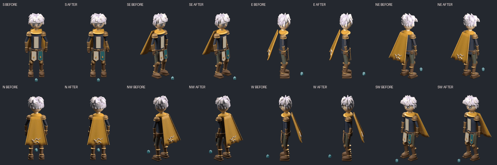

# v45 — แก้แขนซ้ายงอผิดรูป

แก้ท่าของโมเดลต้นแบบv44ตาม feedback “แขนซ้ายงอผิดรูปในบางมุมนะ” รอบนี้ปรับจุดควบคุมมือและศอกซ้ายให้อิงลำตัว แล้วตรวจภาพและไฟล์กระดูกจริงทุกมุม **ยังเป็นโมเดลต้นแบบ ไม่ใช่งานภาพfinalที่ผ่านสไตล์ของเกม** ใช้เครื่องมือlocalและเครดิต0

[ภาพขยายก่อน–หลัง8ทิศ](left-arm-before-after.png) · [แยกผิวแขนดูโดยตรง](isolated-left-before-after.png) · [GIFใหม่8ทิศ](eight-view-dense.gif) · [เปิดreviewerแบบoffline](review.html)

ต้นเหตุที่พบคือpoleศอกเดิมดันออกด้านข้างมาก และมือซ้ายอยู่ตามแกนโลกตอนลำตัวก้ม จึงอ่านเป็นแขนพับข้าง/บิดในบางมุม ตัวตรวจเดิมวัดความยาวและพื้นที่หน้าตัดได้ถูก แต่ยังไม่ครอบคลุมระนาบการงอที่ต้องการสำหรับท่านี้

| ผลตรวจsourceจริง313ช่วงเวลา | ก่อน | หลัง |
|---|---:|---:|
| มุมต้นแขนเอียงออกด้านข้างสูงสุด |42.85°|6.26°|
| ระนาบงอเบี่ยงจากแนวข้างลำตัวสูงสุด |89.02°|11.32°|

ตัวเลขเป็นเกณฑ์ท่า**แขนว่างแบบผ่อนคลายขณะก้มเก็บของ** ไม่ใช่ข้อจำกัดสากลของแขนคนหรือทุกmotion เกณฑ์ใหม่ต้องจับsourceเดิมที่ผู้ใช้ทักได้ด้วย ไม่ใช่แค่เปลี่ยนlabelแล้วผ่าน

คงแขนขวา/ขา/ลำตัว/หัว/clock/กล้องตามsourceเดิม ใช้scaleและตำแหน่งทั้งชุดจากv44โดยไม่fitใหม่แยกเฟรมหรือทิศ ตรวจระหว่างkeyด้วย: residualเท้าสูงสุดประมาณ0.012nativepx มีค่าเท่ากันทั้งก่อน–หลัง ไม่เรียกว่าexactzero

ไฟล์ประกอบ:

- [Blenderที่แก้แล้ว](original-character.blend) · [ผลตรวจsavedrigก่อน–หลัง](arm-inspection.json)
- [ผลตรวจรวม](audit.json) · [negative controls](regressions.json) · [ผลตรวจหน้าreview216ภาพ](browser-qa.json)
- [Know-howพร้อมขั้นตอน](KNOW-HOW.md) · [เกณฑ์เฉพาะท่า](arm-contract.json)
- [ผิวแขนซ้ายแบบมีocclusionจริง8ทิศ](left-surface-eight.gif): สีส้มคือmeshแขนซ้ายจริง ส่วนที่ผ้าหรือลำตัวบังยังถูกบัง ส่วนภาพisolatedแยกแสดงเพื่อดูรูปทรงเท่านั้น ไม่วาดทับตัวละคร

มุมที่เห็นผิวแขนน้อยจะระบุว่า `IMAGE_ANATOMY_UNKNOWN_OCCLUDED` ยังไม่ให้ผ่านกายวิภาคจากภาพนั้นโดยอัตโนมัติ ไม่รับรองcollision/มือทุกแบบ/งานภาพfinal/การเปลี่ยนชิ้นspriteในเกม หรือfactoryพร้อมผลิตจริง ผลGLBv44ก็ไม่ถ่ายโอนมายังmotionใหม่โดยอัตโนมัติ

ทำงานและpushเฉพาะbranchวิจัยเดิม เก็บv30–v44และภาพเดินWที่อนุมัติไว้เหมือนเดิม

ตรวจซ้ำ:28bounded checks /16negative controls /11browser controls ผ่าน แต่[ผลreview](quality-review.json)ยังไม่ใช่การอนุมัติงานภาพfinalหรือรับรองมุมที่ถูกบัง
