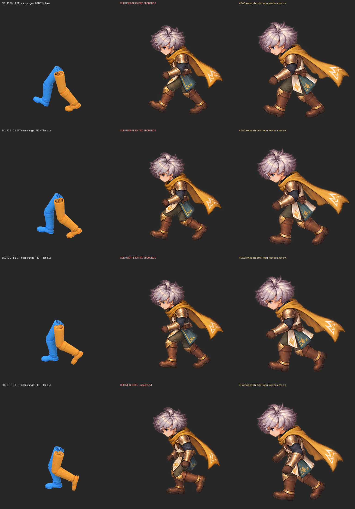
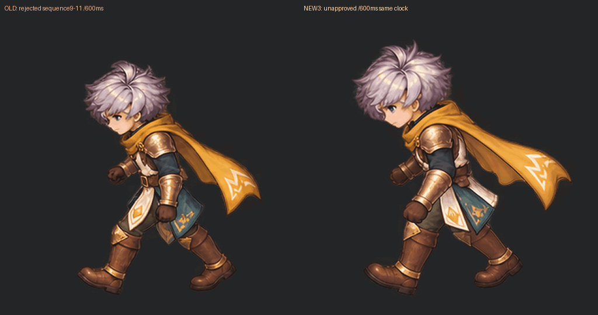

# ขาที่ผิดและมาตรฐานตรวจ sprite v16

**ผู้ใช้ปฏิเสธช่วงภาพ9–11ของ v15 ว่าผิดขา และขอให้เดินสมูทขึ้นพร้อมสร้างบรรทัดฐานสำหรับงาน sprite ทั้งหมด** รอบนี้เก็บคำปฏิเสธกับภาพจริง เพิ่มเครื่องมือตรวจรวม เจนแก้3ครั้ง และตรวจซ้ำโดยไม่เปลี่ยนเกณฑ์ให้ผ่าน

[GIF ทดลองจังหวะเท่ากันทุกเฟรม](uniform-review/walk-uniform-800ms.gif) · [APNG เต็มสี](uniform-review/walk-uniform-800ms.png) · [WebP](uniform-review/walk-uniform-800ms.webp) · [หน้าตรวจ source/เก่า/ใหม่ ทีละเฟรม](frame-review.html) · [มาตรฐานใช้ซ้ำ](../../../skills/modular-eight-direction-sprites/references/sprite-production-standard.md)

**ภาพใหม่ยัง REVIEW_REQUIRED ไม่เป็น production seed.** เครื่องมือยังไม่ได้อนุมานเจ้าของขาอย่างถูกต้องอัตโนมัติ ยังต้องตรวจ proximal chain/occlusion จากภาพใหม่ คำอนุมัติของ v12/v13 ไม่ย้ายมาสู่ชุดนี้

## เคสผิดขาที่ผู้ใช้ยืนยัน

[Receipt](evidence/user-rejected-v15-sequence.json) ผูก3คู่ในภาพผู้ใช้กับช่อง9/10/11ของบอร์ด v15, source sample20/22.5/25 และ SHA ของภาพจริง ปฏิเสธช่วงนี้เป็นกลุ่ม ไม่สร้างข้ออ้างว่าเห็น/วัด hidden hip ของแต่ละรูปแยกกันแล้ว

Source W นี้มี **LEFTใกล้กล้อง / RIGHTไกลกล้อง** ในช่วง9–11 RIGHTก้าวนำทางซ้ายของจอ ส่วนLEFTตามหลังทางขวาจอ Near contourต้องต่อจากสะโพกฝั่งใกล้ไปขาตามหลัง; far thighที่ก้าวนำต้องเกิดด้านหลังnear thigh/pelvisและมีcontour interruption การวางผ้าtealหรือเท้าให้ตรงตำแหน่งอย่างเดียวไม่ยืนยันจุดต่อขา



`sprite-review-gate.py` ตรวจ source/image/rejection hashes และรักษาfractional phasesไว้ ภาพเดิมที่ถูกปฏิเสธยังถูกบล็อกแม้เปลี่ยนphase labelหรือกรอกผลอื่นว่าPASS ภาพคนละbytesเริ่มunconfirmedใหม่ **ไม่ใช่ semantic leg classifier**

## เจนใหม่แล้วตรวจ ไม่เลือกเฉพาะผลที่ดี

| Attempt | สิ่งที่เปลี่ยน / ผล |
| --- | --- |
|1:สี่phase9–12|guideจริงพร้อมhip→knee→ankleทั้งสองข้าง + approved W sheetเป็นappearance; pose/ownershipใหม่ยังไม่อนุมัติ เป็นช่วงกลางก้าว ไม่ใช่loopเต็ม |
|2:ครบ16|source guidesเพิ่มactual bones และเลือกapproved appearanceเฉพาะsource20 ไม่ใช้สี่ท่าเป็นreferenceให้copyผิดphase; seamดีขึ้น แต่stepภายในแย่ลง เก็บเป็นfailure |
|3:ครบ16อีกครั้ง|แก้สองจุดที่measureเตือนและสัดส่วนทั้งตัวโดยอิงsourceเดิม; seamดีขึ้นมาก แต่12→13ยังเกินbudgetและanatomyยังต้องตรวจ |

[raw1](evidence/attempt1-raw.png) · [raw2](evidence/whole-cycle-raw.png) · [raw3](evidence/second-whole-cycle-raw.png) · [guide16](evidence/sixteen-owner-guides.png) · [prompts/provenance](provenance.json)

ตัวใหม่ยังส่งauthoring rows/columnsไม่ตรงequal logical cells การแพ็กปกติจึงใช้ไม่ได้ ใช้empty-gutter panelsที่ตรวจจริง หนึ่งpixel scaleและtranslationร่วมต่อแถว ไม่มีper-frame fit ไม่มีmirror/แก้anatomyด้วยPython รอบ3ผ้าคลุมข้ามcolumn boundaryเดิม เครื่องมือปฏิเสธ ไม่ตัดทิ้งเพื่อให้ผ่าน:เพิ่มpanelcutในgutterจริงและรักษาlogical column originเดิม [spec](evidence/attempt3-row-registration.json) · [receipt](evidence/attempt3-registration-receipt.json) ทุกcutตรวจalpha≤64จริง จุดsoleที่calibrateแถวไม่เป็นการตรวจอิสระและownershipยังunconfirmed

| วัดพิกเซลกลุ่มผมบน512canvas | v15ที่ถูกปฏิเสธช่วงขา | attempt2 | attempt3 |
| --- | ---: | ---: | ---: |
|stepสูงสุด|15.76px|21.13px|20.07px|
|seam16→1|14.47px|7.30px|1.46px|
|edgesเกินbudgetทดลอง20px|ไม่มี|8→9,12→13|12→13|

นี่คือpalette-region centroid ไม่ใช่Head boneหรือความถูกต้องทางanatomy **ไม่อ้างว่าสมูทขึ้นทั้งรอบเพราะseamดีขึ้น** แม้ค่ารอบ3เกิน20เพียงเล็กน้อยก็ไม่เพิ่มthresholdเพื่อให้ผ่าน Root/hip/knee/contactsที่ไม่ได้เห็นยังunknown [old report](check/old-standard-report.json) · [attempt2 report](check/new-standard-report.json) · [attempt3 report](check/attempt3-standard-report.json)



## GIFตึกตัก:แยกclockจากท่าวาด

600ms÷16=37.5ms แต่GIFมีหน่วย10ms ผลdecodeจริงเป็น30/40ms ระยะexposureต่างกัน10ms หรือ26.7%ของค่าเฉลี่ย **ไม่ใช่26.7%ความกระตุกที่คนรับรู้** [decoded600](check/cadence-600ms.json)

สร้างชุดใหม่จากmasterเดิมที่ **50msทุกเฟรม /16เฟรม /800ms** ทั้งGIF/APNG/WebP ไม่มีinterval variation [decoded800](check/cadence-800ms.json) · [manifest](uniform-review/manifest.json) นี่เป็น20FPSเพื่อทดสอบจังหวะ ไม่ใช่FPSมาตรฐานRO และช้ากว่าcontrol600ms จึงไม่เอาความช้าลงมาอ้างว่าท่าวาดถูก PNG/WebP alphaและvisibleRGBAตรงmaster การเปลี่ยนเวลาไม่พิสูจน์โลกจริงfoot-lock/ความเร็วเกม

หน้าดูใช้800msเป็นค่าเริ่มต้นและยังเลือก600mscontrol/1333mssource/2400msดูช้าได้ ทุกชุดในหน้าดูใช้clockที่เลือกเหมือนกัน ช่วง4poseแรกถูกแก้ให้เล่นครั้งเดียวแล้ว เก็บGIFที่เคยloopผิดช่วงไว้ใน [failure archive](evidence/looping-excerpt-failure/) ไม่เอา12→9ของช่วงกลางก้าวมาวัดเป็นseamของloopเต็ม

## มาตรฐานและเครื่องมือที่ใช้ต่อได้

`sprite-standard.py` คำนวณใหม่จากoriginal bound inputs ไม่อ่านคะแนนเก่ามารวมเฉย ๆ และปฏิเสธการเอาanatomy/continuity/contactของคนละชุดหรือคนละลำดับมาปะกัน Known rejection overrideทุกคะแนนอื่น ส่วนmissing root/owner/contact/partsไม่ถูกทำให้PASS

```bash
# จากrepo root: reportคำนวณสำเร็จ ไม่เท่ากับผ่านproduction
PYTHONPATH=/tmp/astraeon-vision-deps python \
  skills/modular-eight-direction-sprites/scripts/sprite-standard.py \
  --contract research/sprite-animation/leg-ownership-v16/evidence/attempt3-standard-contract.json \
  --out /tmp/current-sprite-standard.json --require-production
# ผลปัจจุบันต้องexit2 เพราะยังมีblockers
```

[Standard guide](../../../skills/modular-eight-direction-sprites/references/sprite-production-standard.md) ครอบคลุมsource/camera/owners,pose/spacing,loopหรือone-shot,timing,contacts,parts,file/runtimeและscoped acceptance สำหรับactionอื่นต้องมีsource phasesและgrip/contact adapterของตนเอง **รอบนี้ทดสอบWwalk ไม่อ้างว่าทุกaction/characterผ่านแล้ว** เครื่องมือใหม่ยังไม่มีpositive complete-parts adapterจึงบล็อกproductionไว้

ผ่าน122Python regression checksและ77actual browser checksหลังแก้mobile overflow ค่าทดสอบไม่ได้อนุมัติภาพ [Python](evidence/regression-check.txt) · [Browser](browser-check/browser-report.json) · [decoded output audit](format-check.json)

ค้นใหม่จาก [AniDoc official](https://github.com/robbyant-research/AniDoc), [ToonCrafter official](https://ttwong12.github.io/papers/tooncrafter/tooncrafter.html) และindexed abstractของPhysAnimator พบแนวทางควบคุมgeometryตามsequenceก่อนทำcolor/identity และข้อจำกัดsemantic/occlusionของvideo interpolation [บันทึกscope](evidence/source-audit.json) ไม่ได้ติดตั้ง/runโมเดลเหล่านี้หรืออ้างว่าอ่านPhysAnimatorเต็มpaperเมื่อdirectfetch403 ไม่ใช้ภาพdemoของเขาเป็นinputตัวละครเรา

งานถัดไปก่อนใช้เป็นproduction:แก้paired thigh origins/occlusionของภาพใหม่ให้ตรวจได้จริง คุมproportions/contactครบทุกphase และทดสอบtemporal line-artหรือpart-based backendที่รักษาgeometryได้ การเพิ่มpromptอย่างเดียวยังไม่ให้ผลแน่นอน ไม่มีคำรับรองerror-free generationหรือmass-production mastery
