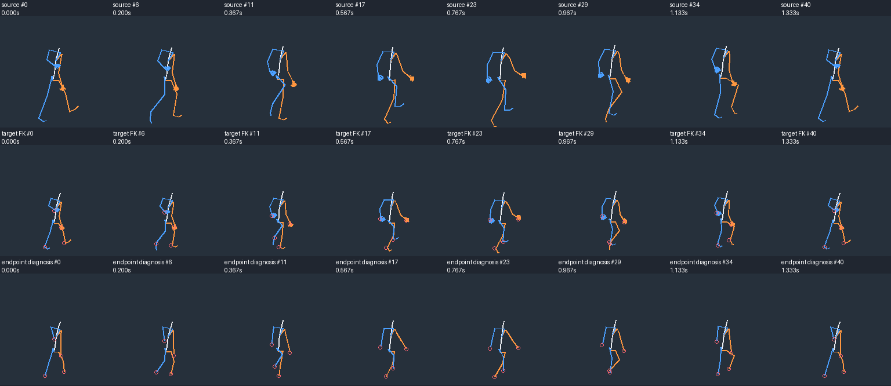
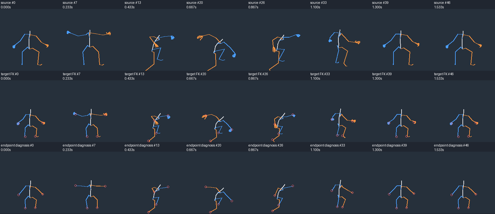

# Preset / retarget research, iteration 8

รอบนี้ศึกษา Mixamo พร้อมงานวิจัย 5 งาน, patent 2 ฉบับ และโค้ด retarget ที่ pin commit ไว้ ทดลองท่าสำเร็จรูปจาก Quaternius จริง 8 ท่า รวม 339 ตัวอย่างตามเวลาต้นฉบับ รวมถึงยืน เดิน วิ่ง กระโดด ลงพื้น กลิ้ง และตีดาบ ผู้ใช้อนุญาต preset จากแหล่งอื่นด้วย; KayKit เป็นอีกแหล่งที่ตรวจหน้าผู้สร้างแล้ว แต่ยังไม่ได้โหลดหรือทดลองคลิป

ข้อค้นพบหลัก: กระดูกยาวคงที่และหมุนถูกไม่ได้แปลว่ามือ/เท้าจะถึงเป้าหมายเมื่อเปลี่ยนสัดส่วน ในการทดลองนี้เป้าข้อมือขวาของท่าดาบเอื้อมไม่ถึงทั้ง 47 ตัวอย่าง จึงเก็บความคลาดที่เหลือไว้ ไม่ยืดแขนหรืออ้างว่าแก้การจับดาบแล้ว ภาพเหล่านี้เป็นไกด์วิเคราะห์โครงกระดูก ยังไม่ใช่แอนิเมชันตัวละครเรา และไม่มีภาพใดได้รับอนุมัติเป็น production seed

[Reusable practice](../../../skills/modular-eight-direction-sprites/references/preset-retargeting-practice.md) · [14-source reading audit](../../../skills/modular-eight-direction-sprites/references/retargeting-source-audit.json) · [Measurements](metrics.json) · [Provenance](provenance.json)

## Review boards

Blue = anatomical right; orange = anatomical left. Every drawing uses the same root-relative orthographic projection, with no bbox fitting or image mirroring. Logical root-to-pelvis helper links are not drawn as anatomical limbs. World/root motion is retained in the data; root-relative diagrams are not ground-contact measurements.

Each comparison has source / proportional FK / independent endpoint diagnostic rows. Red circles mark **synthetic trajectory goals**, not observed floor or weapon contact. Diagnostic rows omit distal finger/toe geometry because those chains/orientations were not solved. Eight overview columns are equally spaced sample indices for review, **not selected production key poses**.





[Walk eight facings](Walk_Loop-eight-views.png) · [Sword eight facings](Sword_Attack-eight-views.png)

[Idle](Idle_Loop-comparison.png) · [Jog](Jog_Fwd_Loop-comparison.png) · [Sprint](Sprint_Loop-comparison.png) · [Jump start](Jump_Start-comparison.png) · [Jump land](Jump_Land-comparison.png) · [Roll](Roll-comparison.png)

Nine `*-dense-*.png` pages retain all 339 source/FK pose pairs. These and both compressed data files are committed for inspection. Visual review scope is recorded in provenance; no hand/object surfaces exist in the target guide.

## Actual preset sample inventory

| Actual source clip | Samples including endpoint | Duration, seconds | Unreachable right-arm goals | Unreachable right-leg goals |
| --- | ---: | ---: | ---: | ---: |
| Idle_Loop | 76 | 2.500000 | 76 | 7 |
| Walk_Loop | 41 | 1.333333 | 41 | 4 |
| Jog_Fwd_Loop | 29 | 0.933333 | 0 | 1 |
| Sprint_Loop | 21 | 0.666667 | 0 | 2 |
| Jump_Start | 41 | 1.333333 | 23 | 3 |
| Jump_Land | 39 | 1.266667 | 39 | 3 |
| Roll | 45 | 1.466667 | 15 | 8 |
| Sword_Attack | 47 | 1.533333 | 47 | 0 |

The same author Standard RM GLB already audited in [source-motion-v7](../source-motion-v7/README.md) supplies these clips, not a Mixamo mirror. The file actually contains 43 animations and 65 bones. [Bundled author license](../source-motion-v7/License.txt) is CC0. No account, payment, Mixamo add-on or third-party retarget code was executed.

`source-transforms.json.gz` records each actual input timestamp, duration to the next input (terminal duration null), parent-local evaluated transforms, world joint heads, object transform and neutral rest matrices. Two Blender captures produced byte-identical compressed data. Repeated poses and endpoint samples remain; a source time is not inferred from a requested GIF FPS.

`proportion-study.json.gz` records the fresh generic target rest matrices, world FK points and independent two-segment diagnoses. Legs/root/pelvis use 0.64; torso 0.80; shoulder/hip offsets 0.85; arm segment offsets 0.72; neck/head offsets 1.15; finger offsets 0.85. These are experimental edge factors, not approved game anatomy, enlarged head geometry or a universal chibi preset.

Wrist targets are source chest-relative trajectories ×0.80, anchored at target chest. Ankle targets are source root-relative trajectories ×0.64, anchored at target root. Those explicit independent targets are deliberately different from some target dimensions. They are not observed contact labels. Fixed-length chain diagnosis reaches feasible goals and reports clamped unreachable goals; it does not move the pelvis/torso, solve palm orientation, annotate support intervals or bake a target rig.

Identity FK agrees with Blender-evaluated source joint heads within **3.626634e-6 source units**. Target parent-child head distances vary by at most **1.328758e-6**, excluding the logical pelvis-to-root offset. Initial broad checking correctly failed on the source's authored pelvis translation during roll/jump; inspection isolated that channel, which remains in the capture/target rather than being frozen. The rigid gate applies to the other anatomical offsets.

Sword right-arm error is at most **0.04312** before diagnosis and **0.03694** afterward, in source units, with all 47 goals still unreachable. Jog/sprint right-arm feasibility does not approve the rest of those animations. The user-rejected original v7 posing was not a source for this experiment and is not repaired by it.

## Reproduce

Run from the repository root, with Blender 4.3.2, Python, NumPy and Pillow. Use fresh output directories.

```sh
blender -b --python-exit-code 2 --factory-startup --python skills/modular-eight-direction-sprites/studies/source-motion/sample-presets.py -- --source research/sprite-animation/source-motion-v7/UAL1_Standard_RM.glb --output /tmp/new-preset-capture
PYTHONDONTWRITEBYTECODE=1 python skills/modular-eight-direction-sprites/studies/source-motion/assess-presets.py --input /tmp/new-preset-capture/source-transforms.json.gz --output /tmp/new-preset-assessment
PYTHONDONTWRITEBYTECODE=1 python -W error::ResourceWarning -m unittest discover -s skills/modular-eight-direction-sprites/scripts/tests -p 'test_*.py' -v
```

The sampler rejects source hash changes, selects actions explicitly, mutes NLA and sets FPS **before** import. The mathematical adapter requires exact complete mappings, a valid DAG, positive factors and proper rigid transforms; reflection, shear and scale transforms are rejected rather than silently flipping anatomical sides. Degenerate poles require authored guidance. All **20 tests** passed, including seven new transform-order/bend/reach/mirroring failure fixtures. Unit tests and world-point checks do not verify visual hand/foot contact or art.

`verification.json` inventories this review's files/hashes and records checks. No existing immutable production build or release gate was changed. An original target rig with calibrated rest bases, full-body constraint adaptation, actual sole/palm/hilt geometry, sparse accepted keys and modular redraw/export remains required.
