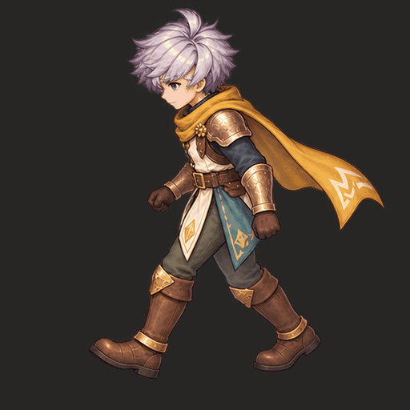

# ตรวจขาด้านข้าง v12 — เชิงกราน, depth และภาพที่ผู้ใช้ยืนยัน

**ชุด W ด้านล่างผู้ใช้ยืนยันว่า “อันนี้ถูกนะ”** เก็บไฟล์ `exec-8aaa73f6-b135-4e5b-b908-b3de6bc8b594.png` ตามเดิม พร้อม SHA ของภาพดิบและ master ทั้งสี่เฟรม ความเห็นนี้ใช้กับภาพชุดนี้ ไม่โอนไปภาพที่เจนใหม่

[W GIF](master/W/walk-quality.gif) · [W เครื่องมือตรวจ](master/W/leg-review.html) · [User acceptance receipt](evidence/W-user-acceptance.json) · [E/W ต้นแบบเปิดชั้นและภาพวาด](profile-review.gif) · [ผลรวม](review-summary.json)

## สิ่งที่แก้จากการตรวจครั้งก่อน

ผู้ใช้ยืนยันว่า E เฟรม 3 ที่แก้โดยย้ายผ้าสีเขียวยังผิด ผมถอนข้อสรุปว่าเส้นขานั้นพิสูจน์ตัวตนขาได้ ภาพนั้นยังเป็น [REJECTED](../eight-direction-v11/master/E/check/continuity-report.json) การไล่เส้นหน้าแข้งและ pixel support ยังไม่พิสูจน์ว่าต้นขาออกจากเชิงกรานข้างที่ถูกต้อง

ภาพร่าง “ซ้ายนำ/ขวานำ” ของผู้ใช้เพิ่มกฎตรวจ: สำหรับมุม W ขาซ้ายอยู่ใกล้กล้อง แม้ขาขวาจะก้าวนำ เส้นขาซ้ายด้านใกล้ยังต้องต่อเนื่อง ส่วนเส้นขาขวาด้านไกลต้องหยุดตรงที่ถูกบังหรือ T-junction ไม่เปลี่ยนชื่อขาตามตำแหน่งบูตหรือสีผ้า [บันทึกกติกา](evidence/user-contour-rule.json)

เครื่องมือจึงเพิ่มเส้นตรวจ **ขอบเชิงกราน → ต้นขา → เข่า ทั้งสองข้าง** และคู่ near/far จากขอบซ้อน ถ้าต้นขาต่อถูกข้างยังอ่านไม่ได้จะไม่ผ่าน การมีสะโพกถูกบังไม่เท่ากับผิดเสมอไป: ต้องอ่านรอยต่อและการบังได้ หรือใช้หลักฐานชิ้นงานแยกที่ตรวจได้ ไม่บังคับให้เห็นข้อสะโพกเปลือยผ่านเสื้อผ้า

## Depth จาก rig จริง

[E เปิดชั้นเสื้อผ้าและจุดสะโพก](source-depth/E-proximal-guide.png) · [W เปิดชั้นเสื้อผ้าและจุดสะโพก](source-depth/W-proximal-guide.png) · [E metric depth](source-depth/E-depth-guide.png) · [W metric depth](source-depth/W-depth-guide.png) · [ข้อมูลและ SHA](source-depth/depth-index.json)

ทำ **8 โพส × 5 โหมด = 40 render passes** จาก `.blend` เดิมโดยไม่แก้โพส มี dressed, cutaway, isolated ขาขวา, isolated ขาซ้าย และ isolated pelvis/torso ใช้ bone weights ตั้งเจ้าของชิ้น เก็บ float32 depth จริง และใช้ display range เดียว [3.6,5.4] scene units ทุกเฟรม

E มีสะโพกขวาใกล้กล้อง W มีสะโพกซ้ายใกล้กล้องตลอดสี่โพสของ source นี้ ระยะต่างประมาณ 0.096–0.101 scene units ตรวจจุดซ้อนที่มองเห็นกับระยะ isolated legs **14,421 pixels ไม่มี depth-order mismatch** ข้อมูลนี้รับรอง source render ไม่ได้วัด depth ที่ซ่อนอยู่ในภาพวาด

ผิวต้นขาด้านไกลในบริเวณ proximal ที่สุ่มรอบจุดสะโพกถูกบังหมดใน dressed source และด้านใกล้ก็ถูกบังมาก จึงเพิ่ม cutaway เพื่อไม่ให้ภาพเสื้อผ้าปิดรอยต่อเป็นเรฟเดียว ความถูกต้องของ source bone ไม่รับรอง anatomy ของภาพวาดทับ

## ตรวจจากรูปจริงเพิ่มแล้ว

[ภาพเทียบโครงสร้างเฟรม 3 ถูก–ผิด](image-structure-check/rejected-W-pose-3/image-structure-comparison.png) · [รายงานจากรูปผิด](image-structure-check/rejected-W-pose-3/structure-report.json) · [รายงานจากรูปที่ยืนยันแล้ว](image-structure-check/approved-W-pose-3/structure-report.json)

ตัวใหม่ `profile-structure.py` จัดภาพด้วย SIFT/RANSAC จากส่วนหัว/ลำตัว ใช้ similarity เดียวทั้งภาพ ไม่ mirror ไม่ปรับขาแยก แล้ววัดความต่างของขอบเส้นในบริเวณเชิงกราน–ต้นขาที่ระบุจาก W เฟรม 3 ที่ผู้ใช้ยืนยัน

**ภาพใหม่ `exec-ea566…` เฟรม 3 ที่ผู้ใช้ชี้ว่าผิดถูกติดธง `STRUCTURAL_DIFFERENCE_REQUIRES_REVIEW` จาก pixels จริง** โดยไม่ใช้ธงผิดที่ผู้ใช้บอกมาคำนวณผล บริเวณ proximal overlap มี p95 edge distance ประมาณ **17.74 px** เกิน budget ชั่วคราว 8 px ส่วนภาพเรฟและ control ที่ขยับภาพ/ปรับความสว่างเล็กน้อยอยู่ใน budget

ผลนี้เป็น **ตัวตรวจโครงสร้างต่างจากภาพที่ยืนยันแล้ว ไม่ใช่โมเดล semantic ที่พิสูจน์ขาสลับอัตโนมัติ** เสื้อผ้าหรือการออกแบบที่เปลี่ยนก็อาจทำให้ต่างได้ ภาพใหม่ที่โครงสร้างตรงยังไม่รับรอง anatomy ที่อ่านไม่ได้ ตัวละคร/ชุด/มุม/เวลาอื่นต้องมี source และเรฟของตัวเอง ระบบตอบ INCONCLUSIVE เมื่อจัดภาพหรือเห็นหลักฐานไม่พอ ไม่อ้างความแม่นยำจากตัวอย่างเดียว

ภาพ `exec-ea566…` เป็นงานที่สั่ง E แต่โมเดลวาด W ตามเรฟที่อนุมัติ แล้วยังถูกผู้ใช้ปฏิเสธเฟรม 3; บาง cell ถูกตัดขอบจึง pack ทั้งคลิปไม่ผ่าน เก็บ [raw](evidence/E-from-approved-W-failed.png) และ [failure record](evidence/E-from-approved-W-failed/failure.json) เท่านั้น ภาพเฟรม 3 ที่ crop มาตรวจเป็น diagnostic ไม่ใช่คลิปครบที่ใช้ได้

## สถานะและการใช้งาน

- **W ใหม่:** ผู้ใช้ยืนยันการอ่านขาถูกต้อง `USER_ACCEPTED_LEG_READABILITY` พิกัดข้อสะโพกภายในที่ถูกบังยังเป็น unknown ไม่สร้างตัวเลขขึ้นมาเพื่อให้คะแนนผ่าน
- **E ใหม่:** ยัง REVIEW_REQUIRED [GIF](master/E/walk-quality.gif) · [เครื่องมือตรวจ](master/E/leg-review.html) ไม่โอนคำอนุมัติจาก W มาให้ E
- **ภาพ E แก้เดิมและภาพใหม่เฟรม 3 ที่ถูกชี้ผิด:** เก็บการปฏิเสธแยกตาม SHA ทุกภาพ คำยืนยัน W ก่อนหน้าไม่อนุมัติ W-like รูปใหม่
- **Production/modular:** ภาพใหม่ยังเป็น flat frames ไม่ใช่คลัง hair/equipment แบบเปลี่ยนชิ้นครบ การอนุมัติ leg readability ไม่รับรอง hidden joints, contacts หรือทุกส่วนของ production pipeline

ดาวน์โหลด HTML แล้วเปิด browser เลือก cutaway/depth/dressed source คลิกขอบเชิงกรานและไล่สายต้นขา–เข่าแต่ละข้าง ตรวจขอบซ้อนใกล้–ไกลด้วย T-junction/contour overlap สีผ้าหรือแสงเงาอย่างเดียวไม่เป็นหลักฐาน Export JSON แล้วรัน checker ใหม่ ผลเดิมถูกพักทันทีที่แก้ annotation ส่วนคำยืนยันผู้ใช้เก็บแยกจาก measurement state และไม่ขยาย scope เอง

**73 Python tests ผ่าน** รวมหกตัวตรวจจากภาพจริง/registration controls; **30 browser checks ของ v11 และ 17 checks ของ depth/approval UI ผ่าน** [Regression](evidence/regression-check.txt) · [Browser report](browser-check/browser-report.json) · [W desktop](browser-check/W-approved-desktop.png) · [W mobile](browser-check/W-approved-mobile.png) · [E pending](browser-check/E-pending-mobile.png)

PNG/APNG และ WebP lossless ของ E/W ที่ pack สำเร็จมีสี่เฟรม 512 square เก็บ alpha/visible RGB ตรง master; GIF ใช้ palette ร่วม 1330 ms ไม่ใช่หลักฐาน anatomy [ผลตรวจรูปแบบ](review-summary.json)

## จดไว้ใช้กับตัวละครอื่น

[SKILL.md v0.12](../../../skills/modular-eight-direction-sprites/SKILL.md) · [กติกา วิธีใช้ซ้ำ วิจัย และคำสั่ง](../../../skills/modular-eight-direction-sprites/references/profile-pelvis-depth.md) · [Source audit](evidence/research-source-audit.json) · [Generation provenance](evidence/generation-provenance.json) · [Inventory](inventory.json)

กฎใช้ซ้ำคือ parent ของขาต้องอยู่กับเชิงกรานเดิม, ใกล้/ไกลมาจาก rig+camera, เส้นใกล้ต่อเนื่องและเส้นไกลหยุดตรงการบัง, ชิ้นเสื้อผ้าไม่เปลี่ยนเจ้าของขา และทุกผลตรวจผูกกับภาพจริงของตัวนั้น หลักฐานรูปร่างหรือ palette ของตัวนี้ไม่ใช่ classifier สากลสำหรับตัวอื่น

ทำงานและ push เฉพาะ `research/modular-sprites-full-body-2026-10-11`
