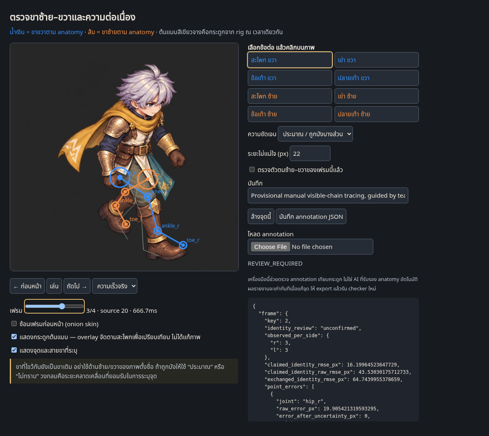

# Quality v10 — ตัวละครละเอียดและเครื่องมือตรวจขา

ใช้สามภาพที่ผู้ใช้แนบล่าสุดเป็นเกณฑ์คุณภาพโดยตรง: หน้าและผมมีรายละเอียด เกราะบรอนซ์มีมิติ ผ้าคลุมเหลืองมีลาย ชุดผ้า/หนังอ่านวัสดุได้ และสัดส่วนใกล้ตัวละครต้นแบบ รอบนี้เก็บ **512×512 master ต่อเฟรม** แทนการย่อเหลือภาพตัวละครเล็กจนรายละเอียดหาย

[GIF](master/walk-quality.gif) · [APNG โปร่งใสเต็มสี](master/walk-quality.png) · [Lossless animated WebP](master/walk-quality.webp) · [แผ่นภาพเต็ม](master/quality-review.png)

**ภาพยังไม่ผ่าน anatomy/motion acceptance** ภาพสวยขึ้นไม่ได้แปลว่าขาถูกต้อง เครื่องมือตรวจด้านล่างรายงานข้อคลาดเคลื่อนจริง และไม่ให้สถานะ production-ready

## เปิดเครื่องมือตรวจ

[leg-review.html](leg-review.html) เป็นไฟล์ครบในตัว ไม่มี dependency/network สำหรับใช้งาน ดาวน์โหลดไฟล์แล้วเปิดในเบราว์เซอร์ได้เลย GitHub แสดง HTML เป็น source จึงต้องดาวน์โหลด ไม่ใช่เปิด blob แล้วคาดว่าจะรันเครื่องมือ

- น้ำเงินคือ **ขาขวาตาม anatomy** ส้มคือ **ขาซ้ายตาม anatomy** ไม่ใช้ด้านซ้าย/ขวาของจอเป็นตัวตนขา
- เลื่อนเฟรม เล่นความเร็วจริง/¼ ดูภาพซ้อนเฟรมก่อนหน้า และซ้อนกระดูกต้นแบบได้
- เลือกสะโพก เข่า ข้อเท้า หรือปลายเท้า แล้วคลิกแก้ตำแหน่งได้ ระบุ “เห็นจุดจริง”, “ประมาณ/ถูกบัง”, หรือ “ไม่ทราบ” พร้อมวงระยะไม่แน่ใจ
- Export/import annotation JSON ได้ การแก้จุดทำให้รายงานเดิมหมดอายุ ต้องรัน checker ใหม่ เครื่องมือไม่เปลี่ยนภาพ ไม่สลับขาให้เอง

## เทียบกับกระดูกต้นแบบจริง

อ้างอิง source `Walk_Loop` ที่ retarget ลง rig ใหม่ใน v9 และเปิดไฟล์ `.blend` ตรวจซ้ำครบ 41 จุดเวลาอีกครั้งในรอบนี้ ใช้ pose indices **0,10,20,30** ในภาพ 4 โพส เปรียบเทียบกระดูก `thigh_* → calf_* → foot_* → ball_leaf_*` โดยฉายด้วยกล้อง SE เดิม ไม่ใช่ skeleton ที่เดาจาก screenshot

Checker ตรวจ hash ของภาพ, motion JSON, source transform capture, baked Blender file และผล replay จากไฟล์จริง แล้วคำนวณ reference projection กลับจาก motion data เพื่อปฏิเสธ reference ที่แก้เอง เวลาโพสที่ผิด หรือภาพที่เปลี่ยนหลัง annotation

[Annotations](leg-annotations.json) · [ผลตรวจ](leg-check/continuity-report.json) · [กระดูกเทียบภาพ](leg-check/leg-review-board.png) · [เปิด rig ตรวจซ้ำ](evidence/source-rig-replayed.json) · [รูปต้นแบบจาก rig](evidence/actual-rig-four-poses.png)

## ผลตรวจภาพล่าสุด

| โพส | คลาดจากกระดูกก่อนหักความไม่แน่ใจ | หลังหักความไม่แน่ใจ | ผล |
| --- | ---: | ---: | --- |
| 1 / source 0 | 30.54 px RMS | 8.96 px RMS | Identity ยังไม่ยืนยัน; ค่าคลาดอยู่ในวงความไม่แน่ใจของ annotation |
| 2 / source 10 | 28.81 px RMS | 5.48 px RMS | Identity ยังไม่ยืนยัน; ค่าคลาดอยู่ในวงความไม่แน่ใจ |
| 3 / source 20 | 43.53 px RMS | **16.20 px RMS** | เกินงบตัวอย่าง 16 px; ต้องแก้ posing/landmark และรีวิว |
| 4 / source 30 | 31.88 px RMS | 3.50 px RMS | ข้อเท้า/ปลายเท้าซ้ายถูกบัง ไม่ใส่จุดเดาให้ผ่าน |

ตำแหน่งที่เห็นและระบุได้ครอบคลุม **65.625%** ของ 32 จุด; ถ้ารวมจุดประมาณเป็น **93.75%** ทั้งสองค่าเป็น **coverage ไม่ใช่ความถูกต้องของ anatomy** มีสองจุดที่ไม่ทราบและตัวตนขาทั้งสี่โพสยังเป็น provisional หลังฉายกระดูกเพื่อตรวจรูปร่างใช้ scale บวกเดียวทั้งคลิปและเทียบแบบ pelvis-relative; ไม่ได้วัด foot-lock หรือรับรอง root registration

การเทียบทั้งสายขาตามที่ระบุให้ error ต่ำกว่าการแลกชื่อทั้งสองขาในตัวอย่างนี้ แต่ยังสรุปไม่ได้ว่าไม่มีการสลับขา เพราะสะโพกถูกผ้าบังและ labels มาจากการ tracing ที่ยังไม่ยืนยันอย่างอิสระ เปรียบเทียบ trajectory ตาม source clock รวมรอยต่อ **4→1** ด้วย: บางค่าคลาดถูกครอบด้วยวงความไม่แน่ใจ จึงเก็บทั้งค่าดิบและค่าหลังหักวงไว้ ไม่ตีความค่าหลังหักที่เป็นศูนย์ว่าเคลื่อนไหวถูกแน่นอน

## ทดสอบเครื่องมือ

**37 Python tests ผ่าน**: เดิน/ไขว้ขาตาม source ที่ถูกต้องไม่เตือนสลับผิด ๆ; จงใจสลับทั้งสายขา, สลับเฉพาะข้อเท้า, ขยับเข่า, ทำซ้ำครึ่งวงรอบ, mirror ภาพ, ทำจุดหาย, เพิ่มความไม่แน่ใจ และแก้ hash/เวลา/bone reference มีการตรวจหรือปฏิเสธตามกรณี การทดสอบเหล่านี้เป็น synthetic coordinate controls ไม่ใช่การอ้างว่าภาพเจนผ่าน anatomy

**20 browser checks ผ่าน**: โหลดภาพจริง คลิกจุดตาม master coordinates เลื่อน/เล่นเฟรม quarter speed, onion skin, export/import, invalidation, ปฏิเสธ reference/เวลาที่แก้ และ desktop/mobile โดยไม่มี JS errors [รายงานเบราว์เซอร์](browser-check/browser-report.json) · [Mobile screenshot](browser-check/mobile.png) · [Regression output](evidence/regression-check.txt)

เบราว์เซอร์ managed environment บล็อกการเปิด `file://` จึงตรวจ self-contained HTML ผ่าน `setContent` บน document ว่าง การทดสอบไม่ได้เปิดเกมเดิมหรือใช้ภาพตัวละครที่ถูกปฏิเสธ

## การเจนและขอบเขต

สองชุด 8 โพสแรกให้คุณภาพผิวภาพดีขึ้น แต่สลับ support leg ไม่ครบตามคำสั่ง เก็บเป็นข้อผิดพลาด ไม่ใช้เป็น motion seed ที่อนุมัติ แล้วทำชุด 4 โพสมือเปล่าจาก **actual rig renders** และใช้ชุดใหม่แรกเป็นตัวอย่างผิวภาพที่อ้างอิงสามภาพล่าสุดของผู้ใช้

Tool ส่งกลับ 1254×1254 แม้ขอ 1024×1024 ต้องตรวจขนาดจริงก่อนแยกภาพ ใช้ cell 627 square และ scale เดียว `512/627` แถวล่างมี displacement ร่วมกัน จึงใช้ row pitch **607 px** (offset -20) กับทั้งแถว ไม่มี per-frame bbox fit, เปลี่ยนสเกลรายเฟรม หรือวาดแก้ anatomy ด้วย Python ค่านี้เฉพาะชีตนี้ ไม่ใช่ค่ามาตรฐาน production และไม่คืน pose ที่แม่นยำอัตโนมัติ

PNG/APNG และ lossless WebP เก็บ RGBA เต็มสี; GIF จำกัด palette ร่วมทั้งคลิป 256 สีและพื้นหลังมืดสำหรับรีวิว Four-pose cadence คง source cycle 1.333333373 s: APNG 1333 ms, GIF 1330 ms ไม่มีอาวุธในตัวอย่างสุดท้ายเพื่อแยกการตรวจ gait ออกจาก grip

[Raw output และ prompts](evidence/prompts.json) · [ชุด 8 โพสครั้งแรก](evidence/eight-pose-attempt-1.png) · [ชุด 8 โพสครั้งที่สอง](evidence/eight-pose-attempt-2.png) · [4 โพสดิบ](evidence/four-pose-raw.png) · [ก่อนแก้ row spacing](evidence/uncalibrated-walk-quality.gif) · [Master manifest](master/quality-manifest.json)

Motion author [Quaternius](https://quaternius.itch.io/universal-animation-library), CC0; [license เดิม](../source-motion-v7/License.txt). Source mannequin geometry ไม่ใช่ตัวละครของเรา รูป painted ทั้งตัวนี้ยังเป็น flat candidate; complete modular geometry/parts ยังคงอยู่ใน [v9](../walk-test-v9/README.md) ไม่สามารถแยกภาพรวมแล้วอ้างว่ามี hidden replacement parts ครบ

[คำสั่งและงานวิจัยสำหรับ checker](../../../skills/modular-eight-direction-sprites/references/anatomical-continuity.md) · [SHA256 inventory](inventory.json)
