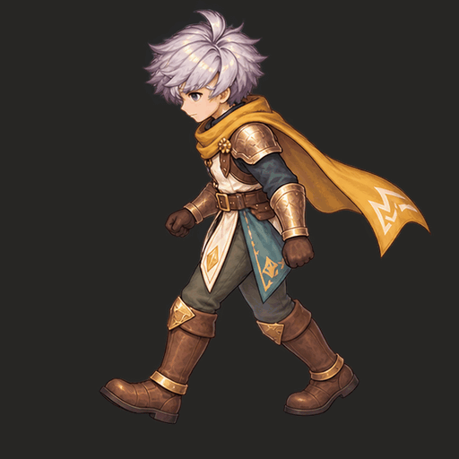

# เดิน W 8 เฟรมตามจำนวนของ RO

เรฟ **RO male Swordman walk block 1 มี 8 เฟรม** ทุกทิศที่ audit ไว้ รอบนี้เพิ่ม W จาก 4 เป็น **8 เฟรมต่อรอบเดิน** โดยเก็บเฟรมที่ผู้ใช้ยืนยันไว้เป็นพิกเซลเดิมในช่อง **1,3,5,7** แล้วเติมช่วงระหว่างกลาง



[GIF 8 เฟรม จังหวะอิงเรฟ](master/walk-ro-cadence.gif) · [APNG เต็มสี 75 ms/เฟรม](master/walk-ro-cadence.png) · [WebP lossless](master/walk-ro-cadence.webp) · [ภาพครบ 8 เฟรม](master/frames-review.png)

## จำนวนเฟรมและเวลา

| ชุด | เฟรม | รอบเดิน | ใช้เทียบอะไร |
| --- | ---: | ---: | --- |
| [8 เฟรมใหม่](master/walk-ro-cadence.gif) | 8 | 600 ms | จำนวน/จังหวะตาม community-rendered RO sample |
| [4 เฟรมเดิม ความเร็วเดียวกัน](master/four-approved-keys-same-speed.gif) | 4 | 600 ms | แยกผลจากจำนวนเฟรมออกจากการเร่ง playback |
| [8 เฟรม ความเร็ว source เดิม](master/walk-source-cadence.gif) | 8 | ประมาณ 1.333 s | เทียบความต่อเนื่องกับจังหวะ Quaternius เดิม |

[RO count/timing audit](evidence/ro-walk-count-audit.json) อ้างอิงข้อมูลที่ตรวจไว้จริงจาก ragassets: 8 เฟรม × 75 ms รวม 600 ms เป็นเวลาใน conversion นี้ ไม่อ้างว่า RO ทุกอาชีพ/แอ็กชันหรือ client จริงมี FPS ตายตัวเช่นนี้ GIF เก็บเวลาได้เป็นหน่วย 10 ms จึงใช้ 70/80 ms กระจายให้ครบ 600 ms; APNG/WebP เก็บ 75 ms ตรง ส่วน source-clock GIF รวม 1330 ms ตามข้อจำกัด format

## เก็บเฟรมที่ถูกไว้ แล้วเติมส่วนที่ขาด

Source จริงเพิ่มเป็น **0,5,10,15,20,25,30,35** จาก baked rig เดิม W กล้องเดิม มี depth/cutaway/isolated geometry 8 โพส 40 render passes และ owner masks ที่จุดซ้อน 10 บริเวณ [Source depth](source-depth/W-proximal-guide.png) · [Source owners](source-owners/W-owner-guide.png)

การเจน 8 โพสทั้งตัวครั้งแรกเปลี่ยนภาพหลักและบางช่วงมีรูปร่างใกล้กันมาก จึงเก็บเป็น [alternative study](attempts/full-eight-redraw/frames-review.png) แล้วเจน 4 inbetweens แยกเป็นชีตร่วมเดียวเพื่อไม่วาดทับเฟรมที่ผู้ใช้ยืนยัน ช่วง source35 ของชีต inbetweens ดูคล้าย passing pose มากกว่า pre-contact จึงเลือก source35 จาก alternative eight-pose study ที่ขาเหยียดเข้า contact มากกว่า ไม่วาดแก้ขาด้วย Python ไม่ mirror และไม่ fit ตัวรายเฟรม

[Frame origins](evidence/frame-origins.json) บอกต้นทางของทุกเฟรม ช่อง 1,3,5,7 มี **RGBA ตรง master เดิมทั้งหมด** ช่อง 2,4,6,8 เป็นภาพใหม่ที่ยังต้องตรวจ/รับรองรอยต่อขาและน้ำหนัก **คำยืนยัน 4 เฟรมเก่าไม่อนุมัติทั้งคลิป 8 เฟรมโดยอัตโนมัติ** ภาพทั้งหมดเป็น flat frames ไม่ใช่ painted replacement parts

พบปัญหาทางเทคนิคระหว่างแพ็ก: resample RGBA แม้ขนาด 1:1 สามารถเปลี่ยนสีบริเวณ alpha ได้ แก้ normalizer ให้ copy cell เดิมตรง ๆ เมื่อเป็น integral 1:1 แล้วตรวจความเท่ากันของเฟรมหลักจริง ชุดก่อนแก้เก็บใน `attempts/interleaved-resampling-failure` เป็นหลักฐาน ไม่ใช่ canonical preview

Raw ชีตแรกส่งกลับ **1774×887** ทำให้ cell เป็น 443.5 square ต้องใช้ extent ร่วมที่ตำแหน่งเศษพิกเซล ไม่ floor เป็นช่องขนาดต่างกัน ชุด final interleave เป็น 2048×1024, cell 512 square, copy 1:1 ไม่มีการขยับหรือสเกลภาพตาม bbox รายเฟรม การจัดกริดไม่พิสูจน์ anatomy หรือ foot-lock

## ตรวจซ้ำ

[เครื่องมือตรวจ 8 เฟรม](leg-review.html) · [รายงาน](check/continuity-report.json) · [ตรวจไฟล์เคลื่อนไหว](format-check.json) · [Browser](browser-check/browser-report.json)

เครื่องมือผูก source/time/image hashes ครบ 8 เฟรมและรอยต่อ **8→1** สถานะทั้งคลิปยัง REVIEW_REQUIRED เพราะรอยต่อเชิงกรานของเฟรมใหม่ไม่ได้วัด/ยืนยันครบ HTML ใช้ **source clock 1.333 s** สำหรับ QA; GIF อิง RO ใช้ playback 600 ms จึงต้องแยกสองนาฬิกานี้ ไม่เปลี่ยนเวลา source เพื่อสร้างคะแนนผ่าน

ตรวจ PNG/APNG, WebP และ GIF ทั้งสองจังหวะรวม **6 clips**: แต่ละไฟล์มี 8 decoded frames ไม่ซ้ำ ทุกไฟล์ full-color มี alpha/visible RGB ตรง master และระยะเวลาตรงที่ประกาศ รวมการเทียบ exact approved anchors **73 regression tests ผ่าน** และ **8 browser checks ผ่าน** [Regression](evidence/regression-check.txt) การตรวจนี้ไม่รับรอง anatomy ของภาพใหม่หรือความนิ่งของ planted contact

## Recipe ใช้ซ้ำ

`export-profile-depth.py --views W --keys 0,5,10,15,20,25,30,35` และ `pack-profile-depth.py --columns 4` รองรับจำนวน pose ที่ระบุ ส่วน `pack-leg-owners.py --profile --columns 4` นำ IDs ของ actual profile renderer มาใช้โดยรวม pelvis/other เป็น occluder 3 และรักษา R=1/L=2

`pack-motion-grid.py` รองรับ grid/จำนวนเฟรมที่กำหนด ใช้ shared scale/padding และ fractional extents พร้อมตรวจ alpha ขอบ cell, เวลา GIF และการเก็บพิกเซล 1:1 ใช้ `--source-cycle-ms` ให้ตรงคลิปจริง อย่าใช้ 8 เฟรมหรือ 75 ms เป็นกฎสำหรับทุกแอ็กชัน/ตัวละคร

```bash
python skills/modular-eight-direction-sprites/studies/walk-test/pack-motion-grid.py \
  --sheet research/sprite-animation/ro-walk-eight-v13/evidence/interleaved-eight.png \
  --output /tmp/new-eight-frame-pack --columns 4 --rows 2 \
  --source-keys 0,5,10,15,20,25,30,35 --frame-ms 75 --source-cycle-ms 1333
node skills/modular-eight-direction-sprites/studies/walk-test/verify-eight-frame-ui.cjs
```

[Raw/prompts/provenance](evidence/generation-provenance.json) · [SHA inventory](inventory.json) · ทำงานเฉพาะ branch `research/modular-sprites-full-body-2026-10-11`
