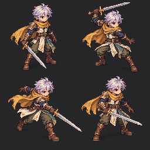

# Four-key original art-direction practice — v5

[Full study board](four-key-pose-study.png) · [Native-size review](native-size-review.png) · [Provenance](study-provenance.json) · [Research and proposed style contract](../../../../skills/modular-eight-direction-sprites/references/original-ro-art-direction.md)

The user asks for Ragnarok's appeal in the game's own identity. This new text-driven board interprets the provided silver-haired, gold-scarf adventurer as ready, load, cut/follow-through and recovery poses, in that row-major order. No rejected branch asset or external sprite image was supplied as a generation input. The built-in image generation tool produced the original board; the native review only crops equal cells and reduces them mechanically, without repainting or extracting transparency.

The changed knees, stance and chest silhouettes make the body action easier to examine independently from a trail. The visible sword arm can be followed back to the nearer right shoulder in these four illustrations, including the cross-body cut. This is visual observation, not a source-rig/weight check. Identity landmarks such as the clasp need stricter consistency, and small ornamentation can overwhelm the face at gameplay size.

The board remains **unapproved study art**. It returned 1254×1254 rather than the requested 1024×1024 and does not establish a uniform authored native pixel grid. It has an opaque background, one facing, no source contact guide, no proven skeleton/bone lengths and no complete hidden parts. It is not an animation strip, approved turnaround, modular sprite or production seed. Do not independently fit the cells into a GIF or treat semantic masks as complete hair/equipment.

The separate [rig proof](../rig-proof-v4/README.md) remains the complete-part technical experiment. Its new [effect exposure check](../rig-proof-v4/effect-exposure-check.json) repairs a 90 ms late trail lifetime while retaining eight body keys and the same action duration. That timing repair does not approve its model look or ribbon shape, and this art board does not replace its actual part sources.
