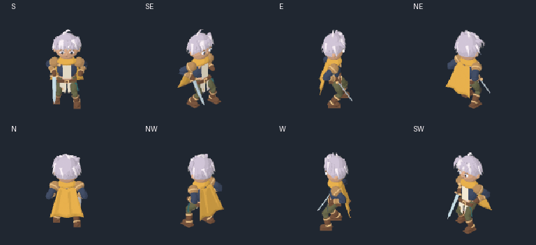
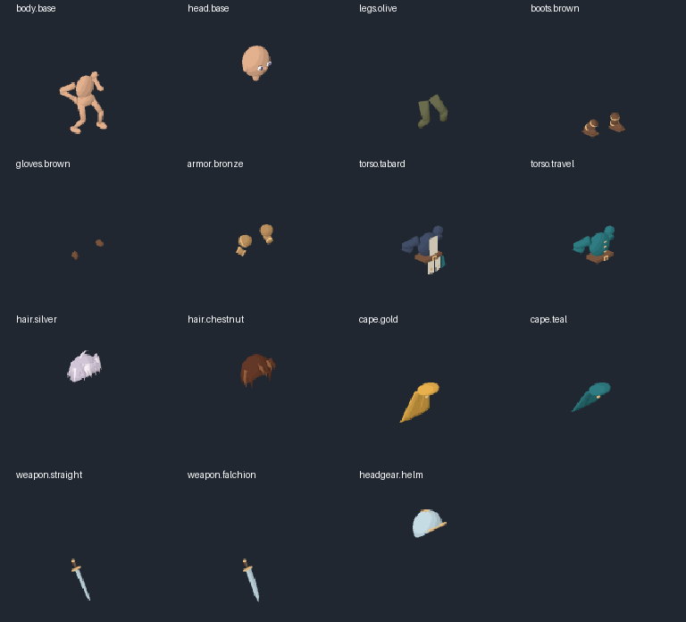

# Silver Scarf — complete-part rig proof v4

**Technical prototype. Character art, acting and sword effect are unapproved.** Painted v3 was rejected for apparent hand switching, its effect and flattened parts; it is retained only as failure evidence. This iteration changes the authoring method to original editable geometry, named anatomical bones and complete independently exported parts. No branch character artwork or third-party sprite pixels are inputs.



[Single-facing attack](attack-SE.gif) · [Quarter speed](attack-quarter-speed.gif) · [Body without weapon/FX](attack-body-only.gif) · [Alternate equipment](attack-alternate.gif) · [Four diagonal attack views](attack-four-diagonals.gif)



## What changed

- One original armature drives the entire character. Both sword variants are weighted only to `weapon.right`, parented to `right.hand`; screen position never determines ownership.
- Complete body, bald head, two genuinely different hair shapes, two torso shapes, two capes, armor, gloves, boots, two weapons and a helmet are independent sources. Hidden geometry remains available when equipment changes.
- Seventeen item/effect passes cover eight facings and eight held attack keys: 1,088 per-item frames. The source has 11 equipment/appearance slots and 48 logical loadouts. Body/head/hair remain separate.
- Every item uses the same camera, scale, ground root and 800 ms timeline: `[80,100,100,60,60,120,140,140]`. This is a provisional RO-like pose cadence, not a universal original-client FPS claim.
- Sword effects use recent actual blade-base/tip history, with separate geometry for straight and curved swords. They emit during the forward cut and clear during recovery/interruption. Their visual appeal and translucent self-overlap remain unresolved.
- A new optional preview policy maps eight facing selections to four existing diagonal attack views, based on the studied RO Swordman block. All equipped pieces share the same resolved view; no image flip occurs. This control is not yet browser-verified on the latest export.

## Inspect and reproduce

[Editable Blender source](silver-scarf-modular-source.blend) · [Manifest](rig-manifest.json) · [Source rig check](source-rig-check.json) · [Independent render comparisons](quality-report.json) · [Structural checks and invalid fixtures](contract-check.json) · [Browser validation status](browser-qa.json)

[Original source scripts and exact commands](../../../../skills/modular-eight-direction-sprites/studies/rigged-parts/README.md). `parts/` contains untrimmed independent color frames; `strips/` contains one-facing eight-pose color and packed-depth strips. Raw EXRs and duplicate per-frame packed-depth PNGs stay local and can be regenerated. All dependencies are local tools; no paid generation job was used.

From this folder, run:

```sh
python -m http.server 8772 --bind 127.0.0.1
```

Open `http://127.0.0.1:8772/`. GitHub displays the GIFs and PNGs above but does not execute the interactive HTML file. The preview has direction, equipment, helmet-coverage, normal/slow, pose, one-shot, interruption and hand-socket controls. It loads actual separate sprite strips and composes source visibility before resolving to a 128 px sprite. This CPU depth compositor is a research harness, not an integrated game renderer.

## Actual evidence and failures

The saved source was reopened and its baked keys evaluated without manual pose assignment. All eight keys retained the right-hand attachment; maximum source grip error was about `1.35e-7` world units. The source has 17 bones. These verify the source relationship, not final artistic wrist/grip readability.

For 96 selected whole-character references, independent full-scene part IDs and alpha match the exported-part compositor exactly. Packed depth also preserves the compositor's visibility. **Exact color comparison remains failed:** six source pixels differ, with maximum channel difference 90, in the final export, after capture-offset and complete bare-foot source changes. The earlier four-pixel failure and unsuccessful shading stabilization are preserved in the comparison records. No pixel patch or loose tolerance converts this to a color pass. The root cause still needs source-topology/renderer investigation.

Coverage checks resolve 48×64 = 3,072 logical loadout/pose combinations; they do not visually approve them all. The source frames touch no canvas edge, and trail frames outside declared phases are blank. [Source provenance](provenance.json) records original authorship, tool choices and limitations. Structural validation checks 272 strip headers and rejects six deliberate faults: wrong-hand weapon, missing diagonal hair, incompatible rig family, mirrored asymmetric weapon, incomplete hidden head and missing pose key.

The **current export passed 29 actual Chromium checks**: paused hair swaps preserve frame/subframe, helmet hides hair, other swaps retain phase, six inspected poses differ in every facing, all eight requested directions resolve the declared paired attack view without changing phase, interruption clears the effect, normal/quarter-speed one-shots return ready, rapid facing requests commit the latest complete view, and a missing diagonal item fails visibly. No happy-path page errors occurred. See [browser report](browser-qa.json) and [current capture](browser-preview.png). Earlier 21-check evidence is retained separately under `baseline-browser/`. A temporary automatic-review quota failure was resolved before the current checks ran.

The one-facing cache contains 68 MiB of decoded color/depth arrays for all 17 items. Browser image/canvas overhead and temporary loads are additional. This is substantial for a single actor: shipping should consider native-resolution pieces, GPU depth or reviewed split layers, lazy equipped-item loading and shared caches after actual game measurement. No game performance claim is made.

## Research and remaining production work

[Deep rig study](../../../../skills/modular-eight-direction-sprites/references/sprite-rig-production.md) · [Pinned GitHub skill comparison](../../../../skills/modular-eight-direction-sprites/references/github-skill-study.md) · [Ragnarok hard reference](../../../../skills/modular-eight-direction-sprites/references/ragnarok-hard-reference.md) · [Reusable skill v0.4](../../../../skills/modular-eight-direction-sprites/SKILL.md)

The original model has simplified proportions, rigid cloth and segmented weights. It is a source/visibility exercise, not final RO sprite art. Animator-facing IK controls, smooth/corrective deformation, final outlines/palette, approved turnaround, attack acting/effect refinement, locomotion/reaction actions, more body/grip families and actual game camera/combat integration remain open. Reading more sources and passing structural checks do not establish the user's “ultimate skill” target or factory readiness.
