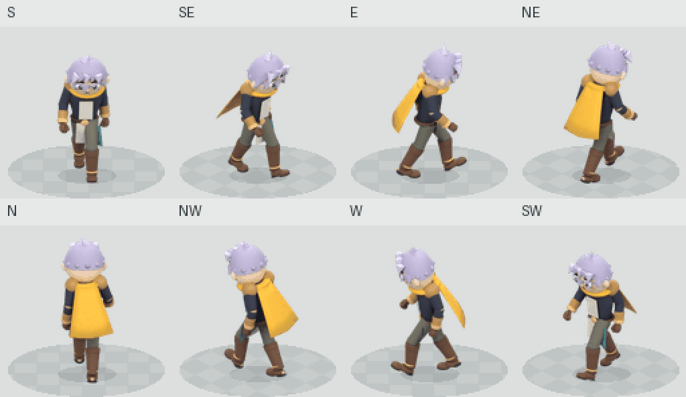

# Walk test v9 — วาดทับเป็นสไตล์ของเรา

ทดสอบหนึ่ง motion: เดินมือเปล่า 8 โพส จาก rig ใหม่ แล้วเจนวาดทับทั้งชีตเป็นตัวละครผมเงิน ผ้าพันคอ/ผ้าคลุมเหลือง ชุดเกราะบรอนซ์ในสไตล์ของเรา ตัวละครและ geometry สร้างใหม่ทั้งหมด ไม่ใช้ภาพตัวละครที่ถูกปฏิเสธจาก branch ใด

[GIF วาดทับ](painted-preview/walk-painted-SE.gif) · [APNG โปร่งใส](painted-preview/walk-painted-SE.png) · [เฟรมเรียง](painted-preview/walk-painted-SE-strip.png) · [Rig เทียบภาพวาด](painted-preview/rig-vs-painted.png)

**เป็นตัวอย่างให้รีวิว ยังไม่ใช่ production final หรือภาพที่ผ่านอนุมัติ** มีการเปลี่ยนรูปทรงผม เสื้อ ผ้าคลุม ถุงมือ และตำแหน่งจาก rig หลังเจน การแก้ระยะห่างแถวของชีตลดการกระโดดร่วมกันของทั้งแถว แต่ไม่ได้รับรอง anatomy/contact ของภาพวาดทุกเฟรม ภาพวาดทั้งตัวเป็น flat preview; ชิ้นส่วนที่เปลี่ยนได้จริงยังอยู่ใน rig/source package ด้านล่าง

## What this test executes

- Quaternius `Walk_Loop` actual animation transforms, 41 source timestamps, retargeted into a freshly built original 170-mesh/67-bone character. Source mannequin geometry and rejected project art are excluded.
- Source-root travel is extracted for in-place sprites, retained as `[0, -0.8319998169, 0]` across 1.333333373 seconds. An engine must move the character at compatible speed; in-place feet are not stationary world contacts.
- Eight authored exposures at source indices `0,5,10,15,20,25,30,35`. Approximately six pose changes per second; render/update FPS is independent. GIF is 1330 ms due to 10 ms timing units; APNG is 1333 ms.
- Eight real camera facings, obtained by rotating the 3D character, with no mirrored images. Painted redraw coverage is **SE only**.
- Thirteen independent complete part slots, a complete hidden base, and two genuinely separate hair geometries. Complete RGBA/depth item exports cover **SE only**, eight exposures per item. Hair swap changes no pixels below native row 65 in this bounded preview.
- Entire-sheet imagegen paintover twice, followed by explicit grid extraction. No independent frame generation or Python anatomy painting.

## Review the original motion and part replacement

[Actual baked rig alongside motion](rig-preview/walk-rig-comparison.gif) · [Hair replacement GIF](rig-preview/walk-hair-swap.gif) · [Complete part board](rig-preview/complete-parts.png) · [Editable Blender source](original-modular-walk.blend) · [Source times, root travel and joints](motion.json)

The floor pattern in rig previews is a moving registration aid at the extracted root speed. It is not recovered game scenery or a physics/contact solver. The painted GIF uses a plain background and retains the generated poses.

## Checks and retained failures

| Check | Actual result | Limit |
| --- | --- | --- |
| Reopen saved action at all 41 source times | Joint replay error 0; anatomical edge variation 9.07e-7 | Does not approve acting or surface drawing |
| Actual deformed footwear vs world Z=0 | All four modeled sole meshes stay above floor; minimum about 0.001 | No support intervals, foot-lock, balance or COM proof |
| Initial footwear failure | Heel/toe minima reached -0.0132/-0.0261 | Preserved in `failed-initial-footwear-check.json` |
| Foot repair | Per-foot measured clearance lift plus fixed-length knee/ankle IK; source bend half-plane retained | Reaches are checked; legs are not stretched and pelvis is not frozen |
| Full render vs native depth-layer reconstruction | Exact RGB comparison **fails**, max 255; mean about 1.11–1.31 over all RGB pixels | Shaded passes and native depth/alpha edges need a better compositor |
| Actual hair replacement | Both geometries visible; lower-body changed pixels 0 for all eight keys | Does not establish every item/visibility combination |
| First redraw | Attractive style, larger/moved poses | Raw output retained; not promoted |
| Second redraw | Better size, but lower row shifted up 13 source pixels | Raw sheet and uncalibrated GIF retained |
| Sheet extraction | One measured **499 px row pitch**, 384×512 cells padded to 512 square, globally scaled 0.25 | One grid-row correction; no individual pose recentering or scale changes |
| Redraw pose fidelity | **Not verified**; shape and registration changes visible | Hair-top range becomes 0 after row calibration; this can mean a frozen/generated head, not correct source bob |

Read [saved-rig-check.json](saved-rig-check.json), [rig-preview/package.json](rig-preview/package.json), [painted-preview/redraw-check.json](painted-preview/redraw-check.json) and [artifact-check.json](artifact-check.json) for machine-readable scope. Checks on the rig do not transfer automatically to the generated painted pixels.

Artifact checks actually decode eight GIF/APNG previews, each with eight unique exposures and the declared 1330/1333 ms duration. They verify source/blend hashes, 64 full-body native images, 104 complete SE RGBA/depth pairs and real changed hair pixels with zero lower-body changes. The existing retarget/reference/pipeline regression suite passes all 20 tests. [SHA256 inventory](inventory.json) covers the review files; it excludes its own digest.

## Provenance and reproducibility

Motion author: [Quaternius Universal Animation Library](https://quaternius.itch.io/universal-animation-library), CC0; [unmodified bundled license](../source-motion-v7/License.txt). Audited input GLB SHA256: `be684571ed655a1b892c2c07e6e2aeca053b606c442d34004adaf1d944090d01`. Evaluated parent-local input capture SHA256: `99d40bed6c9e88060db303095af235bf476708b31cb235eb163a0bfbb54fa619`.

[Exact generation prompts](redraw-evidence/prompts.json) · [Fresh pose template](redraw-evidence/pose-template.png) · [First raw generated sheet](redraw-evidence/attempt-1-raw.png) · [Second raw sheet](redraw-evidence/attempt-2-raw.png) · [Uncorrected grid playback](redraw-evidence/uncalibrated-grid.gif).

Use the [reproduction commands](../../../skills/modular-eight-direction-sprites/studies/walk-test/README.md). Blender 4.3.2, Cycles CPU, 32 samples, 256-square renders normalized to 128-square frames. Cape movement is authored phase lag on two bones, not cloth simulation. Source/render receipts and artifact hashes are retained.

Next acceptance work: repaint against exact source joint/contact guides at native size, restore intentional torso/head motion without jitter, check planted-foot world trajectories and every painted hand/leg, then author complete painted replacement parts against the accepted body. This bounded test does not unlock the existing release gates or claim an arbitrary error-free sprite factory.
