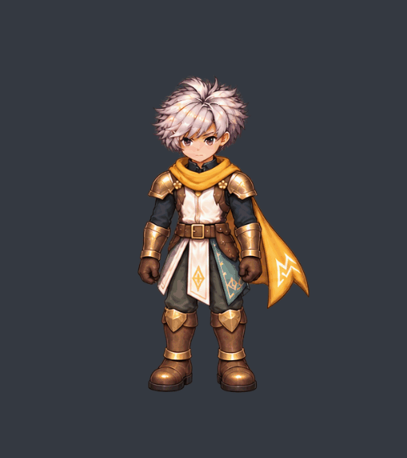
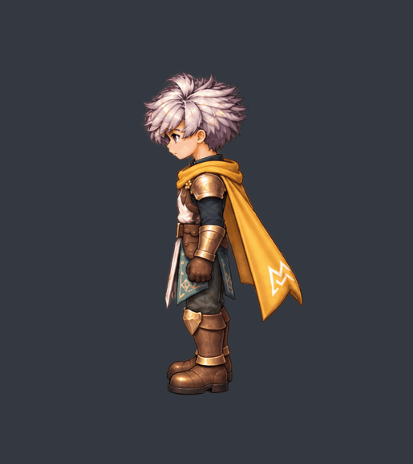
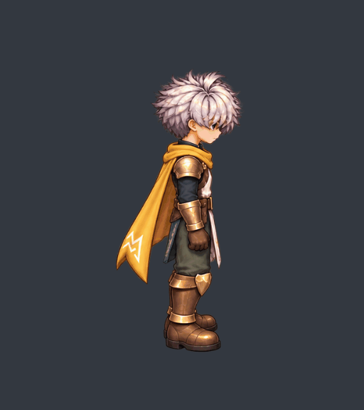
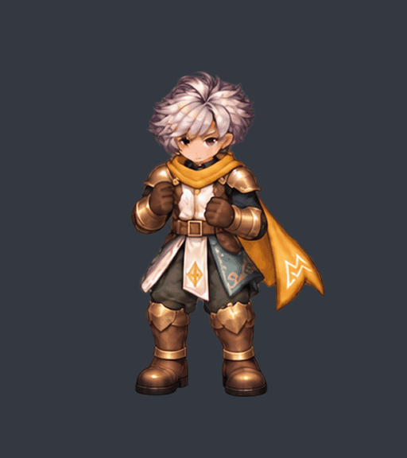
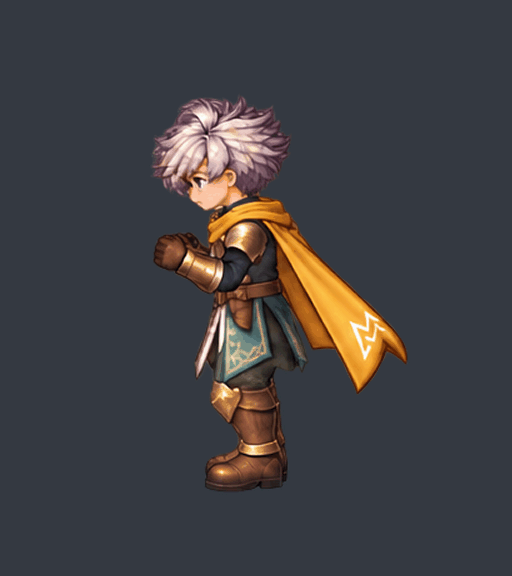
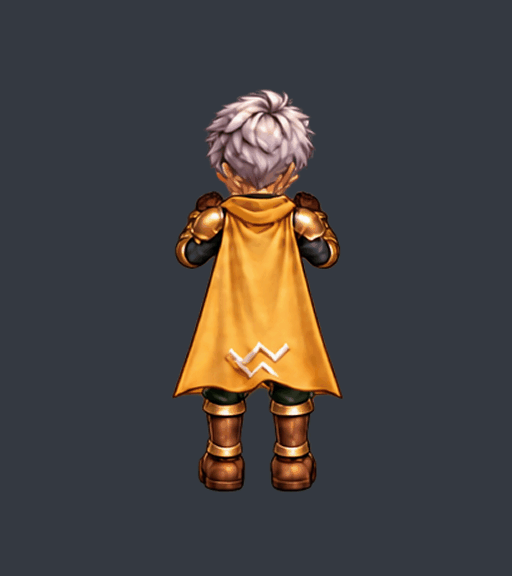
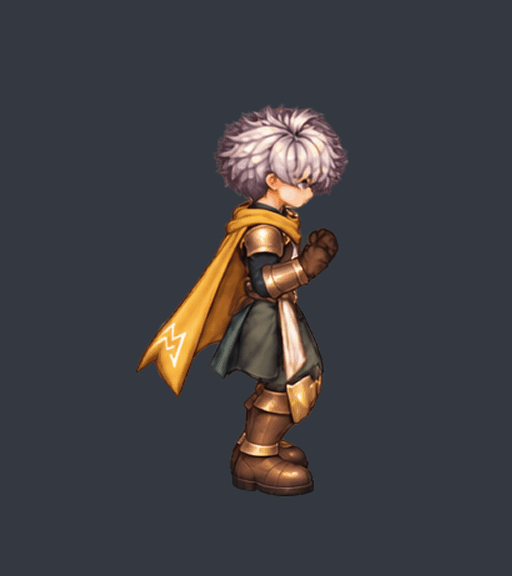
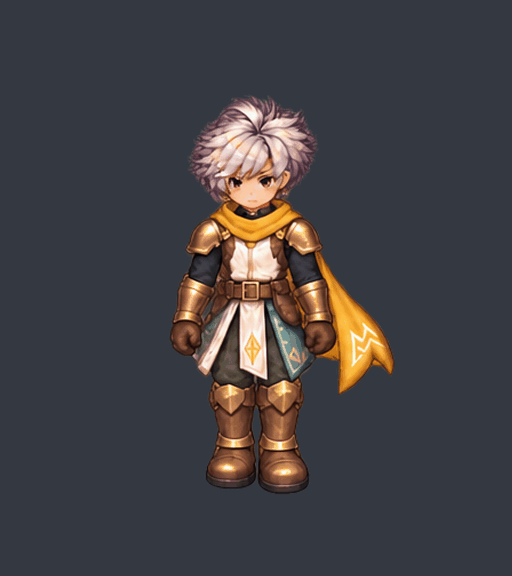
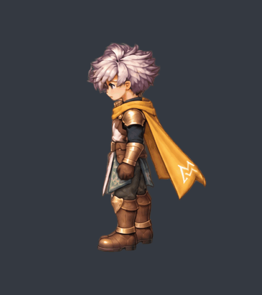
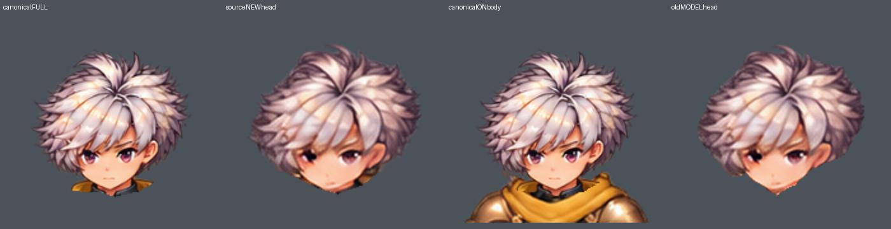

# v61 — transfer checkpoint, 2026-10-17

**ส่งต่องานตามคำสั่งล่าสุดของผู้ใช้ งานยังไม่ผ่านครบ 48 คลิป และยังไม่พร้อมใช้เป็น production**

Start with [detailed handoff](handoff/00-START.md), then [file map](FILE-MAP.md), [current 48-clip status](STATUS.json), [reproduction](REPRODUCE.md), [lessons](KNOW-HOW.md), and [external references](REFERENCES.md). This transfer is explicitly authorized by the user's latest request to write a detailed handoff and push now. It supersedes the previous instruction to delay delivery until all motions pass; it does **not** change art acceptance.

Three new pickup candidates have passed bounded crown/contact and actual browser/native roundtrip checks. Complete head ownership and cross-action family consistency remain unresolved. Six walk directions have no new whole-body bank yet; ready N/E bob, attack and hurt still need work. No all-action approval, game integration, universal head swapping or arbitrary-character factory approval.

## Pickup GIFs — review candidates

| View | Current candidate | Evidence |
| --- | --- | --- |
| S | 8 authored keys / 16 forward-reverse exposures | [reports and source](snapshot/generation/S-candidate7/) |
| W | 8 keys / 16 exposures; hidden second sole unproved | [reports and source](snapshot/generation/W-candidate2/) |
| E | 8 keys / 16 exposures | [reports and source](snapshot/generation/E-candidate1/) |

## Ready and walk candidates — not accepted

Ready S/W have bounded crown/contact passes; N/E fail the current crown limits. These GIFs display the original generated heads, before a production-ready canonical head swap.

Walk S/W have 8 genuine keys and 80 exposures, not 80 drawings. Crown checks pass; phase, family, head and full playback/native review remain pending.

## Head ownership blocker

The head field experiment retains gold collar fragments and/or excludes hair fringe. Exact recomposition alone cannot detect wrong ownership. [Actual failed protected-region report](snapshot/generation/S-head-fields2/ownership-review.json).

Original JSON receipts are retained verbatim, including stale preliminary labels. The newer handoff and STATUS.json govern interpretation. [Relocation map](RELOCATION.json) explains original workspace paths. Repeated timeline/export PNGs are selectively omitted, with exact-key restoration documented. No model weights, installed environment or compiled binaries are shipped.
